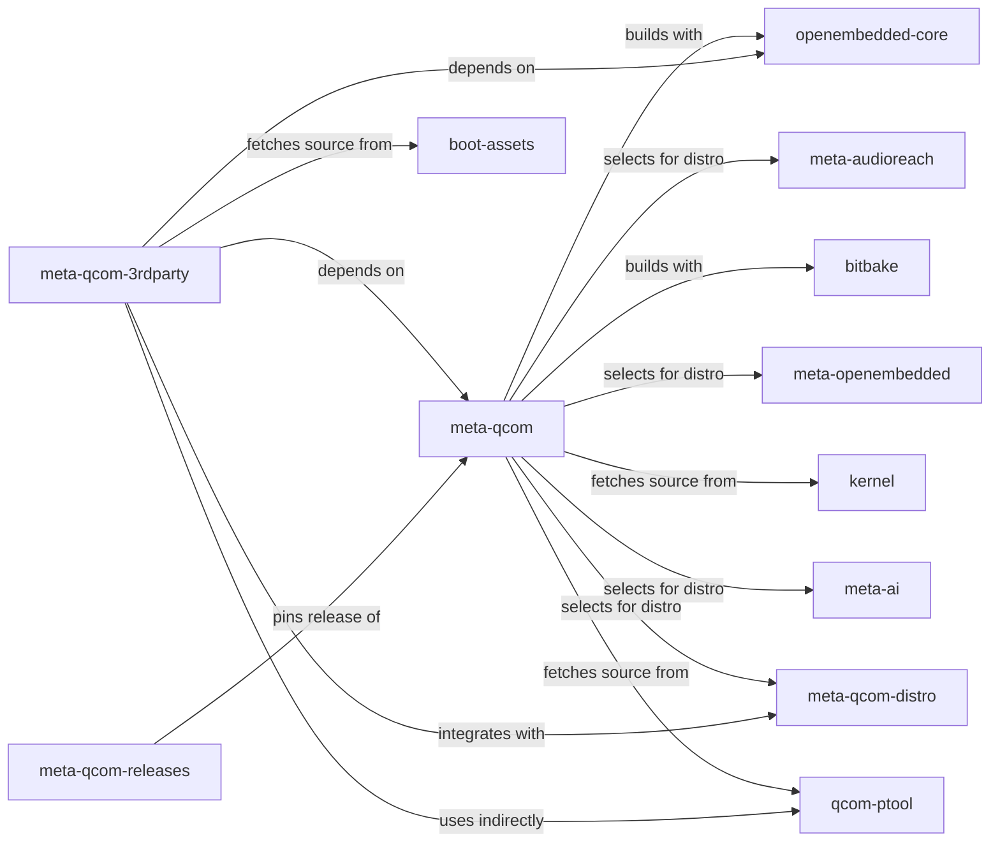
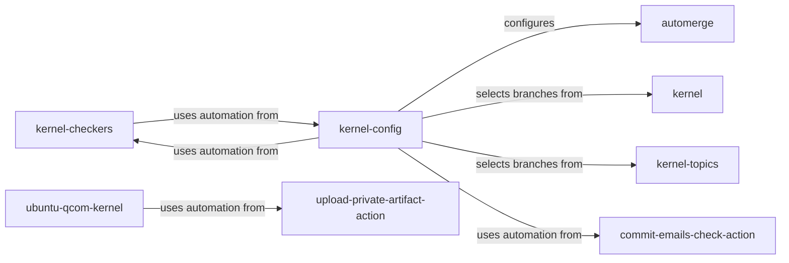
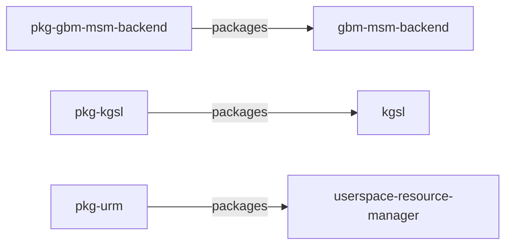
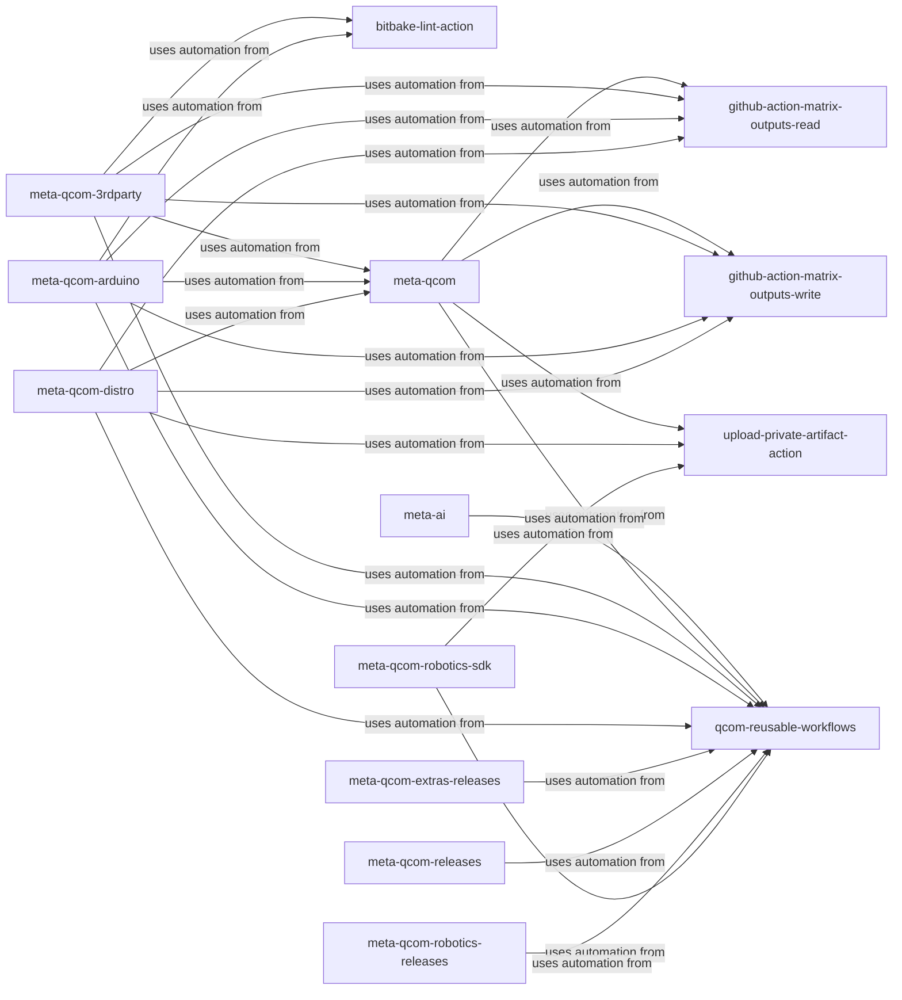
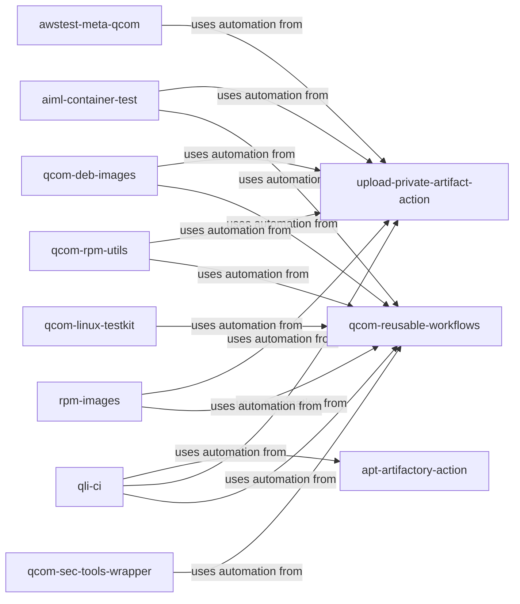
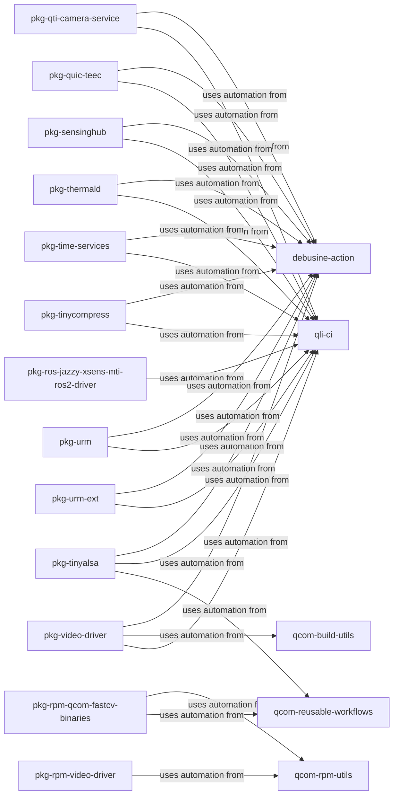
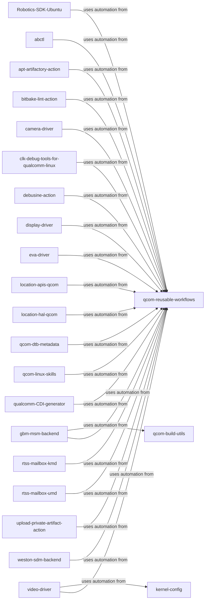

# Qualcomm repository map

Qualcomm repository ecosystem. Initial inventory covers public qualcomm-linux repositories and verified neighbouring upstreams; it is not limited to a release or engagement. Other Qualcomm organisations can be added using the same schema.

**Coverage:** 130 repositories, 110 with reviewed connections, 189 evidenced relationships.

Repository inventory is broader than reviewed relationships. An absent edge means no relationship has been recorded, not proof of independence.

Click a repository node to open it. Shared repositories appear in each relevant map; every relationship is shown once.

- [Yocto builds and releases](#yocto-builds-and-releases)
- [Kernel integration](#kernel-integration)
- [Source packaging](#source-packaging)
- [Layer automation](#layer-automation)
- [Build and validation automation](#build-and-validation-automation)
- [Package automation (1/3)](#package-automation-13)
- [Package automation (2/3)](#package-automation-23)
- [Package automation (3/3)](#package-automation-33)
- [Other automation](#other-automation)

## Yocto builds and releases

## Kernel integration

## Source packaging

## Layer automation

## Build and validation automation

## Package automation (1/3)

```mermaid
flowchart LR
    r0["debusine-action"]
    click r0 href "https://github.com/qualcomm-linux/debusine-action" _blank
    r1["pkg-adreno"]
    click r1 href "https://github.com/qualcomm-linux/pkg-adreno" _blank
    r2["pkg-alsa-ucm-conf"]
    click r2 href "https://github.com/qualcomm-linux/pkg-alsa-ucm-conf" _blank
    r3["pkg-android-platform-tools"]
    click r3 href "https://github.com/qualcomm-linux/pkg-android-platform-tools" _blank
    r4["pkg-audioreach-audio-utils"]
    click r4 href "https://github.com/qualcomm-linux/pkg-audioreach-audio-utils" _blank
    r5["pkg-audioreach-conf"]
    click r5 href "https://github.com/qualcomm-linux/pkg-audioreach-conf" _blank
    r6["pkg-audioreach-dkms"]
    click r6 href "https://github.com/qualcomm-linux/pkg-audioreach-dkms" _blank
    r7["pkg-audioreach-graphmgr"]
    click r7 href "https://github.com/qualcomm-linux/pkg-audioreach-graphmgr" _blank
    r8["pkg-audioreach-graphservices"]
    click r8 href "https://github.com/qualcomm-linux/pkg-audioreach-graphservices" _blank
    r9["pkg-audioreach-pal"]
    click r9 href "https://github.com/qualcomm-linux/pkg-audioreach-pal" _blank
    r10["pkg-audioreach-pipewire-plugin"]
    click r10 href "https://github.com/qualcomm-linux/pkg-audioreach-pipewire-plugin" _blank
    r11["pkg-btftm"]
    click r11 href "https://github.com/qualcomm-linux/pkg-btftm" _blank
    r12["pkg-camx-dev"]
    click r12 href "https://github.com/qualcomm-linux/pkg-camx-dev" _blank
    r13["pkg-camx-dkms"]
    click r13 href "https://github.com/qualcomm-linux/pkg-camx-dkms" _blank
    r14["pkg-camx-firmware-glymur"]
    click r14 href "https://github.com/qualcomm-linux/pkg-camx-firmware-glymur" _blank
    r15["pkg-camx-firmware-hamoa"]
    click r15 href "https://github.com/qualcomm-linux/pkg-camx-firmware-hamoa" _blank
    r16["pkg-camx-firmware-kodiak"]
    click r16 href "https://github.com/qualcomm-linux/pkg-camx-firmware-kodiak" _blank
    r17["pkg-camx-firmware-lemans"]
    click r17 href "https://github.com/qualcomm-linux/pkg-camx-firmware-lemans" _blank
    r18["pkg-camx-firmware-talos"]
    click r18 href "https://github.com/qualcomm-linux/pkg-camx-firmware-talos" _blank
    r19["pkg-camx-glymur"]
    click r19 href "https://github.com/qualcomm-linux/pkg-camx-glymur" _blank
    r20["pkg-camx-hamoa"]
    click r20 href "https://github.com/qualcomm-linux/pkg-camx-hamoa" _blank
    r21["pkg-camx-kodiak"]
    click r21 href "https://github.com/qualcomm-linux/pkg-camx-kodiak" _blank
    r22["qli-ci"]
    click r22 href "https://github.com/qualcomm-linux/qli-ci" _blank
    r23["qcom-reusable-workflows"]
    click r23 href "https://github.com/qualcomm/qcom-reusable-workflows" _blank
    r1 -->|"uses automation from"| r0
    r1 -->|"uses automation from"| r22
    r2 -->|"uses automation from"| r0
    r2 -->|"uses automation from"| r22
    r3 -->|"uses automation from"| r0
    r3 -->|"uses automation from"| r22
    r4 -->|"uses automation from"| r0
    r4 -->|"uses automation from"| r22
    r5 -->|"uses automation from"| r0
    r5 -->|"uses automation from"| r22
    r6 -->|"uses automation from"| r0
    r6 -->|"uses automation from"| r22
    r7 -->|"uses automation from"| r0
    r7 -->|"uses automation from"| r22
    r8 -->|"uses automation from"| r0
    r8 -->|"uses automation from"| r22
    r9 -->|"uses automation from"| r0
    r9 -->|"uses automation from"| r22
    r10 -->|"uses automation from"| r0
    r10 -->|"uses automation from"| r22
    r11 -->|"uses automation from"| r22
    r12 -->|"uses automation from"| r0
    r12 -->|"uses automation from"| r22
    r12 -->|"uses automation from"| r23
    r13 -->|"uses automation from"| r0
    r13 -->|"uses automation from"| r22
    r14 -->|"uses automation from"| r0
    r14 -->|"uses automation from"| r22
    r15 -->|"uses automation from"| r0
    r15 -->|"uses automation from"| r22
    r16 -->|"uses automation from"| r22
    r17 -->|"uses automation from"| r22
    r18 -->|"uses automation from"| r22
    r19 -->|"uses automation from"| r0
    r19 -->|"uses automation from"| r22
    r20 -->|"uses automation from"| r0
    r20 -->|"uses automation from"| r22
    r21 -->|"uses automation from"| r22
```

## Package automation (2/3)

```mermaid
flowchart LR
    r0["debusine-action"]
    click r0 href "https://github.com/qualcomm-linux/debusine-action" _blank
    r1["pkg-camx-lemans"]
    click r1 href "https://github.com/qualcomm-linux/pkg-camx-lemans" _blank
    r2["pkg-camx-nhx"]
    click r2 href "https://github.com/qualcomm-linux/pkg-camx-nhx" _blank
    r3["pkg-camx-talos"]
    click r3 href "https://github.com/qualcomm-linux/pkg-camx-talos" _blank
    r4["pkg-diag-router"]
    click r4 href "https://github.com/qualcomm-linux/pkg-diag-router" _blank
    r5["pkg-eva-dkms"]
    click r5 href "https://github.com/qualcomm-linux/pkg-eva-dkms" _blank
    r6["pkg-fastrpc"]
    click r6 href "https://github.com/qualcomm-linux/pkg-fastrpc" _blank
    r7["pkg-gbm-msm-backend"]
    click r7 href "https://github.com/qualcomm-linux/pkg-gbm-msm-backend" _blank
    r8["pkg-gst-plugins-imsdk"]
    click r8 href "https://github.com/qualcomm-linux/pkg-gst-plugins-imsdk" _blank
    r9["pkg-kgsl"]
    click r9 href "https://github.com/qualcomm-linux/pkg-kgsl" _blank
    r10["pkg-libdiag"]
    click r10 href "https://github.com/qualcomm-linux/pkg-libdiag" _blank
    r11["pkg-linux-qcom"]
    click r11 href "https://github.com/qualcomm-linux/pkg-linux-qcom" _blank
    r12["pkg-mink-idl-compiler"]
    click r12 href "https://github.com/qualcomm-linux/pkg-mink-idl-compiler" _blank
    r13["pkg-minkipc"]
    click r13 href "https://github.com/qualcomm-linux/pkg-minkipc" _blank
    r14["pkg-optee-client"]
    click r14 href "https://github.com/qualcomm-linux/pkg-optee-client" _blank
    r15["pkg-optee-test"]
    click r15 href "https://github.com/qualcomm-linux/pkg-optee-test" _blank
    r16["pkg-qcom-fastcv-binaries"]
    click r16 href "https://github.com/qualcomm-linux/pkg-qcom-fastcv-binaries" _blank
    r17["pkg-qcom-sensors"]
    click r17 href "https://github.com/qualcomm-linux/pkg-qcom-sensors" _blank
    r18["pkg-qcom-sv-binaries"]
    click r18 href "https://github.com/qualcomm-linux/pkg-qcom-sv-binaries" _blank
    r19["pkg-qimsdk-smartvenc"]
    click r19 href "https://github.com/qualcomm-linux/pkg-qimsdk-smartvenc" _blank
    r20["pkg-qmi-framework"]
    click r20 href "https://github.com/qualcomm-linux/pkg-qmi-framework" _blank
    r21["qli-ci"]
    click r21 href "https://github.com/qualcomm-linux/qli-ci" _blank
    r22["upload-private-artifact-action"]
    click r22 href "https://github.com/qualcomm-linux/upload-private-artifact-action" _blank
    r23["qcom-reusable-workflows"]
    click r23 href "https://github.com/qualcomm/qcom-reusable-workflows" _blank
    r1 -->|"uses automation from"| r21
    r2 -->|"uses automation from"| r0
    r2 -->|"uses automation from"| r21
    r3 -->|"uses automation from"| r21
    r4 -->|"uses automation from"| r0
    r4 -->|"uses automation from"| r21
    r5 -->|"uses automation from"| r0
    r5 -->|"uses automation from"| r21
    r5 -->|"uses automation from"| r23
    r6 -->|"uses automation from"| r0
    r6 -->|"uses automation from"| r21
    r7 -->|"uses automation from"| r0
    r7 -->|"uses automation from"| r21
    r8 -->|"uses automation from"| r21
    r9 -->|"uses automation from"| r0
    r9 -->|"uses automation from"| r21
    r10 -->|"uses automation from"| r0
    r10 -->|"uses automation from"| r21
    r11 -->|"uses automation from"| r22
    r11 -->|"uses automation from"| r23
    r12 -->|"uses automation from"| r0
    r12 -->|"uses automation from"| r21
    r13 -->|"uses automation from"| r0
    r13 -->|"uses automation from"| r21
    r14 -->|"uses automation from"| r0
    r14 -->|"uses automation from"| r21
    r15 -->|"uses automation from"| r0
    r15 -->|"uses automation from"| r21
    r16 -->|"uses automation from"| r0
    r16 -->|"uses automation from"| r21
    r16 -->|"uses automation from"| r23
    r17 -->|"uses automation from"| r0
    r17 -->|"uses automation from"| r21
    r18 -->|"uses automation from"| r0
    r18 -->|"uses automation from"| r21
    r18 -->|"uses automation from"| r23
    r19 -->|"uses automation from"| r0
    r19 -->|"uses automation from"| r21
    r20 -->|"uses automation from"| r0
    r20 -->|"uses automation from"| r21
```

## Package automation (3/3)

## Other automation

## Reference details

Repository inventory

### Boot and firmware

- [qualcomm-linux/boot-firmware-ci](https://github.com/qualcomm-linux/boot-firmware-ci) — Boot Firmware CI/CD repo providing build artifacts for reuse across distros (default branch: `main`).
- [qualcomm-linux/edk2](https://github.com/qualcomm-linux/edk2) — Qualcomm upstream staging repo for edk2 (default branch: `qcom-next`).
- [qualcomm-linux/edk2-platforms](https://github.com/qualcomm-linux/edk2-platforms) — Qualcomm upstream staging repo for edk2-platforms (default branch: `qcom-next`).
- [qualcomm-linux/optee_os](https://github.com/qualcomm-linux/optee_os) — Qualcomm upstream staging repo for OP-TEE OS (default branch: `qcom-next`).
- [qualcomm-linux/qcom-ptool](https://github.com/qualcomm-linux/qcom-ptool) — qcom-ptool contains various device partitioning utilities like ptool.py, gen_partitions.py and various sample partition configuration files needed for Qualcomm SoCs. (default branch: `main`).
- [qualcomm-linux/qcom-sec-tools-wrapper](https://github.com/qualcomm-linux/qcom-sec-tools-wrapper) — Shell tooling around Qualcomm's secure boot flow - generate OEM keys, sign images, provision fuses, and build UEFI update capsules. (default branch: `main`).
- [qualcomm-linux/snagboot](https://github.com/qualcomm-linux/snagboot) — Generic recovery and reflashing tool for embedded platforms (default branch: `main`).
- [qualcomm-linux/trusted-firmware-a](https://github.com/qualcomm-linux/trusted-firmware-a) — Qualcomm upstream staging repo for Trusted Firmware-A (default branch: `qcom-next`).
- [qualcomm-linux/u-boot](https://github.com/qualcomm-linux/u-boot) — "Das U-Boot" Source Tree (default branch: `master`).
- [rubikpi-ai/boot-assets](https://github.com/rubikpi-ai/boot-assets) — Vendor-hosted RUBIK Pi boot firmware consumed by the board recipe. (default branch: `not inventoried`).

### Images and build tooling

- [openembedded/bitbake](https://github.com/openembedded/bitbake) — Build engine used by the kas configuration. (default branch: `not inventoried`).
- [qualcomm-linux/docker-pkg-build](https://github.com/qualcomm-linux/docker-pkg-build) — Debian packages build tool for native (arm64-arm64) or cross (amd64-arm64) build (default branch: `main`).
- [qualcomm-linux/qcom-build-utils](https://github.com/qualcomm-linux/qcom-build-utils) — Qualcomm utilities for Linux builds (default branch: `main`).
- [qualcomm-linux/qcom-deb-images](https://github.com/qualcomm-linux/qcom-deb-images) — Qualcomm Linux Debian build scripts (default branch: `main`).
- [qualcomm-linux/qcom-rpm-utils](https://github.com/qualcomm-linux/qcom-rpm-utils) — This repo will hold build scripts and reusable workflows for pkg rpm builds. (default branch: `main`).
- [qualcomm-linux/qli-ci](https://github.com/qualcomm-linux/qli-ci) — Central location for pkg reusable workflows (default branch: `main`).
- [qualcomm-linux/rpm-images](https://github.com/qualcomm-linux/rpm-images) — Repository purpose needs review; open the repository for its maintained documentation. (default branch: `main`).
- [qualcomm/commit-emails-check-action](https://github.com/qualcomm/commit-emails-check-action) — GitHub action for checking email addresses in PR/Push commits (default branch: `main`).
- [qualcomm/qcom-reusable-workflows](https://github.com/qualcomm/qcom-reusable-workflows) — Qualcomm reusable workflows (default branch: `main`).

### Kernel integration

- [qualcomm-linux/automerge](https://github.com/qualcomm-linux/automerge) — Tools to manage creation of qcom-next from the topic branches (default branch: `main`).
- [qualcomm-linux/kernel](https://github.com/qualcomm-linux/kernel) — Linux Kernel for QLI mainline (default branch: `main`).
- [qualcomm-linux/kernel-checkers](https://github.com/qualcomm-linux/kernel-checkers) — Checker tests kernel patches for correctness by running a suite of tests. (default branch: `main`).
- [qualcomm-linux/kernel-config](https://github.com/qualcomm-linux/kernel-config) — Configuration data to create qcom-next from the tech topic branches (default branch: `main`).
- [qualcomm-linux/kernel-topics](https://github.com/qualcomm-linux/kernel-topics) — Tech Topic Branches for QLI mainline (default branch: `main`).
- [qualcomm-linux/kmake-image](https://github.com/qualcomm-linux/kmake-image) — Docker setup for building the Linux kernel (default branch: `main`).
- [qualcomm-linux/ubuntu-qcom-kernel](https://github.com/qualcomm-linux/ubuntu-qcom-kernel) — Mirror and CI build pipeline for Canonical kernel  (default branch: `main`).

### Layers and releases

- [AudioReach/meta-audioreach](https://github.com/AudioReach/meta-audioreach) — AudioReach recipes selected by the distro configuration. (default branch: `not inventoried`).
- [openembedded/meta-openembedded](https://github.com/openembedded/meta-openembedded) — Additional OpenEmbedded layers selected by the distro configuration. (default branch: `not inventoried`).
- [openembedded/openembedded-core](https://github.com/openembedded/openembedded-core) — Base OpenEmbedded recipes and classes. (default branch: `not inventoried`).
- [qualcomm-linux/meta-ai](https://github.com/qualcomm-linux/meta-ai) — OpenEmbedded layer for AI/ML related recipes (default branch: `main`).
- [qualcomm-linux/meta-qcom](https://github.com/qualcomm-linux/meta-qcom) — OpenEmbedded/Yocto Project BSP layer for Qualcomm based platforms (default branch: `master`).
- [qualcomm-linux/meta-qcom-3rdparty](https://github.com/qualcomm-linux/meta-qcom-3rdparty) — OpenEmbedded/Yocto Project BSP layer for Third-Party Maintained Qualcomm based platforms (default branch: `main`).
- [qualcomm-linux/meta-qcom-arduino](https://github.com/qualcomm-linux/meta-qcom-arduino) — OpenEmbedded/Yocto Project BSP layer for Qualcomm based Arduino platforms (default branch: `main`).
- [qualcomm-linux/meta-qcom-distro](https://github.com/qualcomm-linux/meta-qcom-distro) — OpenEmbedded/Yocto Project Reference Distribution layer for Qualcomm based platforms (default branch: `main`).
- [qualcomm-linux/meta-qcom-extras-releases](https://github.com/qualcomm-linux/meta-qcom-extras-releases) — This repo will be used to store kas-lock files for milestone releases of meta-qcom-extras (default branch: `main`).
- [qualcomm-linux/meta-qcom-hwe](https://github.com/qualcomm-linux/meta-qcom-hwe) — Repository purpose needs review; open the repository for its maintained documentation. (default branch: `main`).
- [qualcomm-linux/meta-qcom-qim-product-sdk](https://github.com/qualcomm-linux/meta-qcom-qim-product-sdk) — Repository purpose needs review; open the repository for its maintained documentation. (default branch: `scarthgap`).
- [qualcomm-linux/meta-qcom-realtime](https://github.com/qualcomm-linux/meta-qcom-realtime) — Repository purpose needs review; open the repository for its maintained documentation. (default branch: `scarthgap`).
- [qualcomm-linux/meta-qcom-releases](https://github.com/qualcomm-linux/meta-qcom-releases) — This repo will be used to store kas-lock files for milestone releases of meta-qcom (default branch: `main`).
- [qualcomm-linux/meta-qcom-robotics](https://github.com/qualcomm-linux/meta-qcom-robotics) — Repository purpose needs review; open the repository for its maintained documentation. (default branch: `scarthgap`).
- [qualcomm-linux/meta-qcom-robotics-distro](https://github.com/qualcomm-linux/meta-qcom-robotics-distro) — Repository purpose needs review; open the repository for its maintained documentation. (default branch: `scarthgap`).
- [qualcomm-linux/meta-qcom-robotics-releases](https://github.com/qualcomm-linux/meta-qcom-robotics-releases) — This repo will be used to store kas-lock files for milestone releases of meta-qcom-robotics-sdk (default branch: `main`).
- [qualcomm-linux/meta-qcom-robotics-sdk](https://github.com/qualcomm-linux/meta-qcom-robotics-sdk) — Repository purpose needs review; open the repository for its maintained documentation. (default branch: `main`).
- [qualcomm-linux/qcom-manifest](https://github.com/qualcomm-linux/qcom-manifest) — Repository purpose needs review; open the repository for its maintained documentation. (default branch: `qcom-linux-scarthgap`).

### Other repositories

- [qualcomm-linux/.github](https://github.com/qualcomm-linux/.github) — Qualcomm Linux GitHub organization action templates and configs (default branch: `main`).
- [qualcomm-linux/Robotics-SDK-Ubuntu](https://github.com/qualcomm-linux/Robotics-SDK-Ubuntu) —  Qualcomm Intelligent Robotics SDK (QIR SDK) for ubuntu (default branch: `main`).
- [qualcomm-linux/TC9564_Host_Driver](https://github.com/qualcomm-linux/TC9564_Host_Driver) — TC9564 PCIe-Ethernet Bridge Linux Host Driver (default branch: `qcom`).
- [qualcomm-linux/abctl](https://github.com/qualcomm-linux/abctl) — Repository purpose needs review; open the repository for its maintained documentation. (default branch: `main`).
- [qualcomm-linux/apt-artifactory-action](https://github.com/qualcomm-linux/apt-artifactory-action) — A GitHub Action for managing Debian packages in JFrog Artifactory. This action streamlines workflows for uploading artifacts, validating metadata, cleaning up stale packages, and performing custom operations on APT repositories hosted in Artifactory. (default branch: `main`).
- [qualcomm-linux/bitbake-lint-action](https://github.com/qualcomm-linux/bitbake-lint-action) — GitHub Action for linting bitbake recipes using oelint-adv linter  (default branch: `main`).
- [qualcomm-linux/camera-driver](https://github.com/qualcomm-linux/camera-driver) — This repository contains the source code of camera-kernel driver for the downstream camera-kernel (default branch: `camera-kernel.qclinux.0.0`).
- [qualcomm-linux/clk-debug-tools-for-qualcomm-linux](https://github.com/qualcomm-linux/clk-debug-tools-for-qualcomm-linux) — Out-of-tree clk debug patches for linux-next and scripts for clock-measurement based debugging on Qualcomm SoCs. (default branch: `main`).
- [qualcomm-linux/debusine-action](https://github.com/qualcomm-linux/debusine-action) — A GitHub Actions composite action that automates uploading Debian source packages and triggering Debusine workflows. (default branch: `main`).
- [qualcomm-linux/display-driver](https://github.com/qualcomm-linux/display-driver) — Repository purpose needs review; open the repository for its maintained documentation. (default branch: `main`).
- [qualcomm-linux/eva-driver](https://github.com/qualcomm-linux/eva-driver) — This repository contains the source code of eva-kernel driver for the downstream eva-kernel (default branch: `eva-kernel.qclinux.0.0`).
- [qualcomm-linux/gbm-msm-backend](https://github.com/qualcomm-linux/gbm-msm-backend) — MSM Backend repository to overlay on top of upstream MESA GBM. (default branch: `main`).
- [qualcomm-linux/github-action-matrix-outputs-read](https://github.com/qualcomm-linux/github-action-matrix-outputs-read) — Workaround implementation - Read matrix jobs outputs (default branch: `main`).
- [qualcomm-linux/github-action-matrix-outputs-write](https://github.com/qualcomm-linux/github-action-matrix-outputs-write) — Workaround implementation - Write matrix jobs outputs (default branch: `main`).
- [qualcomm-linux/kgsl](https://github.com/qualcomm-linux/kgsl) — Repository purpose needs review; open the repository for its maintained documentation. (default branch: `gfx-kernel.le.0.0`).
- [qualcomm-linux/location-apis-qcom](https://github.com/qualcomm-linux/location-apis-qcom) — Location Client API layer for Qualcomm based platforms (default branch: `location.lnx.0.0`).
- [qualcomm-linux/location-hal-qcom](https://github.com/qualcomm-linux/location-hal-qcom) — Location hal layer for Qualcomm based platforms (default branch: `location.lnx.0.0`).
- [qualcomm-linux/qcom-dtb-metadata](https://github.com/qualcomm-linux/qcom-dtb-metadata) — Repository purpose needs review; open the repository for its maintained documentation. (default branch: `main`).
- [qualcomm-linux/qcom-linux-skills](https://github.com/qualcomm-linux/qcom-linux-skills) — Agent Skills for Qualcomm Linux (default branch: `main`).
- [qualcomm-linux/qualcomm-CDI-generator](https://github.com/qualcomm-linux/qualcomm-CDI-generator) — Tooling to generate CDI config files to pass devices through to containers (default branch: `main`).
- [qualcomm-linux/rtss-mailbox-kmd](https://github.com/qualcomm-linux/rtss-mailbox-kmd) — RTSS Mailbox Kernel Mode Driver (KMD) for IPC-based inter-processor communication on Qualcomm Automotive, IE-IoT, Robotics SoCs. (default branch: `main`).
- [qualcomm-linux/rtss-mailbox-umd](https://github.com/qualcomm-linux/rtss-mailbox-umd) — RTSS Mailbox User Space package of libraries, demo applications, utils for Qualcomm Automotive, IE-IoT, Robotics SoCs. (default branch: `main`).
- [qualcomm-linux/upload-private-artifact-action](https://github.com/qualcomm-linux/upload-private-artifact-action) — An action for use in qualcomm-linux projects that need to publish CI artifacts that aren't cleared for public distribution. (default branch: `aws`).
- [qualcomm-linux/video-driver](https://github.com/qualcomm-linux/video-driver) — Repository purpose needs review; open the repository for its maintained documentation. (default branch: `video.qclinux.main`).
- [qualcomm-linux/weston-sdm-backend](https://github.com/qualcomm-linux/weston-sdm-backend) — Repository purpose needs review; open the repository for its maintained documentation. (default branch: `main`).
- [qualcomm/userspace-resource-manager](https://github.com/qualcomm/userspace-resource-manager) — Upstream userspace resource manager source packaged by pkg-urm. (default branch: `not inventoried`).

### Packaging

- [qualcomm-linux/pkg-adreno](https://github.com/qualcomm-linux/pkg-adreno) — Repository purpose needs review; open the repository for its maintained documentation. (default branch: `qli-ci`).
- [qualcomm-linux/pkg-alsa-ucm-conf](https://github.com/qualcomm-linux/pkg-alsa-ucm-conf) — Repository purpose needs review; open the repository for its maintained documentation. (default branch: `qli-ci`).
- [qualcomm-linux/pkg-android-platform-tools](https://github.com/qualcomm-linux/pkg-android-platform-tools) — Repository purpose needs review; open the repository for its maintained documentation. (default branch: `qli-ci`).
- [qualcomm-linux/pkg-audioreach-audio-utils](https://github.com/qualcomm-linux/pkg-audioreach-audio-utils) — Repository purpose needs review; open the repository for its maintained documentation. (default branch: `qli-ci`).
- [qualcomm-linux/pkg-audioreach-conf](https://github.com/qualcomm-linux/pkg-audioreach-conf) — Repository purpose needs review; open the repository for its maintained documentation. (default branch: `qli-ci`).
- [qualcomm-linux/pkg-audioreach-dkms](https://github.com/qualcomm-linux/pkg-audioreach-dkms) — Repository purpose needs review; open the repository for its maintained documentation. (default branch: `qli-ci`).
- [qualcomm-linux/pkg-audioreach-graphmgr](https://github.com/qualcomm-linux/pkg-audioreach-graphmgr) — Repository purpose needs review; open the repository for its maintained documentation. (default branch: `qli-ci`).
- [qualcomm-linux/pkg-audioreach-graphservices](https://github.com/qualcomm-linux/pkg-audioreach-graphservices) — Repository purpose needs review; open the repository for its maintained documentation. (default branch: `qli-ci`).
- [qualcomm-linux/pkg-audioreach-pal](https://github.com/qualcomm-linux/pkg-audioreach-pal) — Repository purpose needs review; open the repository for its maintained documentation. (default branch: `qli-ci`).
- [qualcomm-linux/pkg-audioreach-pipewire-plugin](https://github.com/qualcomm-linux/pkg-audioreach-pipewire-plugin) — Repository purpose needs review; open the repository for its maintained documentation. (default branch: `qli-ci`).
- [qualcomm-linux/pkg-btftm](https://github.com/qualcomm-linux/pkg-btftm) — this is for bt-performant.qclinux.0.0  Btdiag debian generate and upload to apt (default branch: `qli-ci`).
- [qualcomm-linux/pkg-camx-dev](https://github.com/qualcomm-linux/pkg-camx-dev) — Repository purpose needs review; open the repository for its maintained documentation. (default branch: `qli-ci`).
- [qualcomm-linux/pkg-camx-dkms](https://github.com/qualcomm-linux/pkg-camx-dkms) — repo to created camx-dlkm debian (default branch: `qli-ci`).
- [qualcomm-linux/pkg-camx-firmware-glymur](https://github.com/qualcomm-linux/pkg-camx-firmware-glymur) — add repo for glymur target firmware (default branch: `qli-ci`).
- [qualcomm-linux/pkg-camx-firmware-hamoa](https://github.com/qualcomm-linux/pkg-camx-firmware-hamoa) — Repository purpose needs review; open the repository for its maintained documentation. (default branch: `qli-ci`).
- [qualcomm-linux/pkg-camx-firmware-kodiak](https://github.com/qualcomm-linux/pkg-camx-firmware-kodiak) — Repository purpose needs review; open the repository for its maintained documentation. (default branch: `qli-ci`).
- [qualcomm-linux/pkg-camx-firmware-lemans](https://github.com/qualcomm-linux/pkg-camx-firmware-lemans) — Repository purpose needs review; open the repository for its maintained documentation. (default branch: `qli-ci`).
- [qualcomm-linux/pkg-camx-firmware-talos](https://github.com/qualcomm-linux/pkg-camx-firmware-talos) — Repository purpose needs review; open the repository for its maintained documentation. (default branch: `qli-ci`).
- [qualcomm-linux/pkg-camx-glymur](https://github.com/qualcomm-linux/pkg-camx-glymur) — repo for glymur target (default branch: `qli-ci`).
- [qualcomm-linux/pkg-camx-hamoa](https://github.com/qualcomm-linux/pkg-camx-hamoa) — Camera hamoa (default branch: `qli-ci`).
- [qualcomm-linux/pkg-camx-kodiak](https://github.com/qualcomm-linux/pkg-camx-kodiak) — camx kodiak UMD Debian creation (default branch: `qli-ci`).
- [qualcomm-linux/pkg-camx-lemans](https://github.com/qualcomm-linux/pkg-camx-lemans) — camx lemans UMD Debian creation (default branch: `qli-ci`).
- [qualcomm-linux/pkg-camx-nhx](https://github.com/qualcomm-linux/pkg-camx-nhx) — camx test Debian creation (default branch: `qli-ci`).
- [qualcomm-linux/pkg-camx-talos](https://github.com/qualcomm-linux/pkg-camx-talos) — camx talos UMD Debian. (default branch: `qli-ci`).
- [qualcomm-linux/pkg-diag-router](https://github.com/qualcomm-linux/pkg-diag-router) — Debain package repo for qcom-diag-router (default branch: `qli-ci`).
- [qualcomm-linux/pkg-eva-dkms](https://github.com/qualcomm-linux/pkg-eva-dkms) — Qcom Linux repo to generate the EVA dlkm debian packages (default branch: `qli-ci`).
- [qualcomm-linux/pkg-fastrpc](https://github.com/qualcomm-linux/pkg-fastrpc) — Repository purpose needs review; open the repository for its maintained documentation. (default branch: `qli-ci`).
- [qualcomm-linux/pkg-gbm-msm-backend](https://github.com/qualcomm-linux/pkg-gbm-msm-backend) — Packaging repo for gbm-msm-backend (default branch: `qli-ci`).
- [qualcomm-linux/pkg-gst-plugins-imsdk](https://github.com/qualcomm-linux/pkg-gst-plugins-imsdk) — Repository purpose needs review; open the repository for its maintained documentation. (default branch: `qli-ci`).
- [qualcomm-linux/pkg-kgsl](https://github.com/qualcomm-linux/pkg-kgsl) — Packaging repo for kgsl (default branch: `qli-ci`).
- [qualcomm-linux/pkg-libdiag](https://github.com/qualcomm-linux/pkg-libdiag) — Deb file distribution repo for libdiag and diagnostics utils  (default branch: `qli-ci`).
- [qualcomm-linux/pkg-linux-qcom](https://github.com/qualcomm-linux/pkg-linux-qcom) — QCOM Linux Kernel Debian Package repository (default branch: `main`).
- [qualcomm-linux/pkg-mink-idl-compiler](https://github.com/qualcomm-linux/pkg-mink-idl-compiler) — Debian packaging meta-data for mink-idl-compiler project. (default branch: `qli-ci`).
- [qualcomm-linux/pkg-minkipc](https://github.com/qualcomm-linux/pkg-minkipc) — Debian packaging meta-data for minkipc project. (default branch: `qli-ci`).
- [qualcomm-linux/pkg-optee-client](https://github.com/qualcomm-linux/pkg-optee-client) — Debian package meta-data to package Qualcomm vendored mink optee-client library (default branch: `qli-ci`).
- [qualcomm-linux/pkg-optee-test](https://github.com/qualcomm-linux/pkg-optee-test) — Debian package meta-data to package Qualcomm vendored mink xtest for QTEE (default branch: `qli-ci`).
- [qualcomm-linux/pkg-qcom-fastcv-binaries](https://github.com/qualcomm-linux/pkg-qcom-fastcv-binaries) — Repository purpose needs review; open the repository for its maintained documentation. (default branch: `qli-ci`).
- [qualcomm-linux/pkg-qcom-sensors](https://github.com/qualcomm-linux/pkg-qcom-sensors) — Repository purpose needs review; open the repository for its maintained documentation. (default branch: `qli-ci`).
- [qualcomm-linux/pkg-qcom-sv-binaries](https://github.com/qualcomm-linux/pkg-qcom-sv-binaries) — Qcom Linux SV Debian packaging repository (default branch: `qli-ci`).
- [qualcomm-linux/pkg-qimsdk-smartvenc](https://github.com/qualcomm-linux/pkg-qimsdk-smartvenc) — pkg-bin-smart-venc-ctrl (default branch: `qli-ci`).
- [qualcomm-linux/pkg-qmi-framework](https://github.com/qualcomm-linux/pkg-qmi-framework) — Repository purpose needs review; open the repository for its maintained documentation. (default branch: `qli-ci`).
- [qualcomm-linux/pkg-qti-camera-service](https://github.com/qualcomm-linux/pkg-qti-camera-service) — Repository purpose needs review; open the repository for its maintained documentation. (default branch: `qli-ci`).
- [qualcomm-linux/pkg-quic-teec](https://github.com/qualcomm-linux/pkg-quic-teec) — Debian packaging meta-data for quic-teec project. (default branch: `qli-ci`).
- [qualcomm-linux/pkg-ros-jazzy-xsens-mti-ros2-driver](https://github.com/qualcomm-linux/pkg-ros-jazzy-xsens-mti-ros2-driver) — ROS 2 driver for Xsens MTi IMU sensors (default branch: `qcom/debian/latest`).
- [qualcomm-linux/pkg-rpm-qcom-fastcv-binaries](https://github.com/qualcomm-linux/pkg-rpm-qcom-fastcv-binaries) — Repository purpose needs review; open the repository for its maintained documentation. (default branch: `main`).
- [qualcomm-linux/pkg-rpm-video-driver](https://github.com/qualcomm-linux/pkg-rpm-video-driver) — Repository purpose needs review; open the repository for its maintained documentation. (default branch: `main`).
- [qualcomm-linux/pkg-sensinghub](https://github.com/qualcomm-linux/pkg-sensinghub) — Repository purpose needs review; open the repository for its maintained documentation. (default branch: `qli-ci`).
- [qualcomm-linux/pkg-thermald](https://github.com/qualcomm-linux/pkg-thermald) — Debian overlay package for thermald: backports upstream patches  (default branch: `qli-ci`).
- [qualcomm-linux/pkg-time-services](https://github.com/qualcomm-linux/pkg-time-services) — Time-services package repo (default branch: `qli-ci`).
- [qualcomm-linux/pkg-tinyalsa](https://github.com/qualcomm-linux/pkg-tinyalsa) — Repository purpose needs review; open the repository for its maintained documentation. (default branch: `qli-ci`).
- [qualcomm-linux/pkg-tinycompress](https://github.com/qualcomm-linux/pkg-tinycompress) — Repository purpose needs review; open the repository for its maintained documentation. (default branch: `qli-ci`).
- [qualcomm-linux/pkg-urm](https://github.com/qualcomm-linux/pkg-urm) — This project handles Debian packaging for the URM project (<https://github.com/qualcomm/userspace-resource-manager>) (default branch: `qli-ci`).
- [qualcomm-linux/pkg-urm-ext](https://github.com/qualcomm-linux/pkg-urm-ext) — This project handles Debian packaging for the URM extension project i.e <https://github.com/qualcomm/userspace-resource-manager-extensions>  (default branch: `qli-ci`).
- [qualcomm-linux/pkg-video-driver](https://github.com/qualcomm-linux/pkg-video-driver) — Repository purpose needs review; open the repository for its maintained documentation. (default branch: `qli-ci`).

### Validation

- [qualcomm-linux/aiml-container-test](https://github.com/qualcomm-linux/aiml-container-test) — Container targeted at testing AI and ML workloads for Qualcomm platforms (default branch: `main`).
- [qualcomm-linux/awstest-meta-qcom](https://github.com/qualcomm-linux/awstest-meta-qcom) — OpenEmbedded/Yocto Project BSP layer for Qualcomm based platforms (default branch: `master`).
- [qualcomm-linux/job_render](https://github.com/qualcomm-linux/job_render) — Lava job render (default branch: `main`).
- [qualcomm-linux/lava-test-plans](https://github.com/qualcomm-linux/lava-test-plans) — Repository purpose needs review; open the repository for its maintained documentation. (default branch: `master`).
- [qualcomm-linux/mark-test](https://github.com/qualcomm-linux/mark-test) — Repository purpose needs review; open the repository for its maintained documentation. (default branch: `main`).
- [qualcomm-linux/qcom-linux-testkit](https://github.com/qualcomm-linux/qcom-linux-testkit) — This repository provides standalone validation scripts designed to test and verify various Linux features, particularly for Qualcomm RB3Gen2 and platforms based on meta-qcom and meta-qcom-distros. (default branch: `main`).

Relationship applicability and sources

### qualcomm-linux/Robotics-SDK-Ubuntu

- **uses automation from** [qcom-reusable-workflows](https://github.com/qualcomm/qcom-reusable-workflows)
  - GitHub Actions integration
  - [qcom-preflight-checks.yml](https://github.com/qualcomm-linux/Robotics-SDK-Ubuntu/blob/adb07ba557a9ea72e631f2093ada213a037b5707/.github/workflows/qcom-preflight-checks.yml)

### qualcomm-linux/abctl

- **uses automation from** [qcom-reusable-workflows](https://github.com/qualcomm/qcom-reusable-workflows)
  - GitHub Actions integration
  - [qcom-preflight-checks.yml](https://github.com/qualcomm-linux/abctl/blob/af979ae0650494f556ba873768915ed9ba8132a3/.github/workflows/qcom-preflight-checks.yml)

### qualcomm-linux/aiml-container-test

- **uses automation from** [upload-private-artifact-action](https://github.com/qualcomm-linux/upload-private-artifact-action)
  - GitHub Actions integration
  - [docker_build.yml](https://github.com/qualcomm-linux/aiml-container-test/blob/2dfbb557da0a296ed3d4546c13bbfb5caa6c5490/.github/workflows/docker_build.yml)
  - [docker_build.yml](https://github.com/qualcomm-linux/aiml-container-test/blob/2dfbb557da0a296ed3d4546c13bbfb5caa6c5490/.github/workflows/docker_build.yml)
- **uses automation from** [qcom-reusable-workflows](https://github.com/qualcomm/qcom-reusable-workflows)
  - GitHub Actions integration
  - [qcom-preflight-checks.yml](https://github.com/qualcomm-linux/aiml-container-test/blob/2dfbb557da0a296ed3d4546c13bbfb5caa6c5490/.github/workflows/qcom-preflight-checks.yml)

### qualcomm-linux/apt-artifactory-action

- **uses automation from** [qcom-reusable-workflows](https://github.com/qualcomm/qcom-reusable-workflows)
  - GitHub Actions integration
  - [qcom-preflight-checks.yml](https://github.com/qualcomm-linux/apt-artifactory-action/blob/a75d47e9e3780fd5d643a4511586bf85ea4bf07d/.github/workflows/qcom-preflight-checks.yml)

### qualcomm-linux/awstest-meta-qcom

- **uses automation from** [upload-private-artifact-action](https://github.com/qualcomm-linux/upload-private-artifact-action)
  - GitHub Actions integration
  - [build-yocto.yml](https://github.com/qualcomm-linux/awstest-meta-qcom/blob/5135d214d1712ee4b857120fe3bebb0d62a58c45/.github/workflows/build-yocto.yml)

### qualcomm-linux/bitbake-lint-action

- **uses automation from** [qcom-reusable-workflows](https://github.com/qualcomm/qcom-reusable-workflows)
  - GitHub Actions integration
  - [qcom-preflight-checks.yml](https://github.com/qualcomm-linux/bitbake-lint-action/blob/f547834091c805556133db1b1dc0869dc8d3490c/.github/workflows/qcom-preflight-checks.yml)

### qualcomm-linux/camera-driver

- **uses automation from** [qcom-reusable-workflows](https://github.com/qualcomm/qcom-reusable-workflows)
  - GitHub Actions integration
  - [qcom-preflight-checks.yml](https://github.com/qualcomm-linux/camera-driver/blob/82ac3a671a5b0a4e3b3ac4519208af1d37a93eb6/.github/workflows/qcom-preflight-checks.yml)

### qualcomm-linux/clk-debug-tools-for-qualcomm-linux

- **uses automation from** [qcom-reusable-workflows](https://github.com/qualcomm/qcom-reusable-workflows)
  - GitHub Actions integration
  - [qcom-preflight-checks.yml](https://github.com/qualcomm-linux/clk-debug-tools-for-qualcomm-linux/blob/3e1bd36ead0fcff776b938a8886639d126b4e169/.github/workflows/qcom-preflight-checks.yml)

### qualcomm-linux/debusine-action

- **uses automation from** [qcom-reusable-workflows](https://github.com/qualcomm/qcom-reusable-workflows)
  - GitHub Actions integration
  - [qcom-preflight-checks.yml](https://github.com/qualcomm-linux/debusine-action/blob/69bf7bacca357ef0aa8c8a30bfa40bbe1cba4602/.github/workflows/qcom-preflight-checks.yml)

### qualcomm-linux/display-driver

- **uses automation from** [qcom-reusable-workflows](https://github.com/qualcomm/qcom-reusable-workflows)
  - GitHub Actions integration
  - [qcom-preflight-checks.yml](https://github.com/qualcomm-linux/display-driver/blob/8326898a73e0acdad43ab46ed0d56e4c8e9bcf54/.github/workflows/qcom-preflight-checks.yml)

### qualcomm-linux/eva-driver

- **uses automation from** [qcom-reusable-workflows](https://github.com/qualcomm/qcom-reusable-workflows)
  - GitHub Actions integration
  - [qcom-preflight-checks.yml](https://github.com/qualcomm-linux/eva-driver/blob/afe001b8a90edcb1e5c360f0a0e2e291b99f9545/.github/workflows/qcom-preflight-checks.yml)

### qualcomm-linux/gbm-msm-backend

- **uses automation from** [qcom-build-utils](https://github.com/qualcomm-linux/qcom-build-utils)
  - GitHub Actions integration
  - [pkg-build-pr-check.yml](https://github.com/qualcomm-linux/gbm-msm-backend/blob/8c5776e3ef62cfb4a4cfb5763cb84f4b58640379/.github/workflows/pkg-build-pr-check.yml)
- **uses automation from** [qcom-reusable-workflows](https://github.com/qualcomm/qcom-reusable-workflows)
  - GitHub Actions integration
  - [qcom-preflight-checks.yml](https://github.com/qualcomm-linux/gbm-msm-backend/blob/8c5776e3ef62cfb4a4cfb5763cb84f4b58640379/.github/workflows/qcom-preflight-checks.yml)

### qualcomm-linux/kernel-checkers

- **uses automation from** [kernel-config](https://github.com/qualcomm-linux/kernel-config)
  - GitHub Actions integration
  - [checker.yml](https://github.com/qualcomm-linux/kernel-checkers/blob/23c35b0e159903b2f69ec5d11f5b6e5dcd493319/.github/workflows/checker.yml)

### qualcomm-linux/kernel-config

- **configures** [automerge](https://github.com/qualcomm-linux/automerge)
  - qcom-next integration configuration.
  - [README](https://github.com/qualcomm-linux/kernel-config/blob/ca3a00b71520dd58ede87f9c2921b48f95ac0b32/README)
- **selects branches from** [kernel](https://github.com/qualcomm-linux/kernel)
  - qcom-next.conf names baseline and topic branches.
  - [qcom-next.conf](https://github.com/qualcomm-linux/kernel-config/blob/ca3a00b71520dd58ede87f9c2921b48f95ac0b32/qcom-next.conf)
- **uses automation from** [kernel-checkers](https://github.com/qualcomm-linux/kernel-checkers)
  - GitHub Actions integration
  - [kernel_checker.yml](https://github.com/qualcomm-linux/kernel-config/blob/ca3a00b71520dd58ede87f9c2921b48f95ac0b32/.github/workflows/kernel_checker.yml)
- **selects branches from** [kernel-topics](https://github.com/qualcomm-linux/kernel-topics)
  - qcom-next.conf names baseline and topic branches.
  - [qcom-next.conf](https://github.com/qualcomm-linux/kernel-config/blob/ca3a00b71520dd58ede87f9c2921b48f95ac0b32/qcom-next.conf)
- **uses automation from** [commit-emails-check-action](https://github.com/qualcomm/commit-emails-check-action)
  - GitHub Actions integration
  - [email_checker.yml](https://github.com/qualcomm-linux/kernel-config/blob/ca3a00b71520dd58ede87f9c2921b48f95ac0b32/.github/workflows/email_checker.yml)

### qualcomm-linux/location-apis-qcom

- **uses automation from** [qcom-reusable-workflows](https://github.com/qualcomm/qcom-reusable-workflows)
  - GitHub Actions integration
  - [qcom-preflight-checks.yml](https://github.com/qualcomm-linux/location-apis-qcom/blob/e5627ee5a0e39ad95bc17e6348e09664ac5371d1/.github/workflows/qcom-preflight-checks.yml)

### qualcomm-linux/location-hal-qcom

- **uses automation from** [qcom-reusable-workflows](https://github.com/qualcomm/qcom-reusable-workflows)
  - GitHub Actions integration
  - [qcom-preflight-checks.yml](https://github.com/qualcomm-linux/location-hal-qcom/blob/96b21c90da387747155debb9f482fa11eed9bf74/.github/workflows/qcom-preflight-checks.yml)

### qualcomm-linux/meta-ai

- **uses automation from** [qcom-reusable-workflows](https://github.com/qualcomm/qcom-reusable-workflows)
  - GitHub Actions integration
  - [pr.yml](https://github.com/qualcomm-linux/meta-ai/blob/21e7b36b0d259a9cf5d2226160b227962f762585/.github/workflows/pr.yml)
  - [qcom-preflight-checks.yml](https://github.com/qualcomm-linux/meta-ai/blob/21e7b36b0d259a9cf5d2226160b227962f762585/.github/workflows/qcom-preflight-checks.yml)

### qualcomm-linux/meta-qcom

- **selects for distro** [meta-audioreach](https://github.com/AudioReach/meta-audioreach)
  - Optional qcom-distro kas composition; not required by every BSP-only build.
  - [qcom-distro.yml](https://github.com/qualcomm-linux/meta-qcom/blob/c6729710f055e1c0337c830030ab25eef7f293a5/ci/qcom-distro.yml)
- **builds with** [bitbake](https://github.com/openembedded/bitbake)
  - Development kas configuration on master; release locks can select other revisions.
  - [base.yml](https://github.com/qualcomm-linux/meta-qcom/blob/c6729710f055e1c0337c830030ab25eef7f293a5/ci/base.yml)
- **selects for distro** [meta-openembedded](https://github.com/openembedded/meta-openembedded)
  - Optional qcom-distro kas composition; not required by every BSP-only build.
  - [qcom-distro.yml](https://github.com/qualcomm-linux/meta-qcom/blob/c6729710f055e1c0337c830030ab25eef7f293a5/ci/qcom-distro.yml)
- **builds with** [openembedded-core](https://github.com/openembedded/openembedded-core)
  - Development kas configuration on master; release locks can select other revisions.
  - [base.yml](https://github.com/qualcomm-linux/meta-qcom/blob/c6729710f055e1c0337c830030ab25eef7f293a5/ci/base.yml)
- **uses automation from** [github-action-matrix-outputs-read](https://github.com/qualcomm-linux/github-action-matrix-outputs-read)
  - GitHub Actions integration
  - [test-distro.yml](https://github.com/qualcomm-linux/meta-qcom/blob/c6729710f055e1c0337c830030ab25eef7f293a5/.github/workflows/test-distro.yml)
- **uses automation from** [github-action-matrix-outputs-write](https://github.com/qualcomm-linux/github-action-matrix-outputs-write)
  - GitHub Actions integration
  - [test-distro.yml](https://github.com/qualcomm-linux/meta-qcom/blob/c6729710f055e1c0337c830030ab25eef7f293a5/.github/workflows/test-distro.yml)
- **fetches source from** [kernel](https://github.com/qualcomm-linux/kernel)
  - linux-qcom-next recipe; kernel provider and source revision are configuration-dependent.
  - [linux-qcom-next_git.bb](https://github.com/qualcomm-linux/meta-qcom/blob/c6729710f055e1c0337c830030ab25eef7f293a5/recipes-kernel/linux/linux-qcom-next_git.bb)
- **selects for distro** [meta-ai](https://github.com/qualcomm-linux/meta-ai)
  - Optional qcom-distro kas composition; not required by every BSP-only build.
  - [qcom-distro.yml](https://github.com/qualcomm-linux/meta-qcom/blob/c6729710f055e1c0337c830030ab25eef7f293a5/ci/qcom-distro.yml)
- **selects for distro** [meta-qcom-distro](https://github.com/qualcomm-linux/meta-qcom-distro)
  - Optional qcom-distro kas composition; not required by every BSP-only build.
  - [qcom-distro.yml](https://github.com/qualcomm-linux/meta-qcom/blob/c6729710f055e1c0337c830030ab25eef7f293a5/ci/qcom-distro.yml)
- **fetches source from** [qcom-ptool](https://github.com/qualcomm-linux/qcom-ptool)
  - Partition recipe source; pinned by qcom-ptool.inc.
  - [qcom-ptool.inc](https://github.com/qualcomm-linux/meta-qcom/blob/c6729710f055e1c0337c830030ab25eef7f293a5/recipes-bsp/partition/qcom-ptool.inc)
- **uses automation from** [upload-private-artifact-action](https://github.com/qualcomm-linux/upload-private-artifact-action)
  - GitHub Actions integration
  - [compile.yml](https://github.com/qualcomm-linux/meta-qcom/blob/c6729710f055e1c0337c830030ab25eef7f293a5/.github/workflows/compile.yml)
- **uses automation from** [qcom-reusable-workflows](https://github.com/qualcomm/qcom-reusable-workflows)
  - GitHub Actions integration
  - [pr.yml](https://github.com/qualcomm-linux/meta-qcom/blob/c6729710f055e1c0337c830030ab25eef7f293a5/.github/workflows/pr.yml)

### qualcomm-linux/meta-qcom-3rdparty

- **depends on** [openembedded-core](https://github.com/openembedded/openembedded-core)
  - wrynose-compatible main snapshot 8927b428bcae; required layer collection.
  - [layer.conf](https://github.com/qualcomm-linux/meta-qcom-3rdparty/blob/8927b428bcaea0c47186beeb9d9446061c785e9c/conf/layer.conf)
- **uses automation from** [bitbake-lint-action](https://github.com/qualcomm-linux/bitbake-lint-action)
  - GitHub Actions integration
  - [bitbake-lint.yml](https://github.com/qualcomm-linux/meta-qcom-3rdparty/blob/8927b428bcaea0c47186beeb9d9446061c785e9c/.github/workflows/bitbake-lint.yml)
- **uses automation from** [github-action-matrix-outputs-read](https://github.com/qualcomm-linux/github-action-matrix-outputs-read)
  - GitHub Actions integration
  - [test-distro.yml](https://github.com/qualcomm-linux/meta-qcom-3rdparty/blob/8927b428bcaea0c47186beeb9d9446061c785e9c/.github/workflows/test-distro.yml)
- **uses automation from** [github-action-matrix-outputs-write](https://github.com/qualcomm-linux/github-action-matrix-outputs-write)
  - GitHub Actions integration
  - [test-distro.yml](https://github.com/qualcomm-linux/meta-qcom-3rdparty/blob/8927b428bcaea0c47186beeb9d9446061c785e9c/.github/workflows/test-distro.yml)
- **depends on** [meta-qcom](https://github.com/qualcomm-linux/meta-qcom)
  - wrynose-compatible main snapshot 8927b428bcae; required layer collection.
  - [layer.conf](https://github.com/qualcomm-linux/meta-qcom-3rdparty/blob/8927b428bcaea0c47186beeb9d9446061c785e9c/conf/layer.conf)
- **uses automation from** [meta-qcom](https://github.com/qualcomm-linux/meta-qcom)
  - GitHub Actions integration
  - [build-yocto.yml](https://github.com/qualcomm-linux/meta-qcom-3rdparty/blob/8927b428bcaea0c47186beeb9d9446061c785e9c/.github/workflows/build-yocto.yml)
  - [build-yocto.yml](https://github.com/qualcomm-linux/meta-qcom-3rdparty/blob/8927b428bcaea0c47186beeb9d9446061c785e9c/.github/workflows/build-yocto.yml)
  - [test-distro.yml](https://github.com/qualcomm-linux/meta-qcom-3rdparty/blob/8927b428bcaea0c47186beeb9d9446061c785e9c/.github/workflows/test-distro.yml)
  - [test-distro.yml](https://github.com/qualcomm-linux/meta-qcom-3rdparty/blob/8927b428bcaea0c47186beeb9d9446061c785e9c/.github/workflows/test-distro.yml)
  - [test-distro.yml](https://github.com/qualcomm-linux/meta-qcom-3rdparty/blob/8927b428bcaea0c47186beeb9d9446061c785e9c/.github/workflows/test-distro.yml)
- **integrates with** [meta-qcom-distro](https://github.com/qualcomm-linux/meta-qcom-distro)
  - Optional: the dynamic layer applies only when qcom-distro is present.
  - [layer.conf](https://github.com/qualcomm-linux/meta-qcom-3rdparty/blob/8927b428bcaea0c47186beeb9d9446061c785e9c/conf/layer.conf)
- **uses indirectly** [qcom-ptool](https://github.com/qualcomm-linux/qcom-ptool)
  - Partition tooling is supplied through meta-qcom; this is an indirect relationship, not an extra layer dependency.
  - [qcom-ptool.inc](https://github.com/qualcomm-linux/meta-qcom/blob/c6729710f055e1c0337c830030ab25eef7f293a5/recipes-bsp/partition/qcom-ptool.inc)
  - [rubikpi3.conf](https://github.com/qualcomm-linux/meta-qcom-3rdparty/blob/8927b428bcaea0c47186beeb9d9446061c785e9c/conf/machine/rubikpi3.conf)
- **uses automation from** [qcom-reusable-workflows](https://github.com/qualcomm/qcom-reusable-workflows)
  - GitHub Actions integration
  - [qcom-preflight-checks.yml](https://github.com/qualcomm-linux/meta-qcom-3rdparty/blob/8927b428bcaea0c47186beeb9d9446061c785e9c/.github/workflows/qcom-preflight-checks.yml)
- **fetches source from** [boot-assets](https://github.com/rubikpi-ai/boot-assets)
  - RUBIK Pi 3 boot firmware only; pinned by the recipe SRCREV.
  - [firmware-qcom-boot-rubikpi3_20260621.bb](https://github.com/qualcomm-linux/meta-qcom-3rdparty/blob/8927b428bcaea0c47186beeb9d9446061c785e9c/recipes-bsp/firmware-boot/firmware-qcom-boot-rubikpi3_20260621.bb)

### qualcomm-linux/meta-qcom-arduino

- **uses automation from** [bitbake-lint-action](https://github.com/qualcomm-linux/bitbake-lint-action)
  - GitHub Actions integration
  - [bitbake-lint.yml](https://github.com/qualcomm-linux/meta-qcom-arduino/blob/35f3dfdd4dca56d0df60b621ff8fd70a8043bcfd/.github/workflows/bitbake-lint.yml)
- **uses automation from** [github-action-matrix-outputs-read](https://github.com/qualcomm-linux/github-action-matrix-outputs-read)
  - GitHub Actions integration
  - [test-distro.yml](https://github.com/qualcomm-linux/meta-qcom-arduino/blob/35f3dfdd4dca56d0df60b621ff8fd70a8043bcfd/.github/workflows/test-distro.yml)
- **uses automation from** [github-action-matrix-outputs-write](https://github.com/qualcomm-linux/github-action-matrix-outputs-write)
  - GitHub Actions integration
  - [test-distro.yml](https://github.com/qualcomm-linux/meta-qcom-arduino/blob/35f3dfdd4dca56d0df60b621ff8fd70a8043bcfd/.github/workflows/test-distro.yml)
- **uses automation from** [meta-qcom](https://github.com/qualcomm-linux/meta-qcom)
  - GitHub Actions integration
  - [build-yocto.yml](https://github.com/qualcomm-linux/meta-qcom-arduino/blob/35f3dfdd4dca56d0df60b621ff8fd70a8043bcfd/.github/workflows/build-yocto.yml)
  - [build-yocto.yml](https://github.com/qualcomm-linux/meta-qcom-arduino/blob/35f3dfdd4dca56d0df60b621ff8fd70a8043bcfd/.github/workflows/build-yocto.yml)
  - [test-distro.yml](https://github.com/qualcomm-linux/meta-qcom-arduino/blob/35f3dfdd4dca56d0df60b621ff8fd70a8043bcfd/.github/workflows/test-distro.yml)
  - [test-distro.yml](https://github.com/qualcomm-linux/meta-qcom-arduino/blob/35f3dfdd4dca56d0df60b621ff8fd70a8043bcfd/.github/workflows/test-distro.yml)
  - [test-distro.yml](https://github.com/qualcomm-linux/meta-qcom-arduino/blob/35f3dfdd4dca56d0df60b621ff8fd70a8043bcfd/.github/workflows/test-distro.yml)
- **uses automation from** [qcom-reusable-workflows](https://github.com/qualcomm/qcom-reusable-workflows)
  - GitHub Actions integration
  - [qcom-preflight-checks.yml](https://github.com/qualcomm-linux/meta-qcom-arduino/blob/35f3dfdd4dca56d0df60b621ff8fd70a8043bcfd/.github/workflows/qcom-preflight-checks.yml)

### qualcomm-linux/meta-qcom-distro

- **uses automation from** [github-action-matrix-outputs-read](https://github.com/qualcomm-linux/github-action-matrix-outputs-read)
  - GitHub Actions integration
  - [test-distro.yml](https://github.com/qualcomm-linux/meta-qcom-distro/blob/805634470ec74ae15ca04b4f164a608f06b362fa/.github/workflows/test-distro.yml)
- **uses automation from** [github-action-matrix-outputs-write](https://github.com/qualcomm-linux/github-action-matrix-outputs-write)
  - GitHub Actions integration
  - [test-distro.yml](https://github.com/qualcomm-linux/meta-qcom-distro/blob/805634470ec74ae15ca04b4f164a608f06b362fa/.github/workflows/test-distro.yml)
- **uses automation from** [meta-qcom](https://github.com/qualcomm-linux/meta-qcom)
  - GitHub Actions integration
  - [build-yocto.yml](https://github.com/qualcomm-linux/meta-qcom-distro/blob/805634470ec74ae15ca04b4f164a608f06b362fa/.github/workflows/build-yocto.yml)
  - [test-distro.yml](https://github.com/qualcomm-linux/meta-qcom-distro/blob/805634470ec74ae15ca04b4f164a608f06b362fa/.github/workflows/test-distro.yml)
  - [test-distro.yml](https://github.com/qualcomm-linux/meta-qcom-distro/blob/805634470ec74ae15ca04b4f164a608f06b362fa/.github/workflows/test-distro.yml)
  - [test-distro.yml](https://github.com/qualcomm-linux/meta-qcom-distro/blob/805634470ec74ae15ca04b4f164a608f06b362fa/.github/workflows/test-distro.yml)
- **uses automation from** [upload-private-artifact-action](https://github.com/qualcomm-linux/upload-private-artifact-action)
  - GitHub Actions integration
  - [action.yml](https://github.com/qualcomm-linux/meta-qcom-distro/blob/805634470ec74ae15ca04b4f164a608f06b362fa/.github/actions/compile/action.yml)
- **uses automation from** [qcom-reusable-workflows](https://github.com/qualcomm/qcom-reusable-workflows)
  - GitHub Actions integration
  - [pr.yml](https://github.com/qualcomm-linux/meta-qcom-distro/blob/805634470ec74ae15ca04b4f164a608f06b362fa/.github/workflows/pr.yml)

### qualcomm-linux/meta-qcom-extras-releases

- **uses automation from** [qcom-reusable-workflows](https://github.com/qualcomm/qcom-reusable-workflows)
  - GitHub Actions integration
  - [qcom-preflight-checks.yml](https://github.com/qualcomm-linux/meta-qcom-extras-releases/blob/a9408f7fa7982dd0e8fda6f9add1f61c6ad3b5f0/.github/workflows/qcom-preflight-checks.yml)

### qualcomm-linux/meta-qcom-releases

- **pins release of** [meta-qcom](https://github.com/qualcomm-linux/meta-qcom)
  - Milestone tags and kas lock files; select the desired release tag.
  - [README.md](https://github.com/qualcomm-linux/meta-qcom-releases/blob/4129a6850c070bb57da122b2ebceff3de9951a1a/README.md)
- **uses automation from** [qcom-reusable-workflows](https://github.com/qualcomm/qcom-reusable-workflows)
  - GitHub Actions integration
  - [qcom-preflight-checks.yml](https://github.com/qualcomm-linux/meta-qcom-releases/blob/4129a6850c070bb57da122b2ebceff3de9951a1a/.github/workflows/qcom-preflight-checks.yml)

### qualcomm-linux/meta-qcom-robotics-releases

- **uses automation from** [qcom-reusable-workflows](https://github.com/qualcomm/qcom-reusable-workflows)
  - GitHub Actions integration
  - [qcom-preflight-checks.yml](https://github.com/qualcomm-linux/meta-qcom-robotics-releases/blob/229a9de1d5cb2317d7ee90fb0350b058f9689287/.github/workflows/qcom-preflight-checks.yml)

### qualcomm-linux/meta-qcom-robotics-sdk

- **uses automation from** [upload-private-artifact-action](https://github.com/qualcomm-linux/upload-private-artifact-action)
  - GitHub Actions integration
  - [action.yml](https://github.com/qualcomm-linux/meta-qcom-robotics-sdk/blob/7b47d3855b440d28626128c0f207d8561d64f718/.github/actions/compile/action.yml)
- **uses automation from** [qcom-reusable-workflows](https://github.com/qualcomm/qcom-reusable-workflows)
  - GitHub Actions integration
  - [qcom-preflight-checks.yml](https://github.com/qualcomm-linux/meta-qcom-robotics-sdk/blob/7b47d3855b440d28626128c0f207d8561d64f718/.github/workflows/qcom-preflight-checks.yml)

### qualcomm-linux/pkg-adreno

- **uses automation from** [debusine-action](https://github.com/qualcomm-linux/debusine-action)
  - GitHub Actions integration
  - [debusine-daily.yml](https://github.com/qualcomm-linux/pkg-adreno/blob/f9be5b5fcffc2d92dc3e322998d0d945671f8c5d/.github/workflows/debusine-daily.yml)
  - [debusine-pr-check.yml](https://github.com/qualcomm-linux/pkg-adreno/blob/f9be5b5fcffc2d92dc3e322998d0d945671f8c5d/.github/workflows/debusine-pr-check.yml)
  - [debusine-release.yml](https://github.com/qualcomm-linux/pkg-adreno/blob/f9be5b5fcffc2d92dc3e322998d0d945671f8c5d/.github/workflows/debusine-release.yml)
- **uses automation from** [qli-ci](https://github.com/qualcomm-linux/qli-ci)
  - GitHub Actions integration
  - [pkg-build.yml](https://github.com/qualcomm-linux/pkg-adreno/blob/f9be5b5fcffc2d92dc3e322998d0d945671f8c5d/.github/workflows/pkg-build.yml)
  - [pkg-pr-hook.yml](https://github.com/qualcomm-linux/pkg-adreno/blob/f9be5b5fcffc2d92dc3e322998d0d945671f8c5d/.github/workflows/pkg-pr-hook.yml)
  - [pkg-promote-prebuilt.yml](https://github.com/qualcomm-linux/pkg-adreno/blob/f9be5b5fcffc2d92dc3e322998d0d945671f8c5d/.github/workflows/pkg-promote-prebuilt.yml)
  - [pkg-promote.yml](https://github.com/qualcomm-linux/pkg-adreno/blob/f9be5b5fcffc2d92dc3e322998d0d945671f8c5d/.github/workflows/pkg-promote.yml)
  - [pkg-release.yml](https://github.com/qualcomm-linux/pkg-adreno/blob/f9be5b5fcffc2d92dc3e322998d0d945671f8c5d/.github/workflows/pkg-release.yml)

### qualcomm-linux/pkg-alsa-ucm-conf

- **uses automation from** [debusine-action](https://github.com/qualcomm-linux/debusine-action)
  - GitHub Actions integration
  - [debusine-daily.yml](https://github.com/qualcomm-linux/pkg-alsa-ucm-conf/blob/c7e24476c6a2108b477bb9c0875d0f5ac7c1548a/.github/workflows/debusine-daily.yml)
  - [debusine-pr-check.yml](https://github.com/qualcomm-linux/pkg-alsa-ucm-conf/blob/c7e24476c6a2108b477bb9c0875d0f5ac7c1548a/.github/workflows/debusine-pr-check.yml)
  - [debusine-release.yml](https://github.com/qualcomm-linux/pkg-alsa-ucm-conf/blob/c7e24476c6a2108b477bb9c0875d0f5ac7c1548a/.github/workflows/debusine-release.yml)
- **uses automation from** [qli-ci](https://github.com/qualcomm-linux/qli-ci)
  - GitHub Actions integration
  - [pkg-build.yml](https://github.com/qualcomm-linux/pkg-alsa-ucm-conf/blob/c7e24476c6a2108b477bb9c0875d0f5ac7c1548a/.github/workflows/pkg-build.yml)
  - [pkg-pr-hook.yml](https://github.com/qualcomm-linux/pkg-alsa-ucm-conf/blob/c7e24476c6a2108b477bb9c0875d0f5ac7c1548a/.github/workflows/pkg-pr-hook.yml)
  - [pkg-promote-prebuilt.yml](https://github.com/qualcomm-linux/pkg-alsa-ucm-conf/blob/c7e24476c6a2108b477bb9c0875d0f5ac7c1548a/.github/workflows/pkg-promote-prebuilt.yml)
  - [pkg-promote.yml](https://github.com/qualcomm-linux/pkg-alsa-ucm-conf/blob/c7e24476c6a2108b477bb9c0875d0f5ac7c1548a/.github/workflows/pkg-promote.yml)
  - [pkg-release.yml](https://github.com/qualcomm-linux/pkg-alsa-ucm-conf/blob/c7e24476c6a2108b477bb9c0875d0f5ac7c1548a/.github/workflows/pkg-release.yml)

### qualcomm-linux/pkg-android-platform-tools

- **uses automation from** [debusine-action](https://github.com/qualcomm-linux/debusine-action)
  - GitHub Actions integration
  - [debusine-daily.yml](https://github.com/qualcomm-linux/pkg-android-platform-tools/blob/45c4e8b0f51c4b6a42e25fe46500a1accd2991a5/.github/workflows/debusine-daily.yml)
  - [debusine-pr-check.yml](https://github.com/qualcomm-linux/pkg-android-platform-tools/blob/45c4e8b0f51c4b6a42e25fe46500a1accd2991a5/.github/workflows/debusine-pr-check.yml)
  - [debusine-release.yml](https://github.com/qualcomm-linux/pkg-android-platform-tools/blob/45c4e8b0f51c4b6a42e25fe46500a1accd2991a5/.github/workflows/debusine-release.yml)
- **uses automation from** [qli-ci](https://github.com/qualcomm-linux/qli-ci)
  - GitHub Actions integration
  - [pkg-build.yml](https://github.com/qualcomm-linux/pkg-android-platform-tools/blob/45c4e8b0f51c4b6a42e25fe46500a1accd2991a5/.github/workflows/pkg-build.yml)
  - [pkg-pr-hook.yml](https://github.com/qualcomm-linux/pkg-android-platform-tools/blob/45c4e8b0f51c4b6a42e25fe46500a1accd2991a5/.github/workflows/pkg-pr-hook.yml)
  - [pkg-promote-prebuilt.yml](https://github.com/qualcomm-linux/pkg-android-platform-tools/blob/45c4e8b0f51c4b6a42e25fe46500a1accd2991a5/.github/workflows/pkg-promote-prebuilt.yml)
  - [pkg-promote.yml](https://github.com/qualcomm-linux/pkg-android-platform-tools/blob/45c4e8b0f51c4b6a42e25fe46500a1accd2991a5/.github/workflows/pkg-promote.yml)
  - [pkg-release.yml](https://github.com/qualcomm-linux/pkg-android-platform-tools/blob/45c4e8b0f51c4b6a42e25fe46500a1accd2991a5/.github/workflows/pkg-release.yml)

### qualcomm-linux/pkg-audioreach-audio-utils

- **uses automation from** [debusine-action](https://github.com/qualcomm-linux/debusine-action)
  - GitHub Actions integration
  - [debusine-daily.yml](https://github.com/qualcomm-linux/pkg-audioreach-audio-utils/blob/ccbe8390d27942843039732b47ed4dbc2fd34e57/.github/workflows/debusine-daily.yml)
  - [debusine-pr-check.yml](https://github.com/qualcomm-linux/pkg-audioreach-audio-utils/blob/ccbe8390d27942843039732b47ed4dbc2fd34e57/.github/workflows/debusine-pr-check.yml)
  - [debusine-release.yml](https://github.com/qualcomm-linux/pkg-audioreach-audio-utils/blob/ccbe8390d27942843039732b47ed4dbc2fd34e57/.github/workflows/debusine-release.yml)
- **uses automation from** [qli-ci](https://github.com/qualcomm-linux/qli-ci)
  - GitHub Actions integration
  - [pkg-build.yml](https://github.com/qualcomm-linux/pkg-audioreach-audio-utils/blob/ccbe8390d27942843039732b47ed4dbc2fd34e57/.github/workflows/pkg-build.yml)
  - [pkg-pr-hook.yml](https://github.com/qualcomm-linux/pkg-audioreach-audio-utils/blob/ccbe8390d27942843039732b47ed4dbc2fd34e57/.github/workflows/pkg-pr-hook.yml)
  - [pkg-promote-prebuilt.yml](https://github.com/qualcomm-linux/pkg-audioreach-audio-utils/blob/ccbe8390d27942843039732b47ed4dbc2fd34e57/.github/workflows/pkg-promote-prebuilt.yml)
  - [pkg-promote.yml](https://github.com/qualcomm-linux/pkg-audioreach-audio-utils/blob/ccbe8390d27942843039732b47ed4dbc2fd34e57/.github/workflows/pkg-promote.yml)
  - [pkg-release.yml](https://github.com/qualcomm-linux/pkg-audioreach-audio-utils/blob/ccbe8390d27942843039732b47ed4dbc2fd34e57/.github/workflows/pkg-release.yml)

### qualcomm-linux/pkg-audioreach-conf

- **uses automation from** [debusine-action](https://github.com/qualcomm-linux/debusine-action)
  - GitHub Actions integration
  - [debusine-daily.yml](https://github.com/qualcomm-linux/pkg-audioreach-conf/blob/84fb468ab2030755d8ee2c030751a52ca336b9d3/.github/workflows/debusine-daily.yml)
  - [debusine-pr-check.yml](https://github.com/qualcomm-linux/pkg-audioreach-conf/blob/84fb468ab2030755d8ee2c030751a52ca336b9d3/.github/workflows/debusine-pr-check.yml)
  - [debusine-release.yml](https://github.com/qualcomm-linux/pkg-audioreach-conf/blob/84fb468ab2030755d8ee2c030751a52ca336b9d3/.github/workflows/debusine-release.yml)
- **uses automation from** [qli-ci](https://github.com/qualcomm-linux/qli-ci)
  - GitHub Actions integration
  - [pkg-build.yml](https://github.com/qualcomm-linux/pkg-audioreach-conf/blob/84fb468ab2030755d8ee2c030751a52ca336b9d3/.github/workflows/pkg-build.yml)
  - [pkg-pr-hook.yml](https://github.com/qualcomm-linux/pkg-audioreach-conf/blob/84fb468ab2030755d8ee2c030751a52ca336b9d3/.github/workflows/pkg-pr-hook.yml)
  - [pkg-promote-prebuilt.yml](https://github.com/qualcomm-linux/pkg-audioreach-conf/blob/84fb468ab2030755d8ee2c030751a52ca336b9d3/.github/workflows/pkg-promote-prebuilt.yml)
  - [pkg-promote.yml](https://github.com/qualcomm-linux/pkg-audioreach-conf/blob/84fb468ab2030755d8ee2c030751a52ca336b9d3/.github/workflows/pkg-promote.yml)
  - [pkg-release.yml](https://github.com/qualcomm-linux/pkg-audioreach-conf/blob/84fb468ab2030755d8ee2c030751a52ca336b9d3/.github/workflows/pkg-release.yml)

### qualcomm-linux/pkg-audioreach-dkms

- **uses automation from** [debusine-action](https://github.com/qualcomm-linux/debusine-action)
  - GitHub Actions integration
  - [debusine-daily.yml](https://github.com/qualcomm-linux/pkg-audioreach-dkms/blob/2f99252ccdea0bb0b1159117dfc1614bf909def9/.github/workflows/debusine-daily.yml)
  - [debusine-pr-check.yml](https://github.com/qualcomm-linux/pkg-audioreach-dkms/blob/2f99252ccdea0bb0b1159117dfc1614bf909def9/.github/workflows/debusine-pr-check.yml)
  - [debusine-release.yml](https://github.com/qualcomm-linux/pkg-audioreach-dkms/blob/2f99252ccdea0bb0b1159117dfc1614bf909def9/.github/workflows/debusine-release.yml)
- **uses automation from** [qli-ci](https://github.com/qualcomm-linux/qli-ci)
  - GitHub Actions integration
  - [pkg-build.yml](https://github.com/qualcomm-linux/pkg-audioreach-dkms/blob/2f99252ccdea0bb0b1159117dfc1614bf909def9/.github/workflows/pkg-build.yml)
  - [pkg-pr-hook.yml](https://github.com/qualcomm-linux/pkg-audioreach-dkms/blob/2f99252ccdea0bb0b1159117dfc1614bf909def9/.github/workflows/pkg-pr-hook.yml)
  - [pkg-promote-prebuilt.yml](https://github.com/qualcomm-linux/pkg-audioreach-dkms/blob/2f99252ccdea0bb0b1159117dfc1614bf909def9/.github/workflows/pkg-promote-prebuilt.yml)
  - [pkg-promote.yml](https://github.com/qualcomm-linux/pkg-audioreach-dkms/blob/2f99252ccdea0bb0b1159117dfc1614bf909def9/.github/workflows/pkg-promote.yml)
  - [pkg-release.yml](https://github.com/qualcomm-linux/pkg-audioreach-dkms/blob/2f99252ccdea0bb0b1159117dfc1614bf909def9/.github/workflows/pkg-release.yml)

### qualcomm-linux/pkg-audioreach-graphmgr

- **uses automation from** [debusine-action](https://github.com/qualcomm-linux/debusine-action)
  - GitHub Actions integration
  - [debusine-daily.yml](https://github.com/qualcomm-linux/pkg-audioreach-graphmgr/blob/b52b104434d0da75bb56e93331e6ec0309c7b736/.github/workflows/debusine-daily.yml)
  - [debusine-pr-check.yml](https://github.com/qualcomm-linux/pkg-audioreach-graphmgr/blob/b52b104434d0da75bb56e93331e6ec0309c7b736/.github/workflows/debusine-pr-check.yml)
  - [debusine-release.yml](https://github.com/qualcomm-linux/pkg-audioreach-graphmgr/blob/b52b104434d0da75bb56e93331e6ec0309c7b736/.github/workflows/debusine-release.yml)
- **uses automation from** [qli-ci](https://github.com/qualcomm-linux/qli-ci)
  - GitHub Actions integration
  - [pkg-build.yml](https://github.com/qualcomm-linux/pkg-audioreach-graphmgr/blob/b52b104434d0da75bb56e93331e6ec0309c7b736/.github/workflows/pkg-build.yml)
  - [pkg-pr-hook.yml](https://github.com/qualcomm-linux/pkg-audioreach-graphmgr/blob/b52b104434d0da75bb56e93331e6ec0309c7b736/.github/workflows/pkg-pr-hook.yml)
  - [pkg-promote-prebuilt.yml](https://github.com/qualcomm-linux/pkg-audioreach-graphmgr/blob/b52b104434d0da75bb56e93331e6ec0309c7b736/.github/workflows/pkg-promote-prebuilt.yml)
  - [pkg-promote.yml](https://github.com/qualcomm-linux/pkg-audioreach-graphmgr/blob/b52b104434d0da75bb56e93331e6ec0309c7b736/.github/workflows/pkg-promote.yml)
  - [pkg-release.yml](https://github.com/qualcomm-linux/pkg-audioreach-graphmgr/blob/b52b104434d0da75bb56e93331e6ec0309c7b736/.github/workflows/pkg-release.yml)

### qualcomm-linux/pkg-audioreach-graphservices

- **uses automation from** [debusine-action](https://github.com/qualcomm-linux/debusine-action)
  - GitHub Actions integration
  - [debusine-daily.yml](https://github.com/qualcomm-linux/pkg-audioreach-graphservices/blob/a9a8879557e0b8e13e30f43bc0f7d1aa5a5b8de8/.github/workflows/debusine-daily.yml)
  - [debusine-pr-check.yml](https://github.com/qualcomm-linux/pkg-audioreach-graphservices/blob/a9a8879557e0b8e13e30f43bc0f7d1aa5a5b8de8/.github/workflows/debusine-pr-check.yml)
  - [debusine-release.yml](https://github.com/qualcomm-linux/pkg-audioreach-graphservices/blob/a9a8879557e0b8e13e30f43bc0f7d1aa5a5b8de8/.github/workflows/debusine-release.yml)
- **uses automation from** [qli-ci](https://github.com/qualcomm-linux/qli-ci)
  - GitHub Actions integration
  - [pkg-build.yml](https://github.com/qualcomm-linux/pkg-audioreach-graphservices/blob/a9a8879557e0b8e13e30f43bc0f7d1aa5a5b8de8/.github/workflows/pkg-build.yml)
  - [pkg-pr-hook.yml](https://github.com/qualcomm-linux/pkg-audioreach-graphservices/blob/a9a8879557e0b8e13e30f43bc0f7d1aa5a5b8de8/.github/workflows/pkg-pr-hook.yml)
  - [pkg-promote-prebuilt.yml](https://github.com/qualcomm-linux/pkg-audioreach-graphservices/blob/a9a8879557e0b8e13e30f43bc0f7d1aa5a5b8de8/.github/workflows/pkg-promote-prebuilt.yml)
  - [pkg-promote.yml](https://github.com/qualcomm-linux/pkg-audioreach-graphservices/blob/a9a8879557e0b8e13e30f43bc0f7d1aa5a5b8de8/.github/workflows/pkg-promote.yml)
  - [pkg-release.yml](https://github.com/qualcomm-linux/pkg-audioreach-graphservices/blob/a9a8879557e0b8e13e30f43bc0f7d1aa5a5b8de8/.github/workflows/pkg-release.yml)

### qualcomm-linux/pkg-audioreach-pal

- **uses automation from** [debusine-action](https://github.com/qualcomm-linux/debusine-action)
  - GitHub Actions integration
  - [debusine-daily.yml](https://github.com/qualcomm-linux/pkg-audioreach-pal/blob/6d54a9d57eff689c12059f94d439576553abb770/.github/workflows/debusine-daily.yml)
  - [debusine-pr-check.yml](https://github.com/qualcomm-linux/pkg-audioreach-pal/blob/6d54a9d57eff689c12059f94d439576553abb770/.github/workflows/debusine-pr-check.yml)
  - [debusine-release.yml](https://github.com/qualcomm-linux/pkg-audioreach-pal/blob/6d54a9d57eff689c12059f94d439576553abb770/.github/workflows/debusine-release.yml)
- **uses automation from** [qli-ci](https://github.com/qualcomm-linux/qli-ci)
  - GitHub Actions integration
  - [pkg-build.yml](https://github.com/qualcomm-linux/pkg-audioreach-pal/blob/6d54a9d57eff689c12059f94d439576553abb770/.github/workflows/pkg-build.yml)
  - [pkg-pr-hook.yml](https://github.com/qualcomm-linux/pkg-audioreach-pal/blob/6d54a9d57eff689c12059f94d439576553abb770/.github/workflows/pkg-pr-hook.yml)
  - [pkg-promote-prebuilt.yml](https://github.com/qualcomm-linux/pkg-audioreach-pal/blob/6d54a9d57eff689c12059f94d439576553abb770/.github/workflows/pkg-promote-prebuilt.yml)
  - [pkg-promote.yml](https://github.com/qualcomm-linux/pkg-audioreach-pal/blob/6d54a9d57eff689c12059f94d439576553abb770/.github/workflows/pkg-promote.yml)
  - [pkg-release.yml](https://github.com/qualcomm-linux/pkg-audioreach-pal/blob/6d54a9d57eff689c12059f94d439576553abb770/.github/workflows/pkg-release.yml)

### qualcomm-linux/pkg-audioreach-pipewire-plugin

- **uses automation from** [debusine-action](https://github.com/qualcomm-linux/debusine-action)
  - GitHub Actions integration
  - [debusine-daily.yml](https://github.com/qualcomm-linux/pkg-audioreach-pipewire-plugin/blob/48b1b95d0e8fa489bd812a4e1a0e26927e06ae41/.github/workflows/debusine-daily.yml)
  - [debusine-pr-check.yml](https://github.com/qualcomm-linux/pkg-audioreach-pipewire-plugin/blob/48b1b95d0e8fa489bd812a4e1a0e26927e06ae41/.github/workflows/debusine-pr-check.yml)
  - [debusine-release.yml](https://github.com/qualcomm-linux/pkg-audioreach-pipewire-plugin/blob/48b1b95d0e8fa489bd812a4e1a0e26927e06ae41/.github/workflows/debusine-release.yml)
- **uses automation from** [qli-ci](https://github.com/qualcomm-linux/qli-ci)
  - GitHub Actions integration
  - [pkg-build.yml](https://github.com/qualcomm-linux/pkg-audioreach-pipewire-plugin/blob/48b1b95d0e8fa489bd812a4e1a0e26927e06ae41/.github/workflows/pkg-build.yml)
  - [pkg-pr-hook.yml](https://github.com/qualcomm-linux/pkg-audioreach-pipewire-plugin/blob/48b1b95d0e8fa489bd812a4e1a0e26927e06ae41/.github/workflows/pkg-pr-hook.yml)
  - [pkg-promote-prebuilt.yml](https://github.com/qualcomm-linux/pkg-audioreach-pipewire-plugin/blob/48b1b95d0e8fa489bd812a4e1a0e26927e06ae41/.github/workflows/pkg-promote-prebuilt.yml)
  - [pkg-promote.yml](https://github.com/qualcomm-linux/pkg-audioreach-pipewire-plugin/blob/48b1b95d0e8fa489bd812a4e1a0e26927e06ae41/.github/workflows/pkg-promote.yml)
  - [pkg-release.yml](https://github.com/qualcomm-linux/pkg-audioreach-pipewire-plugin/blob/48b1b95d0e8fa489bd812a4e1a0e26927e06ae41/.github/workflows/pkg-release.yml)

### qualcomm-linux/pkg-btftm

- **uses automation from** [qli-ci](https://github.com/qualcomm-linux/qli-ci)
  - GitHub Actions integration
  - [pkg-build.yml](https://github.com/qualcomm-linux/pkg-btftm/blob/658e384b7edd260e850154768cb9745494cb36e3/.github/workflows/pkg-build.yml)
  - [pkg-pr-hook.yml](https://github.com/qualcomm-linux/pkg-btftm/blob/658e384b7edd260e850154768cb9745494cb36e3/.github/workflows/pkg-pr-hook.yml)
  - [pkg-promote-prebuilt.yml](https://github.com/qualcomm-linux/pkg-btftm/blob/658e384b7edd260e850154768cb9745494cb36e3/.github/workflows/pkg-promote-prebuilt.yml)
  - [pkg-promote.yml](https://github.com/qualcomm-linux/pkg-btftm/blob/658e384b7edd260e850154768cb9745494cb36e3/.github/workflows/pkg-promote.yml)
  - [pkg-release.yml](https://github.com/qualcomm-linux/pkg-btftm/blob/658e384b7edd260e850154768cb9745494cb36e3/.github/workflows/pkg-release.yml)

### qualcomm-linux/pkg-camx-dev

- **uses automation from** [debusine-action](https://github.com/qualcomm-linux/debusine-action)
  - GitHub Actions integration
  - [debusine-daily.yml](https://github.com/qualcomm-linux/pkg-camx-dev/blob/9f6b00f40a5499f2f4113002faee2839992c7823/.github/workflows/debusine-daily.yml)
  - [debusine-pr-check.yml](https://github.com/qualcomm-linux/pkg-camx-dev/blob/9f6b00f40a5499f2f4113002faee2839992c7823/.github/workflows/debusine-pr-check.yml)
  - [debusine-release.yml](https://github.com/qualcomm-linux/pkg-camx-dev/blob/9f6b00f40a5499f2f4113002faee2839992c7823/.github/workflows/debusine-release.yml)
- **uses automation from** [qli-ci](https://github.com/qualcomm-linux/qli-ci)
  - GitHub Actions integration
  - [pkg-build.yml](https://github.com/qualcomm-linux/pkg-camx-dev/blob/9f6b00f40a5499f2f4113002faee2839992c7823/.github/workflows/pkg-build.yml)
  - [pkg-pr-hook.yml](https://github.com/qualcomm-linux/pkg-camx-dev/blob/9f6b00f40a5499f2f4113002faee2839992c7823/.github/workflows/pkg-pr-hook.yml)
  - [pkg-promote-prebuilt.yml](https://github.com/qualcomm-linux/pkg-camx-dev/blob/9f6b00f40a5499f2f4113002faee2839992c7823/.github/workflows/pkg-promote-prebuilt.yml)
  - [pkg-promote.yml](https://github.com/qualcomm-linux/pkg-camx-dev/blob/9f6b00f40a5499f2f4113002faee2839992c7823/.github/workflows/pkg-promote.yml)
  - [pkg-release.yml](https://github.com/qualcomm-linux/pkg-camx-dev/blob/9f6b00f40a5499f2f4113002faee2839992c7823/.github/workflows/pkg-release.yml)
- **uses automation from** [qcom-reusable-workflows](https://github.com/qualcomm/qcom-reusable-workflows)
  - GitHub Actions integration
  - [qcom-preflight-checks.yml](https://github.com/qualcomm-linux/pkg-camx-dev/blob/9f6b00f40a5499f2f4113002faee2839992c7823/.github/workflows/qcom-preflight-checks.yml)

### qualcomm-linux/pkg-camx-dkms

- **uses automation from** [debusine-action](https://github.com/qualcomm-linux/debusine-action)
  - GitHub Actions integration
  - [debusine-daily.yml](https://github.com/qualcomm-linux/pkg-camx-dkms/blob/def75ba549525c8c23db534cfb5dffbdedae110d/.github/workflows/debusine-daily.yml)
  - [debusine-pr-check.yml](https://github.com/qualcomm-linux/pkg-camx-dkms/blob/def75ba549525c8c23db534cfb5dffbdedae110d/.github/workflows/debusine-pr-check.yml)
  - [debusine-release.yml](https://github.com/qualcomm-linux/pkg-camx-dkms/blob/def75ba549525c8c23db534cfb5dffbdedae110d/.github/workflows/debusine-release.yml)
- **uses automation from** [qli-ci](https://github.com/qualcomm-linux/qli-ci)
  - GitHub Actions integration
  - [pkg-build.yml](https://github.com/qualcomm-linux/pkg-camx-dkms/blob/def75ba549525c8c23db534cfb5dffbdedae110d/.github/workflows/pkg-build.yml)
  - [pkg-pr-hook.yml](https://github.com/qualcomm-linux/pkg-camx-dkms/blob/def75ba549525c8c23db534cfb5dffbdedae110d/.github/workflows/pkg-pr-hook.yml)
  - [pkg-promote-prebuilt.yml](https://github.com/qualcomm-linux/pkg-camx-dkms/blob/def75ba549525c8c23db534cfb5dffbdedae110d/.github/workflows/pkg-promote-prebuilt.yml)
  - [pkg-promote.yml](https://github.com/qualcomm-linux/pkg-camx-dkms/blob/def75ba549525c8c23db534cfb5dffbdedae110d/.github/workflows/pkg-promote.yml)
  - [pkg-release.yml](https://github.com/qualcomm-linux/pkg-camx-dkms/blob/def75ba549525c8c23db534cfb5dffbdedae110d/.github/workflows/pkg-release.yml)

### qualcomm-linux/pkg-camx-firmware-glymur

- **uses automation from** [debusine-action](https://github.com/qualcomm-linux/debusine-action)
  - GitHub Actions integration
  - [debusine-daily.yml](https://github.com/qualcomm-linux/pkg-camx-firmware-glymur/blob/222860c460bed9c1789c5c602d2edad68e124f0f/.github/workflows/debusine-daily.yml)
  - [debusine-pr-check.yml](https://github.com/qualcomm-linux/pkg-camx-firmware-glymur/blob/222860c460bed9c1789c5c602d2edad68e124f0f/.github/workflows/debusine-pr-check.yml)
  - [debusine-release.yml](https://github.com/qualcomm-linux/pkg-camx-firmware-glymur/blob/222860c460bed9c1789c5c602d2edad68e124f0f/.github/workflows/debusine-release.yml)
- **uses automation from** [qli-ci](https://github.com/qualcomm-linux/qli-ci)
  - GitHub Actions integration
  - [pkg-build.yml](https://github.com/qualcomm-linux/pkg-camx-firmware-glymur/blob/222860c460bed9c1789c5c602d2edad68e124f0f/.github/workflows/pkg-build.yml)
  - [pkg-pr-hook.yml](https://github.com/qualcomm-linux/pkg-camx-firmware-glymur/blob/222860c460bed9c1789c5c602d2edad68e124f0f/.github/workflows/pkg-pr-hook.yml)
  - [pkg-promote-prebuilt.yml](https://github.com/qualcomm-linux/pkg-camx-firmware-glymur/blob/222860c460bed9c1789c5c602d2edad68e124f0f/.github/workflows/pkg-promote-prebuilt.yml)
  - [pkg-promote.yml](https://github.com/qualcomm-linux/pkg-camx-firmware-glymur/blob/222860c460bed9c1789c5c602d2edad68e124f0f/.github/workflows/pkg-promote.yml)
  - [pkg-release.yml](https://github.com/qualcomm-linux/pkg-camx-firmware-glymur/blob/222860c460bed9c1789c5c602d2edad68e124f0f/.github/workflows/pkg-release.yml)

### qualcomm-linux/pkg-camx-firmware-hamoa

- **uses automation from** [debusine-action](https://github.com/qualcomm-linux/debusine-action)
  - GitHub Actions integration
  - [debusine-daily.yml](https://github.com/qualcomm-linux/pkg-camx-firmware-hamoa/blob/42668b53c70803760c170220ffb662eb16cdf4f4/.github/workflows/debusine-daily.yml)
  - [debusine-pr-check.yml](https://github.com/qualcomm-linux/pkg-camx-firmware-hamoa/blob/42668b53c70803760c170220ffb662eb16cdf4f4/.github/workflows/debusine-pr-check.yml)
  - [debusine-release.yml](https://github.com/qualcomm-linux/pkg-camx-firmware-hamoa/blob/42668b53c70803760c170220ffb662eb16cdf4f4/.github/workflows/debusine-release.yml)
- **uses automation from** [qli-ci](https://github.com/qualcomm-linux/qli-ci)
  - GitHub Actions integration
  - [pkg-build.yml](https://github.com/qualcomm-linux/pkg-camx-firmware-hamoa/blob/42668b53c70803760c170220ffb662eb16cdf4f4/.github/workflows/pkg-build.yml)
  - [pkg-pr-hook.yml](https://github.com/qualcomm-linux/pkg-camx-firmware-hamoa/blob/42668b53c70803760c170220ffb662eb16cdf4f4/.github/workflows/pkg-pr-hook.yml)
  - [pkg-promote-prebuilt.yml](https://github.com/qualcomm-linux/pkg-camx-firmware-hamoa/blob/42668b53c70803760c170220ffb662eb16cdf4f4/.github/workflows/pkg-promote-prebuilt.yml)
  - [pkg-promote.yml](https://github.com/qualcomm-linux/pkg-camx-firmware-hamoa/blob/42668b53c70803760c170220ffb662eb16cdf4f4/.github/workflows/pkg-promote.yml)
  - [pkg-release.yml](https://github.com/qualcomm-linux/pkg-camx-firmware-hamoa/blob/42668b53c70803760c170220ffb662eb16cdf4f4/.github/workflows/pkg-release.yml)

### qualcomm-linux/pkg-camx-firmware-kodiak

- **uses automation from** [qli-ci](https://github.com/qualcomm-linux/qli-ci)
  - GitHub Actions integration
  - [pkg-build.yml](https://github.com/qualcomm-linux/pkg-camx-firmware-kodiak/blob/b6e554500418fe736c93dd8fd08ea87f90cc1ce2/.github/workflows/pkg-build.yml)
  - [pkg-pr-hook.yml](https://github.com/qualcomm-linux/pkg-camx-firmware-kodiak/blob/b6e554500418fe736c93dd8fd08ea87f90cc1ce2/.github/workflows/pkg-pr-hook.yml)
  - [pkg-promote-prebuilt.yml](https://github.com/qualcomm-linux/pkg-camx-firmware-kodiak/blob/b6e554500418fe736c93dd8fd08ea87f90cc1ce2/.github/workflows/pkg-promote-prebuilt.yml)
  - [pkg-promote.yml](https://github.com/qualcomm-linux/pkg-camx-firmware-kodiak/blob/b6e554500418fe736c93dd8fd08ea87f90cc1ce2/.github/workflows/pkg-promote.yml)
  - [pkg-release.yml](https://github.com/qualcomm-linux/pkg-camx-firmware-kodiak/blob/b6e554500418fe736c93dd8fd08ea87f90cc1ce2/.github/workflows/pkg-release.yml)

### qualcomm-linux/pkg-camx-firmware-lemans

- **uses automation from** [qli-ci](https://github.com/qualcomm-linux/qli-ci)
  - GitHub Actions integration
  - [pkg-build.yml](https://github.com/qualcomm-linux/pkg-camx-firmware-lemans/blob/df865fd42215bd29c85d9c919352448d61c10c89/.github/workflows/pkg-build.yml)
  - [pkg-pr-hook.yml](https://github.com/qualcomm-linux/pkg-camx-firmware-lemans/blob/df865fd42215bd29c85d9c919352448d61c10c89/.github/workflows/pkg-pr-hook.yml)
  - [pkg-promote-prebuilt.yml](https://github.com/qualcomm-linux/pkg-camx-firmware-lemans/blob/df865fd42215bd29c85d9c919352448d61c10c89/.github/workflows/pkg-promote-prebuilt.yml)
  - [pkg-promote.yml](https://github.com/qualcomm-linux/pkg-camx-firmware-lemans/blob/df865fd42215bd29c85d9c919352448d61c10c89/.github/workflows/pkg-promote.yml)
  - [pkg-release.yml](https://github.com/qualcomm-linux/pkg-camx-firmware-lemans/blob/df865fd42215bd29c85d9c919352448d61c10c89/.github/workflows/pkg-release.yml)

### qualcomm-linux/pkg-camx-firmware-talos

- **uses automation from** [qli-ci](https://github.com/qualcomm-linux/qli-ci)
  - GitHub Actions integration
  - [pkg-build.yml](https://github.com/qualcomm-linux/pkg-camx-firmware-talos/blob/d0e187f6d495632832fd05e23593ba710790cfac/.github/workflows/pkg-build.yml)
  - [pkg-pr-hook.yml](https://github.com/qualcomm-linux/pkg-camx-firmware-talos/blob/d0e187f6d495632832fd05e23593ba710790cfac/.github/workflows/pkg-pr-hook.yml)
  - [pkg-promote-prebuilt.yml](https://github.com/qualcomm-linux/pkg-camx-firmware-talos/blob/d0e187f6d495632832fd05e23593ba710790cfac/.github/workflows/pkg-promote-prebuilt.yml)
  - [pkg-promote.yml](https://github.com/qualcomm-linux/pkg-camx-firmware-talos/blob/d0e187f6d495632832fd05e23593ba710790cfac/.github/workflows/pkg-promote.yml)
  - [pkg-release.yml](https://github.com/qualcomm-linux/pkg-camx-firmware-talos/blob/d0e187f6d495632832fd05e23593ba710790cfac/.github/workflows/pkg-release.yml)

### qualcomm-linux/pkg-camx-glymur

- **uses automation from** [debusine-action](https://github.com/qualcomm-linux/debusine-action)
  - GitHub Actions integration
  - [debusine-daily.yml](https://github.com/qualcomm-linux/pkg-camx-glymur/blob/3f29e8610eda358a4888bd3f9b430de29831e705/.github/workflows/debusine-daily.yml)
  - [debusine-pr-check.yml](https://github.com/qualcomm-linux/pkg-camx-glymur/blob/3f29e8610eda358a4888bd3f9b430de29831e705/.github/workflows/debusine-pr-check.yml)
  - [debusine-release.yml](https://github.com/qualcomm-linux/pkg-camx-glymur/blob/3f29e8610eda358a4888bd3f9b430de29831e705/.github/workflows/debusine-release.yml)
- **uses automation from** [qli-ci](https://github.com/qualcomm-linux/qli-ci)
  - GitHub Actions integration
  - [pkg-build.yml](https://github.com/qualcomm-linux/pkg-camx-glymur/blob/3f29e8610eda358a4888bd3f9b430de29831e705/.github/workflows/pkg-build.yml)
  - [pkg-pr-hook.yml](https://github.com/qualcomm-linux/pkg-camx-glymur/blob/3f29e8610eda358a4888bd3f9b430de29831e705/.github/workflows/pkg-pr-hook.yml)
  - [pkg-promote-prebuilt.yml](https://github.com/qualcomm-linux/pkg-camx-glymur/blob/3f29e8610eda358a4888bd3f9b430de29831e705/.github/workflows/pkg-promote-prebuilt.yml)
  - [pkg-promote.yml](https://github.com/qualcomm-linux/pkg-camx-glymur/blob/3f29e8610eda358a4888bd3f9b430de29831e705/.github/workflows/pkg-promote.yml)
  - [pkg-release.yml](https://github.com/qualcomm-linux/pkg-camx-glymur/blob/3f29e8610eda358a4888bd3f9b430de29831e705/.github/workflows/pkg-release.yml)

### qualcomm-linux/pkg-camx-hamoa

- **uses automation from** [debusine-action](https://github.com/qualcomm-linux/debusine-action)
  - GitHub Actions integration
  - [debusine-daily.yml](https://github.com/qualcomm-linux/pkg-camx-hamoa/blob/50a6d285cad3fe4518a3bb9272e5a2b4def22d45/.github/workflows/debusine-daily.yml)
  - [debusine-pr-check.yml](https://github.com/qualcomm-linux/pkg-camx-hamoa/blob/50a6d285cad3fe4518a3bb9272e5a2b4def22d45/.github/workflows/debusine-pr-check.yml)
  - [debusine-release.yml](https://github.com/qualcomm-linux/pkg-camx-hamoa/blob/50a6d285cad3fe4518a3bb9272e5a2b4def22d45/.github/workflows/debusine-release.yml)
- **uses automation from** [qli-ci](https://github.com/qualcomm-linux/qli-ci)
  - GitHub Actions integration
  - [pkg-build.yml](https://github.com/qualcomm-linux/pkg-camx-hamoa/blob/50a6d285cad3fe4518a3bb9272e5a2b4def22d45/.github/workflows/pkg-build.yml)
  - [pkg-pr-hook.yml](https://github.com/qualcomm-linux/pkg-camx-hamoa/blob/50a6d285cad3fe4518a3bb9272e5a2b4def22d45/.github/workflows/pkg-pr-hook.yml)
  - [pkg-promote-prebuilt.yml](https://github.com/qualcomm-linux/pkg-camx-hamoa/blob/50a6d285cad3fe4518a3bb9272e5a2b4def22d45/.github/workflows/pkg-promote-prebuilt.yml)
  - [pkg-promote.yml](https://github.com/qualcomm-linux/pkg-camx-hamoa/blob/50a6d285cad3fe4518a3bb9272e5a2b4def22d45/.github/workflows/pkg-promote.yml)
  - [pkg-release.yml](https://github.com/qualcomm-linux/pkg-camx-hamoa/blob/50a6d285cad3fe4518a3bb9272e5a2b4def22d45/.github/workflows/pkg-release.yml)

### qualcomm-linux/pkg-camx-kodiak

- **uses automation from** [qli-ci](https://github.com/qualcomm-linux/qli-ci)
  - GitHub Actions integration
  - [pkg-build.yml](https://github.com/qualcomm-linux/pkg-camx-kodiak/blob/bd72761d774149019112facb54da5b3f22fa7c70/.github/workflows/pkg-build.yml)
  - [pkg-pr-hook.yml](https://github.com/qualcomm-linux/pkg-camx-kodiak/blob/bd72761d774149019112facb54da5b3f22fa7c70/.github/workflows/pkg-pr-hook.yml)
  - [pkg-promote-prebuilt.yml](https://github.com/qualcomm-linux/pkg-camx-kodiak/blob/bd72761d774149019112facb54da5b3f22fa7c70/.github/workflows/pkg-promote-prebuilt.yml)
  - [pkg-promote.yml](https://github.com/qualcomm-linux/pkg-camx-kodiak/blob/bd72761d774149019112facb54da5b3f22fa7c70/.github/workflows/pkg-promote.yml)
  - [pkg-release.yml](https://github.com/qualcomm-linux/pkg-camx-kodiak/blob/bd72761d774149019112facb54da5b3f22fa7c70/.github/workflows/pkg-release.yml)

### qualcomm-linux/pkg-camx-lemans

- **uses automation from** [qli-ci](https://github.com/qualcomm-linux/qli-ci)
  - GitHub Actions integration
  - [pkg-build.yml](https://github.com/qualcomm-linux/pkg-camx-lemans/blob/b56fda00f209f2d69fb20112f5e482a20fd6c134/.github/workflows/pkg-build.yml)
  - [pkg-pr-hook.yml](https://github.com/qualcomm-linux/pkg-camx-lemans/blob/b56fda00f209f2d69fb20112f5e482a20fd6c134/.github/workflows/pkg-pr-hook.yml)
  - [pkg-promote-prebuilt.yml](https://github.com/qualcomm-linux/pkg-camx-lemans/blob/b56fda00f209f2d69fb20112f5e482a20fd6c134/.github/workflows/pkg-promote-prebuilt.yml)
  - [pkg-promote.yml](https://github.com/qualcomm-linux/pkg-camx-lemans/blob/b56fda00f209f2d69fb20112f5e482a20fd6c134/.github/workflows/pkg-promote.yml)
  - [pkg-release.yml](https://github.com/qualcomm-linux/pkg-camx-lemans/blob/b56fda00f209f2d69fb20112f5e482a20fd6c134/.github/workflows/pkg-release.yml)

### qualcomm-linux/pkg-camx-nhx

- **uses automation from** [debusine-action](https://github.com/qualcomm-linux/debusine-action)
  - GitHub Actions integration
  - [debusine-daily.yml](https://github.com/qualcomm-linux/pkg-camx-nhx/blob/486742c680b46474366f014c288f38c1683751d8/.github/workflows/debusine-daily.yml)
  - [debusine-pr-check.yml](https://github.com/qualcomm-linux/pkg-camx-nhx/blob/486742c680b46474366f014c288f38c1683751d8/.github/workflows/debusine-pr-check.yml)
  - [debusine-release.yml](https://github.com/qualcomm-linux/pkg-camx-nhx/blob/486742c680b46474366f014c288f38c1683751d8/.github/workflows/debusine-release.yml)
- **uses automation from** [qli-ci](https://github.com/qualcomm-linux/qli-ci)
  - GitHub Actions integration
  - [pkg-build.yml](https://github.com/qualcomm-linux/pkg-camx-nhx/blob/486742c680b46474366f014c288f38c1683751d8/.github/workflows/pkg-build.yml)
  - [pkg-pr-hook.yml](https://github.com/qualcomm-linux/pkg-camx-nhx/blob/486742c680b46474366f014c288f38c1683751d8/.github/workflows/pkg-pr-hook.yml)
  - [pkg-promote-prebuilt.yml](https://github.com/qualcomm-linux/pkg-camx-nhx/blob/486742c680b46474366f014c288f38c1683751d8/.github/workflows/pkg-promote-prebuilt.yml)
  - [pkg-promote.yml](https://github.com/qualcomm-linux/pkg-camx-nhx/blob/486742c680b46474366f014c288f38c1683751d8/.github/workflows/pkg-promote.yml)
  - [pkg-release.yml](https://github.com/qualcomm-linux/pkg-camx-nhx/blob/486742c680b46474366f014c288f38c1683751d8/.github/workflows/pkg-release.yml)

### qualcomm-linux/pkg-camx-talos

- **uses automation from** [qli-ci](https://github.com/qualcomm-linux/qli-ci)
  - GitHub Actions integration
  - [pkg-build.yml](https://github.com/qualcomm-linux/pkg-camx-talos/blob/e535c6fd5859d850de6419805f96ae7654f1be9b/.github/workflows/pkg-build.yml)
  - [pkg-pr-hook.yml](https://github.com/qualcomm-linux/pkg-camx-talos/blob/e535c6fd5859d850de6419805f96ae7654f1be9b/.github/workflows/pkg-pr-hook.yml)
  - [pkg-promote-prebuilt.yml](https://github.com/qualcomm-linux/pkg-camx-talos/blob/e535c6fd5859d850de6419805f96ae7654f1be9b/.github/workflows/pkg-promote-prebuilt.yml)
  - [pkg-promote.yml](https://github.com/qualcomm-linux/pkg-camx-talos/blob/e535c6fd5859d850de6419805f96ae7654f1be9b/.github/workflows/pkg-promote.yml)
  - [pkg-release.yml](https://github.com/qualcomm-linux/pkg-camx-talos/blob/e535c6fd5859d850de6419805f96ae7654f1be9b/.github/workflows/pkg-release.yml)

### qualcomm-linux/pkg-diag-router

- **uses automation from** [debusine-action](https://github.com/qualcomm-linux/debusine-action)
  - GitHub Actions integration
  - [debusine-daily.yml](https://github.com/qualcomm-linux/pkg-diag-router/blob/de552caf71bb44dece247de711604f61d6747f90/.github/workflows/debusine-daily.yml)
  - [debusine-pr-check.yml](https://github.com/qualcomm-linux/pkg-diag-router/blob/de552caf71bb44dece247de711604f61d6747f90/.github/workflows/debusine-pr-check.yml)
  - [debusine-release.yml](https://github.com/qualcomm-linux/pkg-diag-router/blob/de552caf71bb44dece247de711604f61d6747f90/.github/workflows/debusine-release.yml)
- **uses automation from** [qli-ci](https://github.com/qualcomm-linux/qli-ci)
  - GitHub Actions integration
  - [pkg-build.yml](https://github.com/qualcomm-linux/pkg-diag-router/blob/de552caf71bb44dece247de711604f61d6747f90/.github/workflows/pkg-build.yml)
  - [pkg-pr-hook.yml](https://github.com/qualcomm-linux/pkg-diag-router/blob/de552caf71bb44dece247de711604f61d6747f90/.github/workflows/pkg-pr-hook.yml)
  - [pkg-promote-prebuilt.yml](https://github.com/qualcomm-linux/pkg-diag-router/blob/de552caf71bb44dece247de711604f61d6747f90/.github/workflows/pkg-promote-prebuilt.yml)
  - [pkg-promote.yml](https://github.com/qualcomm-linux/pkg-diag-router/blob/de552caf71bb44dece247de711604f61d6747f90/.github/workflows/pkg-promote.yml)
  - [pkg-release.yml](https://github.com/qualcomm-linux/pkg-diag-router/blob/de552caf71bb44dece247de711604f61d6747f90/.github/workflows/pkg-release.yml)

### qualcomm-linux/pkg-eva-dkms

- **uses automation from** [debusine-action](https://github.com/qualcomm-linux/debusine-action)
  - GitHub Actions integration
  - [debusine-daily.yml](https://github.com/qualcomm-linux/pkg-eva-dkms/blob/5538823ba78a9ea904e7fe205cca223283246cf4/.github/workflows/debusine-daily.yml)
  - [debusine-pr-check.yml](https://github.com/qualcomm-linux/pkg-eva-dkms/blob/5538823ba78a9ea904e7fe205cca223283246cf4/.github/workflows/debusine-pr-check.yml)
  - [debusine-release.yml](https://github.com/qualcomm-linux/pkg-eva-dkms/blob/5538823ba78a9ea904e7fe205cca223283246cf4/.github/workflows/debusine-release.yml)
- **uses automation from** [qli-ci](https://github.com/qualcomm-linux/qli-ci)
  - GitHub Actions integration
  - [pkg-build.yml](https://github.com/qualcomm-linux/pkg-eva-dkms/blob/5538823ba78a9ea904e7fe205cca223283246cf4/.github/workflows/pkg-build.yml)
  - [pkg-pr-hook.yml](https://github.com/qualcomm-linux/pkg-eva-dkms/blob/5538823ba78a9ea904e7fe205cca223283246cf4/.github/workflows/pkg-pr-hook.yml)
  - [pkg-promote-prebuilt.yml](https://github.com/qualcomm-linux/pkg-eva-dkms/blob/5538823ba78a9ea904e7fe205cca223283246cf4/.github/workflows/pkg-promote-prebuilt.yml)
  - [pkg-promote.yml](https://github.com/qualcomm-linux/pkg-eva-dkms/blob/5538823ba78a9ea904e7fe205cca223283246cf4/.github/workflows/pkg-promote.yml)
  - [pkg-release.yml](https://github.com/qualcomm-linux/pkg-eva-dkms/blob/5538823ba78a9ea904e7fe205cca223283246cf4/.github/workflows/pkg-release.yml)
- **uses automation from** [qcom-reusable-workflows](https://github.com/qualcomm/qcom-reusable-workflows)
  - GitHub Actions integration
  - [qcom-preflight-checks.yml](https://github.com/qualcomm-linux/pkg-eva-dkms/blob/5538823ba78a9ea904e7fe205cca223283246cf4/.github/workflows/qcom-preflight-checks.yml)

### qualcomm-linux/pkg-fastrpc

- **uses automation from** [debusine-action](https://github.com/qualcomm-linux/debusine-action)
  - GitHub Actions integration
  - [debusine-daily.yml](https://github.com/qualcomm-linux/pkg-fastrpc/blob/9b1a916be3d29fa184feb16995a4db403d91aa59/.github/workflows/debusine-daily.yml)
  - [debusine-pr-check.yml](https://github.com/qualcomm-linux/pkg-fastrpc/blob/9b1a916be3d29fa184feb16995a4db403d91aa59/.github/workflows/debusine-pr-check.yml)
  - [debusine-release.yml](https://github.com/qualcomm-linux/pkg-fastrpc/blob/9b1a916be3d29fa184feb16995a4db403d91aa59/.github/workflows/debusine-release.yml)
- **uses automation from** [qli-ci](https://github.com/qualcomm-linux/qli-ci)
  - GitHub Actions integration
  - [pkg-build.yml](https://github.com/qualcomm-linux/pkg-fastrpc/blob/9b1a916be3d29fa184feb16995a4db403d91aa59/.github/workflows/pkg-build.yml)
  - [pkg-pr-hook.yml](https://github.com/qualcomm-linux/pkg-fastrpc/blob/9b1a916be3d29fa184feb16995a4db403d91aa59/.github/workflows/pkg-pr-hook.yml)
  - [pkg-promote-prebuilt.yml](https://github.com/qualcomm-linux/pkg-fastrpc/blob/9b1a916be3d29fa184feb16995a4db403d91aa59/.github/workflows/pkg-promote-prebuilt.yml)
  - [pkg-promote.yml](https://github.com/qualcomm-linux/pkg-fastrpc/blob/9b1a916be3d29fa184feb16995a4db403d91aa59/.github/workflows/pkg-promote.yml)
  - [pkg-release.yml](https://github.com/qualcomm-linux/pkg-fastrpc/blob/9b1a916be3d29fa184feb16995a4db403d91aa59/.github/workflows/pkg-release.yml)

### qualcomm-linux/pkg-gbm-msm-backend

- **uses automation from** [debusine-action](https://github.com/qualcomm-linux/debusine-action)
  - GitHub Actions integration
  - [debusine-daily.yml](https://github.com/qualcomm-linux/pkg-gbm-msm-backend/blob/f6b4fbab5add28563a816f3c49f94c5651c04972/.github/workflows/debusine-daily.yml)
  - [debusine-pr-check.yml](https://github.com/qualcomm-linux/pkg-gbm-msm-backend/blob/f6b4fbab5add28563a816f3c49f94c5651c04972/.github/workflows/debusine-pr-check.yml)
  - [debusine-release.yml](https://github.com/qualcomm-linux/pkg-gbm-msm-backend/blob/f6b4fbab5add28563a816f3c49f94c5651c04972/.github/workflows/debusine-release.yml)
- **packages** [gbm-msm-backend](https://github.com/qualcomm-linux/gbm-msm-backend)
  - Package metadata and source ownership are separate; choose the package branch before editing packaging.
  - [README.md](https://github.com/qualcomm-linux/pkg-gbm-msm-backend/blob/f6b4fbab5add28563a816f3c49f94c5651c04972/README.md)
- **uses automation from** [qli-ci](https://github.com/qualcomm-linux/qli-ci)
  - GitHub Actions integration
  - [pkg-build.yml](https://github.com/qualcomm-linux/pkg-gbm-msm-backend/blob/f6b4fbab5add28563a816f3c49f94c5651c04972/.github/workflows/pkg-build.yml)
  - [pkg-pr-hook.yml](https://github.com/qualcomm-linux/pkg-gbm-msm-backend/blob/f6b4fbab5add28563a816f3c49f94c5651c04972/.github/workflows/pkg-pr-hook.yml)
  - [pkg-promote-prebuilt.yml](https://github.com/qualcomm-linux/pkg-gbm-msm-backend/blob/f6b4fbab5add28563a816f3c49f94c5651c04972/.github/workflows/pkg-promote-prebuilt.yml)
  - [pkg-promote.yml](https://github.com/qualcomm-linux/pkg-gbm-msm-backend/blob/f6b4fbab5add28563a816f3c49f94c5651c04972/.github/workflows/pkg-promote.yml)
  - [pkg-release.yml](https://github.com/qualcomm-linux/pkg-gbm-msm-backend/blob/f6b4fbab5add28563a816f3c49f94c5651c04972/.github/workflows/pkg-release.yml)

### qualcomm-linux/pkg-gst-plugins-imsdk

- **uses automation from** [qli-ci](https://github.com/qualcomm-linux/qli-ci)
  - GitHub Actions integration
  - [pkg-build.yml](https://github.com/qualcomm-linux/pkg-gst-plugins-imsdk/blob/cd7208e6078bfa710e0b7f8b7098525611d698ca/.github/workflows/pkg-build.yml)
  - [pkg-pr-hook.yml](https://github.com/qualcomm-linux/pkg-gst-plugins-imsdk/blob/cd7208e6078bfa710e0b7f8b7098525611d698ca/.github/workflows/pkg-pr-hook.yml)
  - [pkg-promote-prebuilt.yml](https://github.com/qualcomm-linux/pkg-gst-plugins-imsdk/blob/cd7208e6078bfa710e0b7f8b7098525611d698ca/.github/workflows/pkg-promote-prebuilt.yml)
  - [pkg-promote.yml](https://github.com/qualcomm-linux/pkg-gst-plugins-imsdk/blob/cd7208e6078bfa710e0b7f8b7098525611d698ca/.github/workflows/pkg-promote.yml)
  - [pkg-release.yml](https://github.com/qualcomm-linux/pkg-gst-plugins-imsdk/blob/cd7208e6078bfa710e0b7f8b7098525611d698ca/.github/workflows/pkg-release.yml)

### qualcomm-linux/pkg-kgsl

- **uses automation from** [debusine-action](https://github.com/qualcomm-linux/debusine-action)
  - GitHub Actions integration
  - [debusine-daily.yml](https://github.com/qualcomm-linux/pkg-kgsl/blob/e86b135670ce1464db9035193492ddf08ad7f5ed/.github/workflows/debusine-daily.yml)
  - [debusine-pr-check.yml](https://github.com/qualcomm-linux/pkg-kgsl/blob/e86b135670ce1464db9035193492ddf08ad7f5ed/.github/workflows/debusine-pr-check.yml)
  - [debusine-release.yml](https://github.com/qualcomm-linux/pkg-kgsl/blob/e86b135670ce1464db9035193492ddf08ad7f5ed/.github/workflows/debusine-release.yml)
- **packages** [kgsl](https://github.com/qualcomm-linux/kgsl)
  - Package metadata and source ownership are separate; choose the package branch before editing packaging.
  - [README.md](https://github.com/qualcomm-linux/pkg-kgsl/blob/e86b135670ce1464db9035193492ddf08ad7f5ed/README.md)
- **uses automation from** [qli-ci](https://github.com/qualcomm-linux/qli-ci)
  - GitHub Actions integration
  - [pkg-build.yml](https://github.com/qualcomm-linux/pkg-kgsl/blob/e86b135670ce1464db9035193492ddf08ad7f5ed/.github/workflows/pkg-build.yml)
  - [pkg-pr-hook.yml](https://github.com/qualcomm-linux/pkg-kgsl/blob/e86b135670ce1464db9035193492ddf08ad7f5ed/.github/workflows/pkg-pr-hook.yml)
  - [pkg-promote-prebuilt.yml](https://github.com/qualcomm-linux/pkg-kgsl/blob/e86b135670ce1464db9035193492ddf08ad7f5ed/.github/workflows/pkg-promote-prebuilt.yml)
  - [pkg-promote.yml](https://github.com/qualcomm-linux/pkg-kgsl/blob/e86b135670ce1464db9035193492ddf08ad7f5ed/.github/workflows/pkg-promote.yml)
  - [pkg-release.yml](https://github.com/qualcomm-linux/pkg-kgsl/blob/e86b135670ce1464db9035193492ddf08ad7f5ed/.github/workflows/pkg-release.yml)

### qualcomm-linux/pkg-libdiag

- **uses automation from** [debusine-action](https://github.com/qualcomm-linux/debusine-action)
  - GitHub Actions integration
  - [debusine-daily.yml](https://github.com/qualcomm-linux/pkg-libdiag/blob/2e3d889a5411aae0715fbdafb95c97df05fc13cd/.github/workflows/debusine-daily.yml)
  - [debusine-pr-check.yml](https://github.com/qualcomm-linux/pkg-libdiag/blob/2e3d889a5411aae0715fbdafb95c97df05fc13cd/.github/workflows/debusine-pr-check.yml)
  - [debusine-release.yml](https://github.com/qualcomm-linux/pkg-libdiag/blob/2e3d889a5411aae0715fbdafb95c97df05fc13cd/.github/workflows/debusine-release.yml)
- **uses automation from** [qli-ci](https://github.com/qualcomm-linux/qli-ci)
  - GitHub Actions integration
  - [pkg-build.yml](https://github.com/qualcomm-linux/pkg-libdiag/blob/2e3d889a5411aae0715fbdafb95c97df05fc13cd/.github/workflows/pkg-build.yml)
  - [pkg-pr-hook.yml](https://github.com/qualcomm-linux/pkg-libdiag/blob/2e3d889a5411aae0715fbdafb95c97df05fc13cd/.github/workflows/pkg-pr-hook.yml)
  - [pkg-promote-prebuilt.yml](https://github.com/qualcomm-linux/pkg-libdiag/blob/2e3d889a5411aae0715fbdafb95c97df05fc13cd/.github/workflows/pkg-promote-prebuilt.yml)
  - [pkg-promote.yml](https://github.com/qualcomm-linux/pkg-libdiag/blob/2e3d889a5411aae0715fbdafb95c97df05fc13cd/.github/workflows/pkg-promote.yml)
  - [pkg-release.yml](https://github.com/qualcomm-linux/pkg-libdiag/blob/2e3d889a5411aae0715fbdafb95c97df05fc13cd/.github/workflows/pkg-release.yml)

### qualcomm-linux/pkg-linux-qcom

- **uses automation from** [upload-private-artifact-action](https://github.com/qualcomm-linux/upload-private-artifact-action)
  - GitHub Actions integration
  - [build-kernel-debusine.yml](https://github.com/qualcomm-linux/pkg-linux-qcom/blob/28c5a3a221a74c2023672c0f425b6ba28cad95b7/.github/workflows/build-kernel-debusine.yml)
  - [build-kernel-ubuntu.yml](https://github.com/qualcomm-linux/pkg-linux-qcom/blob/28c5a3a221a74c2023672c0f425b6ba28cad95b7/.github/workflows/build-kernel-ubuntu.yml)
- **uses automation from** [qcom-reusable-workflows](https://github.com/qualcomm/qcom-reusable-workflows)
  - GitHub Actions integration
  - [qcom-preflight-checks.yml](https://github.com/qualcomm-linux/pkg-linux-qcom/blob/28c5a3a221a74c2023672c0f425b6ba28cad95b7/.github/workflows/qcom-preflight-checks.yml)

### qualcomm-linux/pkg-mink-idl-compiler

- **uses automation from** [debusine-action](https://github.com/qualcomm-linux/debusine-action)
  - GitHub Actions integration
  - [debusine-daily.yml](https://github.com/qualcomm-linux/pkg-mink-idl-compiler/blob/d8a16f4fdd896b9598302d009f2499cfe0f03f13/.github/workflows/debusine-daily.yml)
  - [debusine-pr-check.yml](https://github.com/qualcomm-linux/pkg-mink-idl-compiler/blob/d8a16f4fdd896b9598302d009f2499cfe0f03f13/.github/workflows/debusine-pr-check.yml)
  - [debusine-release.yml](https://github.com/qualcomm-linux/pkg-mink-idl-compiler/blob/d8a16f4fdd896b9598302d009f2499cfe0f03f13/.github/workflows/debusine-release.yml)
- **uses automation from** [qli-ci](https://github.com/qualcomm-linux/qli-ci)
  - GitHub Actions integration
  - [pkg-build.yml](https://github.com/qualcomm-linux/pkg-mink-idl-compiler/blob/d8a16f4fdd896b9598302d009f2499cfe0f03f13/.github/workflows/pkg-build.yml)
  - [pkg-pr-hook.yml](https://github.com/qualcomm-linux/pkg-mink-idl-compiler/blob/d8a16f4fdd896b9598302d009f2499cfe0f03f13/.github/workflows/pkg-pr-hook.yml)
  - [pkg-promote-prebuilt.yml](https://github.com/qualcomm-linux/pkg-mink-idl-compiler/blob/d8a16f4fdd896b9598302d009f2499cfe0f03f13/.github/workflows/pkg-promote-prebuilt.yml)
  - [pkg-promote.yml](https://github.com/qualcomm-linux/pkg-mink-idl-compiler/blob/d8a16f4fdd896b9598302d009f2499cfe0f03f13/.github/workflows/pkg-promote.yml)
  - [pkg-release.yml](https://github.com/qualcomm-linux/pkg-mink-idl-compiler/blob/d8a16f4fdd896b9598302d009f2499cfe0f03f13/.github/workflows/pkg-release.yml)

### qualcomm-linux/pkg-minkipc

- **uses automation from** [debusine-action](https://github.com/qualcomm-linux/debusine-action)
  - GitHub Actions integration
  - [debusine-daily.yml](https://github.com/qualcomm-linux/pkg-minkipc/blob/6f91bbf486bb53beadf04c8bdd6c65e258280b93/.github/workflows/debusine-daily.yml)
  - [debusine-pr-check.yml](https://github.com/qualcomm-linux/pkg-minkipc/blob/6f91bbf486bb53beadf04c8bdd6c65e258280b93/.github/workflows/debusine-pr-check.yml)
  - [debusine-release.yml](https://github.com/qualcomm-linux/pkg-minkipc/blob/6f91bbf486bb53beadf04c8bdd6c65e258280b93/.github/workflows/debusine-release.yml)
- **uses automation from** [qli-ci](https://github.com/qualcomm-linux/qli-ci)
  - GitHub Actions integration
  - [pkg-build.yml](https://github.com/qualcomm-linux/pkg-minkipc/blob/6f91bbf486bb53beadf04c8bdd6c65e258280b93/.github/workflows/pkg-build.yml)
  - [pkg-pr-hook.yml](https://github.com/qualcomm-linux/pkg-minkipc/blob/6f91bbf486bb53beadf04c8bdd6c65e258280b93/.github/workflows/pkg-pr-hook.yml)
  - [pkg-promote-prebuilt.yml](https://github.com/qualcomm-linux/pkg-minkipc/blob/6f91bbf486bb53beadf04c8bdd6c65e258280b93/.github/workflows/pkg-promote-prebuilt.yml)
  - [pkg-promote.yml](https://github.com/qualcomm-linux/pkg-minkipc/blob/6f91bbf486bb53beadf04c8bdd6c65e258280b93/.github/workflows/pkg-promote.yml)
  - [pkg-release.yml](https://github.com/qualcomm-linux/pkg-minkipc/blob/6f91bbf486bb53beadf04c8bdd6c65e258280b93/.github/workflows/pkg-release.yml)

### qualcomm-linux/pkg-optee-client

- **uses automation from** [debusine-action](https://github.com/qualcomm-linux/debusine-action)
  - GitHub Actions integration
  - [debusine-daily.yml](https://github.com/qualcomm-linux/pkg-optee-client/blob/59db4a2a40b88386d7e81643ddf729902ad1052e/.github/workflows/debusine-daily.yml)
  - [debusine-pr-check.yml](https://github.com/qualcomm-linux/pkg-optee-client/blob/59db4a2a40b88386d7e81643ddf729902ad1052e/.github/workflows/debusine-pr-check.yml)
  - [debusine-release.yml](https://github.com/qualcomm-linux/pkg-optee-client/blob/59db4a2a40b88386d7e81643ddf729902ad1052e/.github/workflows/debusine-release.yml)
- **uses automation from** [qli-ci](https://github.com/qualcomm-linux/qli-ci)
  - GitHub Actions integration
  - [pkg-build.yml](https://github.com/qualcomm-linux/pkg-optee-client/blob/59db4a2a40b88386d7e81643ddf729902ad1052e/.github/workflows/pkg-build.yml)
  - [pkg-pr-hook.yml](https://github.com/qualcomm-linux/pkg-optee-client/blob/59db4a2a40b88386d7e81643ddf729902ad1052e/.github/workflows/pkg-pr-hook.yml)
  - [pkg-promote-prebuilt.yml](https://github.com/qualcomm-linux/pkg-optee-client/blob/59db4a2a40b88386d7e81643ddf729902ad1052e/.github/workflows/pkg-promote-prebuilt.yml)
  - [pkg-promote.yml](https://github.com/qualcomm-linux/pkg-optee-client/blob/59db4a2a40b88386d7e81643ddf729902ad1052e/.github/workflows/pkg-promote.yml)
  - [pkg-release.yml](https://github.com/qualcomm-linux/pkg-optee-client/blob/59db4a2a40b88386d7e81643ddf729902ad1052e/.github/workflows/pkg-release.yml)

### qualcomm-linux/pkg-optee-test

- **uses automation from** [debusine-action](https://github.com/qualcomm-linux/debusine-action)
  - GitHub Actions integration
  - [debusine-daily.yml](https://github.com/qualcomm-linux/pkg-optee-test/blob/877f5a9781f1d79487142109b2aca3c50d455dfd/.github/workflows/debusine-daily.yml)
  - [debusine-pr-check.yml](https://github.com/qualcomm-linux/pkg-optee-test/blob/877f5a9781f1d79487142109b2aca3c50d455dfd/.github/workflows/debusine-pr-check.yml)
  - [debusine-release.yml](https://github.com/qualcomm-linux/pkg-optee-test/blob/877f5a9781f1d79487142109b2aca3c50d455dfd/.github/workflows/debusine-release.yml)
- **uses automation from** [qli-ci](https://github.com/qualcomm-linux/qli-ci)
  - GitHub Actions integration
  - [pkg-build.yml](https://github.com/qualcomm-linux/pkg-optee-test/blob/877f5a9781f1d79487142109b2aca3c50d455dfd/.github/workflows/pkg-build.yml)
  - [pkg-pr-hook.yml](https://github.com/qualcomm-linux/pkg-optee-test/blob/877f5a9781f1d79487142109b2aca3c50d455dfd/.github/workflows/pkg-pr-hook.yml)
  - [pkg-promote-prebuilt.yml](https://github.com/qualcomm-linux/pkg-optee-test/blob/877f5a9781f1d79487142109b2aca3c50d455dfd/.github/workflows/pkg-promote-prebuilt.yml)
  - [pkg-promote.yml](https://github.com/qualcomm-linux/pkg-optee-test/blob/877f5a9781f1d79487142109b2aca3c50d455dfd/.github/workflows/pkg-promote.yml)
  - [pkg-release.yml](https://github.com/qualcomm-linux/pkg-optee-test/blob/877f5a9781f1d79487142109b2aca3c50d455dfd/.github/workflows/pkg-release.yml)

### qualcomm-linux/pkg-qcom-fastcv-binaries

- **uses automation from** [debusine-action](https://github.com/qualcomm-linux/debusine-action)
  - GitHub Actions integration
  - [debusine-daily.yml](https://github.com/qualcomm-linux/pkg-qcom-fastcv-binaries/blob/390d20fee2e0e30d05b72204b3ecec3db3b498fe/.github/workflows/debusine-daily.yml)
  - [debusine-pr-check.yml](https://github.com/qualcomm-linux/pkg-qcom-fastcv-binaries/blob/390d20fee2e0e30d05b72204b3ecec3db3b498fe/.github/workflows/debusine-pr-check.yml)
  - [debusine-release.yml](https://github.com/qualcomm-linux/pkg-qcom-fastcv-binaries/blob/390d20fee2e0e30d05b72204b3ecec3db3b498fe/.github/workflows/debusine-release.yml)
- **uses automation from** [qli-ci](https://github.com/qualcomm-linux/qli-ci)
  - GitHub Actions integration
  - [pkg-build.yml](https://github.com/qualcomm-linux/pkg-qcom-fastcv-binaries/blob/390d20fee2e0e30d05b72204b3ecec3db3b498fe/.github/workflows/pkg-build.yml)
  - [pkg-pr-hook.yml](https://github.com/qualcomm-linux/pkg-qcom-fastcv-binaries/blob/390d20fee2e0e30d05b72204b3ecec3db3b498fe/.github/workflows/pkg-pr-hook.yml)
  - [pkg-promote-prebuilt.yml](https://github.com/qualcomm-linux/pkg-qcom-fastcv-binaries/blob/390d20fee2e0e30d05b72204b3ecec3db3b498fe/.github/workflows/pkg-promote-prebuilt.yml)
  - [pkg-promote.yml](https://github.com/qualcomm-linux/pkg-qcom-fastcv-binaries/blob/390d20fee2e0e30d05b72204b3ecec3db3b498fe/.github/workflows/pkg-promote.yml)
  - [pkg-release.yml](https://github.com/qualcomm-linux/pkg-qcom-fastcv-binaries/blob/390d20fee2e0e30d05b72204b3ecec3db3b498fe/.github/workflows/pkg-release.yml)
- **uses automation from** [qcom-reusable-workflows](https://github.com/qualcomm/qcom-reusable-workflows)
  - GitHub Actions integration
  - [qcom-preflight-checks.yml](https://github.com/qualcomm-linux/pkg-qcom-fastcv-binaries/blob/390d20fee2e0e30d05b72204b3ecec3db3b498fe/.github/workflows/qcom-preflight-checks.yml)

### qualcomm-linux/pkg-qcom-sensors

- **uses automation from** [debusine-action](https://github.com/qualcomm-linux/debusine-action)
  - GitHub Actions integration
  - [debusine-daily.yml](https://github.com/qualcomm-linux/pkg-qcom-sensors/blob/9cc79a9824b2131590178b173c44bc7d7f3aa01a/.github/workflows/debusine-daily.yml)
  - [debusine-pr-check.yml](https://github.com/qualcomm-linux/pkg-qcom-sensors/blob/9cc79a9824b2131590178b173c44bc7d7f3aa01a/.github/workflows/debusine-pr-check.yml)
  - [debusine-release.yml](https://github.com/qualcomm-linux/pkg-qcom-sensors/blob/9cc79a9824b2131590178b173c44bc7d7f3aa01a/.github/workflows/debusine-release.yml)
- **uses automation from** [qli-ci](https://github.com/qualcomm-linux/qli-ci)
  - GitHub Actions integration
  - [pkg-build.yml](https://github.com/qualcomm-linux/pkg-qcom-sensors/blob/9cc79a9824b2131590178b173c44bc7d7f3aa01a/.github/workflows/pkg-build.yml)
  - [pkg-pr-hook.yml](https://github.com/qualcomm-linux/pkg-qcom-sensors/blob/9cc79a9824b2131590178b173c44bc7d7f3aa01a/.github/workflows/pkg-pr-hook.yml)
  - [pkg-promote-prebuilt.yml](https://github.com/qualcomm-linux/pkg-qcom-sensors/blob/9cc79a9824b2131590178b173c44bc7d7f3aa01a/.github/workflows/pkg-promote-prebuilt.yml)
  - [pkg-promote.yml](https://github.com/qualcomm-linux/pkg-qcom-sensors/blob/9cc79a9824b2131590178b173c44bc7d7f3aa01a/.github/workflows/pkg-promote.yml)
  - [pkg-release.yml](https://github.com/qualcomm-linux/pkg-qcom-sensors/blob/9cc79a9824b2131590178b173c44bc7d7f3aa01a/.github/workflows/pkg-release.yml)

### qualcomm-linux/pkg-qcom-sv-binaries

- **uses automation from** [debusine-action](https://github.com/qualcomm-linux/debusine-action)
  - GitHub Actions integration
  - [debusine-daily.yml](https://github.com/qualcomm-linux/pkg-qcom-sv-binaries/blob/3a474d81c028575eff78a4b05ee1a19ecdf64feb/.github/workflows/debusine-daily.yml)
  - [debusine-pr-check.yml](https://github.com/qualcomm-linux/pkg-qcom-sv-binaries/blob/3a474d81c028575eff78a4b05ee1a19ecdf64feb/.github/workflows/debusine-pr-check.yml)
  - [debusine-release.yml](https://github.com/qualcomm-linux/pkg-qcom-sv-binaries/blob/3a474d81c028575eff78a4b05ee1a19ecdf64feb/.github/workflows/debusine-release.yml)
- **uses automation from** [qli-ci](https://github.com/qualcomm-linux/qli-ci)
  - GitHub Actions integration
  - [pkg-build.yml](https://github.com/qualcomm-linux/pkg-qcom-sv-binaries/blob/3a474d81c028575eff78a4b05ee1a19ecdf64feb/.github/workflows/pkg-build.yml)
  - [pkg-pr-hook.yml](https://github.com/qualcomm-linux/pkg-qcom-sv-binaries/blob/3a474d81c028575eff78a4b05ee1a19ecdf64feb/.github/workflows/pkg-pr-hook.yml)
  - [pkg-promote-prebuilt.yml](https://github.com/qualcomm-linux/pkg-qcom-sv-binaries/blob/3a474d81c028575eff78a4b05ee1a19ecdf64feb/.github/workflows/pkg-promote-prebuilt.yml)
  - [pkg-promote.yml](https://github.com/qualcomm-linux/pkg-qcom-sv-binaries/blob/3a474d81c028575eff78a4b05ee1a19ecdf64feb/.github/workflows/pkg-promote.yml)
  - [pkg-release.yml](https://github.com/qualcomm-linux/pkg-qcom-sv-binaries/blob/3a474d81c028575eff78a4b05ee1a19ecdf64feb/.github/workflows/pkg-release.yml)
- **uses automation from** [qcom-reusable-workflows](https://github.com/qualcomm/qcom-reusable-workflows)
  - GitHub Actions integration
  - [qcom-preflight-checks.yml](https://github.com/qualcomm-linux/pkg-qcom-sv-binaries/blob/3a474d81c028575eff78a4b05ee1a19ecdf64feb/.github/workflows/qcom-preflight-checks.yml)

### qualcomm-linux/pkg-qimsdk-smartvenc

- **uses automation from** [debusine-action](https://github.com/qualcomm-linux/debusine-action)
  - GitHub Actions integration
  - [debusine-daily.yml](https://github.com/qualcomm-linux/pkg-qimsdk-smartvenc/blob/1f5400157d331d3f82fd066b1b91f123abf936aa/.github/workflows/debusine-daily.yml)
  - [debusine-pr-check.yml](https://github.com/qualcomm-linux/pkg-qimsdk-smartvenc/blob/1f5400157d331d3f82fd066b1b91f123abf936aa/.github/workflows/debusine-pr-check.yml)
  - [debusine-release.yml](https://github.com/qualcomm-linux/pkg-qimsdk-smartvenc/blob/1f5400157d331d3f82fd066b1b91f123abf936aa/.github/workflows/debusine-release.yml)
- **uses automation from** [qli-ci](https://github.com/qualcomm-linux/qli-ci)
  - GitHub Actions integration
  - [pkg-build.yml](https://github.com/qualcomm-linux/pkg-qimsdk-smartvenc/blob/1f5400157d331d3f82fd066b1b91f123abf936aa/.github/workflows/pkg-build.yml)
  - [pkg-pr-hook.yml](https://github.com/qualcomm-linux/pkg-qimsdk-smartvenc/blob/1f5400157d331d3f82fd066b1b91f123abf936aa/.github/workflows/pkg-pr-hook.yml)
  - [pkg-promote-prebuilt.yml](https://github.com/qualcomm-linux/pkg-qimsdk-smartvenc/blob/1f5400157d331d3f82fd066b1b91f123abf936aa/.github/workflows/pkg-promote-prebuilt.yml)
  - [pkg-promote.yml](https://github.com/qualcomm-linux/pkg-qimsdk-smartvenc/blob/1f5400157d331d3f82fd066b1b91f123abf936aa/.github/workflows/pkg-promote.yml)
  - [pkg-release.yml](https://github.com/qualcomm-linux/pkg-qimsdk-smartvenc/blob/1f5400157d331d3f82fd066b1b91f123abf936aa/.github/workflows/pkg-release.yml)

### qualcomm-linux/pkg-qmi-framework

- **uses automation from** [debusine-action](https://github.com/qualcomm-linux/debusine-action)
  - GitHub Actions integration
  - [debusine-daily.yml](https://github.com/qualcomm-linux/pkg-qmi-framework/blob/6f22fcbd301210a78fc1d18b0168fc1220d09803/.github/workflows/debusine-daily.yml)
  - [debusine-pr-check.yml](https://github.com/qualcomm-linux/pkg-qmi-framework/blob/6f22fcbd301210a78fc1d18b0168fc1220d09803/.github/workflows/debusine-pr-check.yml)
  - [debusine-release.yml](https://github.com/qualcomm-linux/pkg-qmi-framework/blob/6f22fcbd301210a78fc1d18b0168fc1220d09803/.github/workflows/debusine-release.yml)
- **uses automation from** [qli-ci](https://github.com/qualcomm-linux/qli-ci)
  - GitHub Actions integration
  - [pkg-build.yml](https://github.com/qualcomm-linux/pkg-qmi-framework/blob/6f22fcbd301210a78fc1d18b0168fc1220d09803/.github/workflows/pkg-build.yml)
  - [pkg-pr-hook.yml](https://github.com/qualcomm-linux/pkg-qmi-framework/blob/6f22fcbd301210a78fc1d18b0168fc1220d09803/.github/workflows/pkg-pr-hook.yml)
  - [pkg-promote-prebuilt.yml](https://github.com/qualcomm-linux/pkg-qmi-framework/blob/6f22fcbd301210a78fc1d18b0168fc1220d09803/.github/workflows/pkg-promote-prebuilt.yml)
  - [pkg-promote.yml](https://github.com/qualcomm-linux/pkg-qmi-framework/blob/6f22fcbd301210a78fc1d18b0168fc1220d09803/.github/workflows/pkg-promote.yml)
  - [pkg-release.yml](https://github.com/qualcomm-linux/pkg-qmi-framework/blob/6f22fcbd301210a78fc1d18b0168fc1220d09803/.github/workflows/pkg-release.yml)

### qualcomm-linux/pkg-qti-camera-service

- **uses automation from** [debusine-action](https://github.com/qualcomm-linux/debusine-action)
  - GitHub Actions integration
  - [debusine-daily.yml](https://github.com/qualcomm-linux/pkg-qti-camera-service/blob/5de0d6397a481e0e47f51f2330d8dbbcf2e7db05/.github/workflows/debusine-daily.yml)
  - [debusine-pr-check.yml](https://github.com/qualcomm-linux/pkg-qti-camera-service/blob/5de0d6397a481e0e47f51f2330d8dbbcf2e7db05/.github/workflows/debusine-pr-check.yml)
  - [debusine-release.yml](https://github.com/qualcomm-linux/pkg-qti-camera-service/blob/5de0d6397a481e0e47f51f2330d8dbbcf2e7db05/.github/workflows/debusine-release.yml)
- **uses automation from** [qli-ci](https://github.com/qualcomm-linux/qli-ci)
  - GitHub Actions integration
  - [pkg-build.yml](https://github.com/qualcomm-linux/pkg-qti-camera-service/blob/5de0d6397a481e0e47f51f2330d8dbbcf2e7db05/.github/workflows/pkg-build.yml)
  - [pkg-pr-hook.yml](https://github.com/qualcomm-linux/pkg-qti-camera-service/blob/5de0d6397a481e0e47f51f2330d8dbbcf2e7db05/.github/workflows/pkg-pr-hook.yml)
  - [pkg-promote-prebuilt.yml](https://github.com/qualcomm-linux/pkg-qti-camera-service/blob/5de0d6397a481e0e47f51f2330d8dbbcf2e7db05/.github/workflows/pkg-promote-prebuilt.yml)
  - [pkg-promote.yml](https://github.com/qualcomm-linux/pkg-qti-camera-service/blob/5de0d6397a481e0e47f51f2330d8dbbcf2e7db05/.github/workflows/pkg-promote.yml)
  - [pkg-release.yml](https://github.com/qualcomm-linux/pkg-qti-camera-service/blob/5de0d6397a481e0e47f51f2330d8dbbcf2e7db05/.github/workflows/pkg-release.yml)

### qualcomm-linux/pkg-quic-teec

- **uses automation from** [debusine-action](https://github.com/qualcomm-linux/debusine-action)
  - GitHub Actions integration
  - [debusine-daily.yml](https://github.com/qualcomm-linux/pkg-quic-teec/blob/35a9a5ef09a5fbd270e8c35bafdca50540d8d311/.github/workflows/debusine-daily.yml)
  - [debusine-pr-check.yml](https://github.com/qualcomm-linux/pkg-quic-teec/blob/35a9a5ef09a5fbd270e8c35bafdca50540d8d311/.github/workflows/debusine-pr-check.yml)
  - [debusine-release.yml](https://github.com/qualcomm-linux/pkg-quic-teec/blob/35a9a5ef09a5fbd270e8c35bafdca50540d8d311/.github/workflows/debusine-release.yml)
- **uses automation from** [qli-ci](https://github.com/qualcomm-linux/qli-ci)
  - GitHub Actions integration
  - [pkg-build.yml](https://github.com/qualcomm-linux/pkg-quic-teec/blob/35a9a5ef09a5fbd270e8c35bafdca50540d8d311/.github/workflows/pkg-build.yml)
  - [pkg-pr-hook.yml](https://github.com/qualcomm-linux/pkg-quic-teec/blob/35a9a5ef09a5fbd270e8c35bafdca50540d8d311/.github/workflows/pkg-pr-hook.yml)
  - [pkg-promote-prebuilt.yml](https://github.com/qualcomm-linux/pkg-quic-teec/blob/35a9a5ef09a5fbd270e8c35bafdca50540d8d311/.github/workflows/pkg-promote-prebuilt.yml)
  - [pkg-promote.yml](https://github.com/qualcomm-linux/pkg-quic-teec/blob/35a9a5ef09a5fbd270e8c35bafdca50540d8d311/.github/workflows/pkg-promote.yml)
  - [pkg-release.yml](https://github.com/qualcomm-linux/pkg-quic-teec/blob/35a9a5ef09a5fbd270e8c35bafdca50540d8d311/.github/workflows/pkg-release.yml)

### qualcomm-linux/pkg-ros-jazzy-xsens-mti-ros2-driver

- **uses automation from** [qli-ci](https://github.com/qualcomm-linux/qli-ci)
  - GitHub Actions integration
  - [pkg-build.yml](https://github.com/qualcomm-linux/pkg-ros-jazzy-xsens-mti-ros2-driver/blob/dd7b555174d13bfa0c02946e35060fdfa3ea949d/.github/workflows/pkg-build.yml)
  - [pkg-pr-hook.yml](https://github.com/qualcomm-linux/pkg-ros-jazzy-xsens-mti-ros2-driver/blob/dd7b555174d13bfa0c02946e35060fdfa3ea949d/.github/workflows/pkg-pr-hook.yml)
  - [pkg-promote-prebuilt.yml](https://github.com/qualcomm-linux/pkg-ros-jazzy-xsens-mti-ros2-driver/blob/dd7b555174d13bfa0c02946e35060fdfa3ea949d/.github/workflows/pkg-promote-prebuilt.yml)
  - [pkg-promote.yml](https://github.com/qualcomm-linux/pkg-ros-jazzy-xsens-mti-ros2-driver/blob/dd7b555174d13bfa0c02946e35060fdfa3ea949d/.github/workflows/pkg-promote.yml)
  - [pkg-release.yml](https://github.com/qualcomm-linux/pkg-ros-jazzy-xsens-mti-ros2-driver/blob/dd7b555174d13bfa0c02946e35060fdfa3ea949d/.github/workflows/pkg-release.yml)

### qualcomm-linux/pkg-rpm-qcom-fastcv-binaries

- **uses automation from** [qcom-rpm-utils](https://github.com/qualcomm-linux/qcom-rpm-utils)
  - GitHub Actions integration
  - [build-on-pr.yml](https://github.com/qualcomm-linux/pkg-rpm-qcom-fastcv-binaries/blob/d13ab7f38f921e2c2efd092cba22dce952ef8e02/.github/workflows/build-on-pr.yml)
  - [pkg-release.yml](https://github.com/qualcomm-linux/pkg-rpm-qcom-fastcv-binaries/blob/d13ab7f38f921e2c2efd092cba22dce952ef8e02/.github/workflows/pkg-release.yml)
- **uses automation from** [qcom-reusable-workflows](https://github.com/qualcomm/qcom-reusable-workflows)
  - GitHub Actions integration
  - [qcom-preflight-checks.yml](https://github.com/qualcomm-linux/pkg-rpm-qcom-fastcv-binaries/blob/d13ab7f38f921e2c2efd092cba22dce952ef8e02/.github/workflows/qcom-preflight-checks.yml)

### qualcomm-linux/pkg-rpm-video-driver

- **uses automation from** [qcom-rpm-utils](https://github.com/qualcomm-linux/qcom-rpm-utils)
  - GitHub Actions integration
  - [build-on-pr.yml](https://github.com/qualcomm-linux/pkg-rpm-video-driver/blob/4d308c055e09b144800a773a60cfd02da57110be/.github/workflows/build-on-pr.yml)
  - [pkg-release.yml](https://github.com/qualcomm-linux/pkg-rpm-video-driver/blob/4d308c055e09b144800a773a60cfd02da57110be/.github/workflows/pkg-release.yml)

### qualcomm-linux/pkg-sensinghub

- **uses automation from** [debusine-action](https://github.com/qualcomm-linux/debusine-action)
  - GitHub Actions integration
  - [debusine-daily.yml](https://github.com/qualcomm-linux/pkg-sensinghub/blob/ed38224e2291b41dffdda7b331291752f2e94d00/.github/workflows/debusine-daily.yml)
  - [debusine-pr-check.yml](https://github.com/qualcomm-linux/pkg-sensinghub/blob/ed38224e2291b41dffdda7b331291752f2e94d00/.github/workflows/debusine-pr-check.yml)
  - [debusine-release.yml](https://github.com/qualcomm-linux/pkg-sensinghub/blob/ed38224e2291b41dffdda7b331291752f2e94d00/.github/workflows/debusine-release.yml)
- **uses automation from** [qli-ci](https://github.com/qualcomm-linux/qli-ci)
  - GitHub Actions integration
  - [pkg-build.yml](https://github.com/qualcomm-linux/pkg-sensinghub/blob/ed38224e2291b41dffdda7b331291752f2e94d00/.github/workflows/pkg-build.yml)
  - [pkg-pr-hook.yml](https://github.com/qualcomm-linux/pkg-sensinghub/blob/ed38224e2291b41dffdda7b331291752f2e94d00/.github/workflows/pkg-pr-hook.yml)
  - [pkg-promote-prebuilt.yml](https://github.com/qualcomm-linux/pkg-sensinghub/blob/ed38224e2291b41dffdda7b331291752f2e94d00/.github/workflows/pkg-promote-prebuilt.yml)
  - [pkg-promote.yml](https://github.com/qualcomm-linux/pkg-sensinghub/blob/ed38224e2291b41dffdda7b331291752f2e94d00/.github/workflows/pkg-promote.yml)
  - [pkg-release.yml](https://github.com/qualcomm-linux/pkg-sensinghub/blob/ed38224e2291b41dffdda7b331291752f2e94d00/.github/workflows/pkg-release.yml)

### qualcomm-linux/pkg-thermald

- **uses automation from** [debusine-action](https://github.com/qualcomm-linux/debusine-action)
  - GitHub Actions integration
  - [debusine-daily.yml](https://github.com/qualcomm-linux/pkg-thermald/blob/c3389df0694674d2e53034bd463f57bf1fce46b9/.github/workflows/debusine-daily.yml)
  - [debusine-pr-check.yml](https://github.com/qualcomm-linux/pkg-thermald/blob/c3389df0694674d2e53034bd463f57bf1fce46b9/.github/workflows/debusine-pr-check.yml)
  - [debusine-release.yml](https://github.com/qualcomm-linux/pkg-thermald/blob/c3389df0694674d2e53034bd463f57bf1fce46b9/.github/workflows/debusine-release.yml)
- **uses automation from** [qli-ci](https://github.com/qualcomm-linux/qli-ci)
  - GitHub Actions integration
  - [pkg-build.yml](https://github.com/qualcomm-linux/pkg-thermald/blob/c3389df0694674d2e53034bd463f57bf1fce46b9/.github/workflows/pkg-build.yml)
  - [pkg-pr-hook.yml](https://github.com/qualcomm-linux/pkg-thermald/blob/c3389df0694674d2e53034bd463f57bf1fce46b9/.github/workflows/pkg-pr-hook.yml)
  - [pkg-promote-prebuilt.yml](https://github.com/qualcomm-linux/pkg-thermald/blob/c3389df0694674d2e53034bd463f57bf1fce46b9/.github/workflows/pkg-promote-prebuilt.yml)
  - [pkg-promote.yml](https://github.com/qualcomm-linux/pkg-thermald/blob/c3389df0694674d2e53034bd463f57bf1fce46b9/.github/workflows/pkg-promote.yml)
  - [pkg-release.yml](https://github.com/qualcomm-linux/pkg-thermald/blob/c3389df0694674d2e53034bd463f57bf1fce46b9/.github/workflows/pkg-release.yml)

### qualcomm-linux/pkg-time-services

- **uses automation from** [debusine-action](https://github.com/qualcomm-linux/debusine-action)
  - GitHub Actions integration
  - [debusine-daily.yml](https://github.com/qualcomm-linux/pkg-time-services/blob/8f4b8bd71f5d91433fcf43f3a934bdbf014b392b/.github/workflows/debusine-daily.yml)
  - [debusine-pr-check.yml](https://github.com/qualcomm-linux/pkg-time-services/blob/8f4b8bd71f5d91433fcf43f3a934bdbf014b392b/.github/workflows/debusine-pr-check.yml)
  - [debusine-release.yml](https://github.com/qualcomm-linux/pkg-time-services/blob/8f4b8bd71f5d91433fcf43f3a934bdbf014b392b/.github/workflows/debusine-release.yml)
- **uses automation from** [qli-ci](https://github.com/qualcomm-linux/qli-ci)
  - GitHub Actions integration
  - [pkg-build.yml](https://github.com/qualcomm-linux/pkg-time-services/blob/8f4b8bd71f5d91433fcf43f3a934bdbf014b392b/.github/workflows/pkg-build.yml)
  - [pkg-pr-hook.yml](https://github.com/qualcomm-linux/pkg-time-services/blob/8f4b8bd71f5d91433fcf43f3a934bdbf014b392b/.github/workflows/pkg-pr-hook.yml)
  - [pkg-promote-prebuilt.yml](https://github.com/qualcomm-linux/pkg-time-services/blob/8f4b8bd71f5d91433fcf43f3a934bdbf014b392b/.github/workflows/pkg-promote-prebuilt.yml)
  - [pkg-promote.yml](https://github.com/qualcomm-linux/pkg-time-services/blob/8f4b8bd71f5d91433fcf43f3a934bdbf014b392b/.github/workflows/pkg-promote.yml)
  - [pkg-release.yml](https://github.com/qualcomm-linux/pkg-time-services/blob/8f4b8bd71f5d91433fcf43f3a934bdbf014b392b/.github/workflows/pkg-release.yml)

### qualcomm-linux/pkg-tinyalsa

- **uses automation from** [debusine-action](https://github.com/qualcomm-linux/debusine-action)
  - GitHub Actions integration
  - [debusine-daily.yml](https://github.com/qualcomm-linux/pkg-tinyalsa/blob/dd91db749a85c7fbc64cd13fb35b62f6a63ac016/.github/workflows/debusine-daily.yml)
  - [debusine-pr-check.yml](https://github.com/qualcomm-linux/pkg-tinyalsa/blob/dd91db749a85c7fbc64cd13fb35b62f6a63ac016/.github/workflows/debusine-pr-check.yml)
  - [debusine-release.yml](https://github.com/qualcomm-linux/pkg-tinyalsa/blob/dd91db749a85c7fbc64cd13fb35b62f6a63ac016/.github/workflows/debusine-release.yml)
- **uses automation from** [qli-ci](https://github.com/qualcomm-linux/qli-ci)
  - GitHub Actions integration
  - [pkg-build.yml](https://github.com/qualcomm-linux/pkg-tinyalsa/blob/dd91db749a85c7fbc64cd13fb35b62f6a63ac016/.github/workflows/pkg-build.yml)
  - [pkg-pr-hook.yml](https://github.com/qualcomm-linux/pkg-tinyalsa/blob/dd91db749a85c7fbc64cd13fb35b62f6a63ac016/.github/workflows/pkg-pr-hook.yml)
  - [pkg-promote-prebuilt.yml](https://github.com/qualcomm-linux/pkg-tinyalsa/blob/dd91db749a85c7fbc64cd13fb35b62f6a63ac016/.github/workflows/pkg-promote-prebuilt.yml)
  - [pkg-promote.yml](https://github.com/qualcomm-linux/pkg-tinyalsa/blob/dd91db749a85c7fbc64cd13fb35b62f6a63ac016/.github/workflows/pkg-promote.yml)
  - [pkg-release.yml](https://github.com/qualcomm-linux/pkg-tinyalsa/blob/dd91db749a85c7fbc64cd13fb35b62f6a63ac016/.github/workflows/pkg-release.yml)
- **uses automation from** [qcom-reusable-workflows](https://github.com/qualcomm/qcom-reusable-workflows)
  - GitHub Actions integration
  - [qcom-preflight-checks.yml](https://github.com/qualcomm-linux/pkg-tinyalsa/blob/dd91db749a85c7fbc64cd13fb35b62f6a63ac016/.github/workflows/qcom-preflight-checks.yml)

### qualcomm-linux/pkg-tinycompress

- **uses automation from** [debusine-action](https://github.com/qualcomm-linux/debusine-action)
  - GitHub Actions integration
  - [debusine-daily.yml](https://github.com/qualcomm-linux/pkg-tinycompress/blob/4ff224b20bc0c9ac3c6dd4db61742e5e327ee7d9/.github/workflows/debusine-daily.yml)
  - [debusine-pr-check.yml](https://github.com/qualcomm-linux/pkg-tinycompress/blob/4ff224b20bc0c9ac3c6dd4db61742e5e327ee7d9/.github/workflows/debusine-pr-check.yml)
  - [debusine-release.yml](https://github.com/qualcomm-linux/pkg-tinycompress/blob/4ff224b20bc0c9ac3c6dd4db61742e5e327ee7d9/.github/workflows/debusine-release.yml)
- **uses automation from** [qli-ci](https://github.com/qualcomm-linux/qli-ci)
  - GitHub Actions integration
  - [pkg-build.yml](https://github.com/qualcomm-linux/pkg-tinycompress/blob/4ff224b20bc0c9ac3c6dd4db61742e5e327ee7d9/.github/workflows/pkg-build.yml)
  - [pkg-pr-hook.yml](https://github.com/qualcomm-linux/pkg-tinycompress/blob/4ff224b20bc0c9ac3c6dd4db61742e5e327ee7d9/.github/workflows/pkg-pr-hook.yml)
  - [pkg-promote-prebuilt.yml](https://github.com/qualcomm-linux/pkg-tinycompress/blob/4ff224b20bc0c9ac3c6dd4db61742e5e327ee7d9/.github/workflows/pkg-promote-prebuilt.yml)
  - [pkg-promote.yml](https://github.com/qualcomm-linux/pkg-tinycompress/blob/4ff224b20bc0c9ac3c6dd4db61742e5e327ee7d9/.github/workflows/pkg-promote.yml)
  - [pkg-release.yml](https://github.com/qualcomm-linux/pkg-tinycompress/blob/4ff224b20bc0c9ac3c6dd4db61742e5e327ee7d9/.github/workflows/pkg-release.yml)

### qualcomm-linux/pkg-urm

- **uses automation from** [debusine-action](https://github.com/qualcomm-linux/debusine-action)
  - GitHub Actions integration
  - [debusine-daily.yml](https://github.com/qualcomm-linux/pkg-urm/blob/f3dd7df55fe9522d5dabd9b00729c54d7076a111/.github/workflows/debusine-daily.yml)
  - [debusine-pr-check.yml](https://github.com/qualcomm-linux/pkg-urm/blob/f3dd7df55fe9522d5dabd9b00729c54d7076a111/.github/workflows/debusine-pr-check.yml)
  - [debusine-release.yml](https://github.com/qualcomm-linux/pkg-urm/blob/f3dd7df55fe9522d5dabd9b00729c54d7076a111/.github/workflows/debusine-release.yml)
- **uses automation from** [qli-ci](https://github.com/qualcomm-linux/qli-ci)
  - GitHub Actions integration
  - [pkg-build.yml](https://github.com/qualcomm-linux/pkg-urm/blob/f3dd7df55fe9522d5dabd9b00729c54d7076a111/.github/workflows/pkg-build.yml)
  - [pkg-pr-hook.yml](https://github.com/qualcomm-linux/pkg-urm/blob/f3dd7df55fe9522d5dabd9b00729c54d7076a111/.github/workflows/pkg-pr-hook.yml)
  - [pkg-promote-prebuilt.yml](https://github.com/qualcomm-linux/pkg-urm/blob/f3dd7df55fe9522d5dabd9b00729c54d7076a111/.github/workflows/pkg-promote-prebuilt.yml)
  - [pkg-promote.yml](https://github.com/qualcomm-linux/pkg-urm/blob/f3dd7df55fe9522d5dabd9b00729c54d7076a111/.github/workflows/pkg-promote.yml)
  - [pkg-release.yml](https://github.com/qualcomm-linux/pkg-urm/blob/f3dd7df55fe9522d5dabd9b00729c54d7076a111/.github/workflows/pkg-release.yml)
- **packages** [userspace-resource-manager](https://github.com/qualcomm/userspace-resource-manager)
  - Package metadata and source ownership are separate; choose the package branch before editing packaging.
  - [README.md](https://github.com/qualcomm-linux/pkg-urm/blob/f3dd7df55fe9522d5dabd9b00729c54d7076a111/README.md)

### qualcomm-linux/pkg-urm-ext

- **uses automation from** [debusine-action](https://github.com/qualcomm-linux/debusine-action)
  - GitHub Actions integration
  - [debusine-daily.yml](https://github.com/qualcomm-linux/pkg-urm-ext/blob/84ab1dee3b11dbcb39bc937370a8741d59af8510/.github/workflows/debusine-daily.yml)
  - [debusine-pr-check.yml](https://github.com/qualcomm-linux/pkg-urm-ext/blob/84ab1dee3b11dbcb39bc937370a8741d59af8510/.github/workflows/debusine-pr-check.yml)
  - [debusine-release.yml](https://github.com/qualcomm-linux/pkg-urm-ext/blob/84ab1dee3b11dbcb39bc937370a8741d59af8510/.github/workflows/debusine-release.yml)
- **uses automation from** [qli-ci](https://github.com/qualcomm-linux/qli-ci)
  - GitHub Actions integration
  - [pkg-build.yml](https://github.com/qualcomm-linux/pkg-urm-ext/blob/84ab1dee3b11dbcb39bc937370a8741d59af8510/.github/workflows/pkg-build.yml)
  - [pkg-pr-hook.yml](https://github.com/qualcomm-linux/pkg-urm-ext/blob/84ab1dee3b11dbcb39bc937370a8741d59af8510/.github/workflows/pkg-pr-hook.yml)
  - [pkg-promote-prebuilt.yml](https://github.com/qualcomm-linux/pkg-urm-ext/blob/84ab1dee3b11dbcb39bc937370a8741d59af8510/.github/workflows/pkg-promote-prebuilt.yml)
  - [pkg-promote.yml](https://github.com/qualcomm-linux/pkg-urm-ext/blob/84ab1dee3b11dbcb39bc937370a8741d59af8510/.github/workflows/pkg-promote.yml)
  - [pkg-release.yml](https://github.com/qualcomm-linux/pkg-urm-ext/blob/84ab1dee3b11dbcb39bc937370a8741d59af8510/.github/workflows/pkg-release.yml)

### qualcomm-linux/pkg-video-driver

- **uses automation from** [debusine-action](https://github.com/qualcomm-linux/debusine-action)
  - GitHub Actions integration
  - [debusine-daily.yml](https://github.com/qualcomm-linux/pkg-video-driver/blob/ad6153f020edaa7ae5f7621b34601ed63ad68adc/.github/workflows/debusine-daily.yml)
  - [debusine-pr-check.yml](https://github.com/qualcomm-linux/pkg-video-driver/blob/ad6153f020edaa7ae5f7621b34601ed63ad68adc/.github/workflows/debusine-pr-check.yml)
  - [debusine-release.yml](https://github.com/qualcomm-linux/pkg-video-driver/blob/ad6153f020edaa7ae5f7621b34601ed63ad68adc/.github/workflows/debusine-release.yml)
- **uses automation from** [qcom-build-utils](https://github.com/qualcomm-linux/qcom-build-utils)
  - GitHub Actions integration
  - [promote-upstream-suites.yml](https://github.com/qualcomm-linux/pkg-video-driver/blob/ad6153f020edaa7ae5f7621b34601ed63ad68adc/.github/workflows/promote-upstream-suites.yml)
- **uses automation from** [qli-ci](https://github.com/qualcomm-linux/qli-ci)
  - GitHub Actions integration
  - [pkg-build.yml](https://github.com/qualcomm-linux/pkg-video-driver/blob/ad6153f020edaa7ae5f7621b34601ed63ad68adc/.github/workflows/pkg-build.yml)
  - [pkg-pr-hook.yml](https://github.com/qualcomm-linux/pkg-video-driver/blob/ad6153f020edaa7ae5f7621b34601ed63ad68adc/.github/workflows/pkg-pr-hook.yml)
  - [pkg-promote-prebuilt.yml](https://github.com/qualcomm-linux/pkg-video-driver/blob/ad6153f020edaa7ae5f7621b34601ed63ad68adc/.github/workflows/pkg-promote-prebuilt.yml)
  - [pkg-promote.yml](https://github.com/qualcomm-linux/pkg-video-driver/blob/ad6153f020edaa7ae5f7621b34601ed63ad68adc/.github/workflows/pkg-promote.yml)
  - [pkg-release.yml](https://github.com/qualcomm-linux/pkg-video-driver/blob/ad6153f020edaa7ae5f7621b34601ed63ad68adc/.github/workflows/pkg-release.yml)

### qualcomm-linux/qcom-deb-images

- **uses automation from** [upload-private-artifact-action](https://github.com/qualcomm-linux/upload-private-artifact-action)
  - GitHub Actions integration
  - [build-overlay-deb.yml](https://github.com/qualcomm-linux/qcom-deb-images/blob/04ee6f3866e029a811577dd4a8a2a8c09487485e/.github/workflows/build-overlay-deb.yml)
  - [debos.yml](https://github.com/qualcomm-linux/qcom-deb-images/blob/04ee6f3866e029a811577dd4a8a2a8c09487485e/.github/workflows/debos.yml)
  - [debos.yml](https://github.com/qualcomm-linux/qcom-deb-images/blob/04ee6f3866e029a811577dd4a8a2a8c09487485e/.github/workflows/debos.yml)
  - [linux.yml](https://github.com/qualcomm-linux/qcom-deb-images/blob/04ee6f3866e029a811577dd4a8a2a8c09487485e/.github/workflows/linux.yml)
  - [u-boot.yml](https://github.com/qualcomm-linux/qcom-deb-images/blob/04ee6f3866e029a811577dd4a8a2a8c09487485e/.github/workflows/u-boot.yml)
- **uses automation from** [qcom-reusable-workflows](https://github.com/qualcomm/qcom-reusable-workflows)
  - GitHub Actions integration
  - [qcom-preflight-checks.yml](https://github.com/qualcomm-linux/qcom-deb-images/blob/04ee6f3866e029a811577dd4a8a2a8c09487485e/.github/workflows/qcom-preflight-checks.yml)

### qualcomm-linux/qcom-dtb-metadata

- **uses automation from** [qcom-reusable-workflows](https://github.com/qualcomm/qcom-reusable-workflows)
  - GitHub Actions integration
  - [qcom-preflight-checks.yml](https://github.com/qualcomm-linux/qcom-dtb-metadata/blob/30e452bbdcd93285a43c9fde6ea7a1fdfc286d2c/.github/workflows/qcom-preflight-checks.yml)

### qualcomm-linux/qcom-linux-skills

- **uses automation from** [qcom-reusable-workflows](https://github.com/qualcomm/qcom-reusable-workflows)
  - GitHub Actions integration
  - [qcom-preflight-checks.yml](https://github.com/qualcomm-linux/qcom-linux-skills/blob/950b88d7e72dd6f721fc5d3f532559988260f4a5/.github/workflows/qcom-preflight-checks.yml)

### qualcomm-linux/qcom-linux-testkit

- **uses automation from** [qcom-reusable-workflows](https://github.com/qualcomm/qcom-reusable-workflows)
  - GitHub Actions integration
  - [qcom-preflight-checks.yml](https://github.com/qualcomm-linux/qcom-linux-testkit/blob/3071238942d63ea2c3cef8d50771a988c323f262/.github/workflows/qcom-preflight-checks.yml)

### qualcomm-linux/qcom-rpm-utils

- **uses automation from** [upload-private-artifact-action](https://github.com/qualcomm-linux/upload-private-artifact-action)
  - GitHub Actions integration
  - [pkg-build-reusable-workflow.yml](https://github.com/qualcomm-linux/qcom-rpm-utils/blob/2ce52035e30d194fc7402fe49fed45582236604d/.github/workflows/pkg-build-reusable-workflow.yml)
- **uses automation from** [qcom-reusable-workflows](https://github.com/qualcomm/qcom-reusable-workflows)
  - GitHub Actions integration
  - [qcom-preflight-checks.yml](https://github.com/qualcomm-linux/qcom-rpm-utils/blob/2ce52035e30d194fc7402fe49fed45582236604d/.github/workflows/qcom-preflight-checks.yml)

### qualcomm-linux/qcom-sec-tools-wrapper

- **uses automation from** [qcom-reusable-workflows](https://github.com/qualcomm/qcom-reusable-workflows)
  - GitHub Actions integration
  - [qcom-preflight-checks.yml](https://github.com/qualcomm-linux/qcom-sec-tools-wrapper/blob/1b18320b6a7075b1abdc6a7d1f2482ccba14c398/.github/workflows/qcom-preflight-checks.yml)

### qualcomm-linux/qli-ci

- **uses automation from** [apt-artifactory-action](https://github.com/qualcomm-linux/apt-artifactory-action)
  - GitHub Actions integration
  - [pkg-release-reusable-workflow.yml](https://github.com/qualcomm-linux/qli-ci/blob/a9eb55efa7405bea5b8b9a251f87bfcce570be80/.github/workflows/pkg-release-reusable-workflow.yml)
- **uses automation from** [upload-private-artifact-action](https://github.com/qualcomm-linux/upload-private-artifact-action)
  - GitHub Actions integration
  - [pkg-build-reusable-workflow.yml](https://github.com/qualcomm-linux/qli-ci/blob/a9eb55efa7405bea5b8b9a251f87bfcce570be80/.github/workflows/pkg-build-reusable-workflow.yml)
  - [pkg-release-reusable-workflow.yml](https://github.com/qualcomm-linux/qli-ci/blob/a9eb55efa7405bea5b8b9a251f87bfcce570be80/.github/workflows/pkg-release-reusable-workflow.yml)
  - [pkg-release-reusable-workflow.yml](https://github.com/qualcomm-linux/qli-ci/blob/a9eb55efa7405bea5b8b9a251f87bfcce570be80/.github/workflows/pkg-release-reusable-workflow.yml)
- **uses automation from** [qcom-reusable-workflows](https://github.com/qualcomm/qcom-reusable-workflows)
  - GitHub Actions integration
  - [qcom-preflight-checks.yml](https://github.com/qualcomm-linux/qli-ci/blob/a9eb55efa7405bea5b8b9a251f87bfcce570be80/.github/workflows/qcom-preflight-checks.yml)

### qualcomm-linux/qualcomm-CDI-generator

- **uses automation from** [qcom-reusable-workflows](https://github.com/qualcomm/qcom-reusable-workflows)
  - GitHub Actions integration
  - [qcom-preflight-checks.yml](https://github.com/qualcomm-linux/qualcomm-CDI-generator/blob/977c12b25e1f796954912d9de217bda5bdec3417/.github/workflows/qcom-preflight-checks.yml)

### qualcomm-linux/rpm-images

- **uses automation from** [upload-private-artifact-action](https://github.com/qualcomm-linux/upload-private-artifact-action)
  - GitHub Actions integration
  - [build-rpm.yml](https://github.com/qualcomm-linux/rpm-images/blob/466cb78e65f99e4bd75382fd7ed74093088cd70e/.github/workflows/build-rpm.yml)
  - [build-rpm.yml](https://github.com/qualcomm-linux/rpm-images/blob/466cb78e65f99e4bd75382fd7ed74093088cd70e/.github/workflows/build-rpm.yml)
  - [build-rpm.yml](https://github.com/qualcomm-linux/rpm-images/blob/466cb78e65f99e4bd75382fd7ed74093088cd70e/.github/workflows/build-rpm.yml)
- **uses automation from** [qcom-reusable-workflows](https://github.com/qualcomm/qcom-reusable-workflows)
  - GitHub Actions integration
  - [qcom-preflight-checks.yml](https://github.com/qualcomm-linux/rpm-images/blob/466cb78e65f99e4bd75382fd7ed74093088cd70e/.github/workflows/qcom-preflight-checks.yml)

### qualcomm-linux/rtss-mailbox-kmd

- **uses automation from** [qcom-reusable-workflows](https://github.com/qualcomm/qcom-reusable-workflows)
  - GitHub Actions integration
  - [qcom-preflight-checks.yml](https://github.com/qualcomm-linux/rtss-mailbox-kmd/blob/9ce7c2f1ad860beb86e922e62b14fdcd178e129f/.github/workflows/qcom-preflight-checks.yml)

### qualcomm-linux/rtss-mailbox-umd

- **uses automation from** [qcom-reusable-workflows](https://github.com/qualcomm/qcom-reusable-workflows)
  - GitHub Actions integration
  - [qcom-preflight-checks.yml](https://github.com/qualcomm-linux/rtss-mailbox-umd/blob/667fbda29be9e4d09ff5dd1b35e8dfda17a6ed63/.github/workflows/qcom-preflight-checks.yml)

### qualcomm-linux/ubuntu-qcom-kernel

- **uses automation from** [upload-private-artifact-action](https://github.com/qualcomm-linux/upload-private-artifact-action)
  - GitHub Actions integration
  - [build-kernel.yml](https://github.com/qualcomm-linux/ubuntu-qcom-kernel/blob/a26c66f4e02e0009a19c49368d5557de21c26747/.github/workflows/build-kernel.yml)

### qualcomm-linux/upload-private-artifact-action

- **uses automation from** [qcom-reusable-workflows](https://github.com/qualcomm/qcom-reusable-workflows)
  - GitHub Actions integration
  - [qcom-preflight-checks.yml](https://github.com/qualcomm-linux/upload-private-artifact-action/blob/35784966733744f890eca16b3670da4f22df1e76/.github/workflows/qcom-preflight-checks.yml)

### qualcomm-linux/video-driver

- **uses automation from** [kernel-config](https://github.com/qualcomm-linux/kernel-config)
  - GitHub Actions integration
  - [owl_build.yml](https://github.com/qualcomm-linux/video-driver/blob/269addefac0f3378a152cd2cfca18b83103e9300/.github/workflows/owl_build.yml)
  - [sync-and-build.yml](https://github.com/qualcomm-linux/video-driver/blob/269addefac0f3378a152cd2cfca18b83103e9300/.github/workflows/sync-and-build.yml)
  - [test.yml](https://github.com/qualcomm-linux/video-driver/blob/269addefac0f3378a152cd2cfca18b83103e9300/.github/workflows/test.yml)
- **uses automation from** [qcom-reusable-workflows](https://github.com/qualcomm/qcom-reusable-workflows)
  - GitHub Actions integration
  - [qcom-preflight-checks.yml](https://github.com/qualcomm-linux/video-driver/blob/269addefac0f3378a152cd2cfca18b83103e9300/.github/workflows/qcom-preflight-checks.yml)

### qualcomm-linux/weston-sdm-backend

- **uses automation from** [qcom-reusable-workflows](https://github.com/qualcomm/qcom-reusable-workflows)
  - GitHub Actions integration
  - [qcom-preflight-checks.yml](https://github.com/qualcomm-linux/weston-sdm-backend/blob/17e493f2d6f2dc9999659887da553c8a14ea6ea1/.github/workflows/qcom-preflight-checks.yml)

[Map data and updates](data/README.md).

<!-- Dataset SHA-256: 3f891cc17d8d55065895c8ef77d404614f3a01d4a9e86644aecff5753a329dfe. -->
