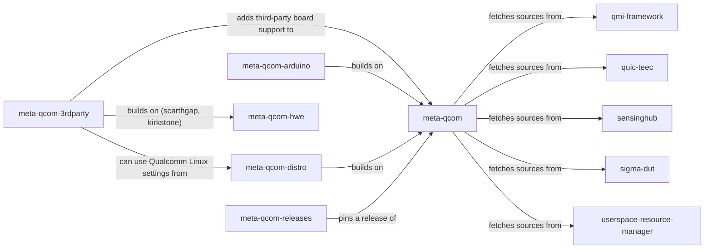
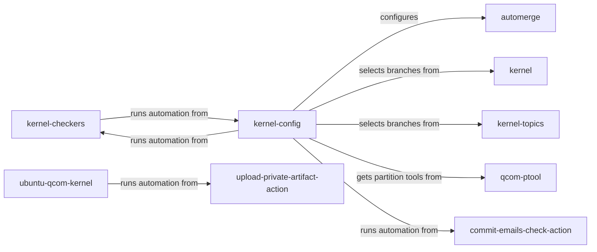
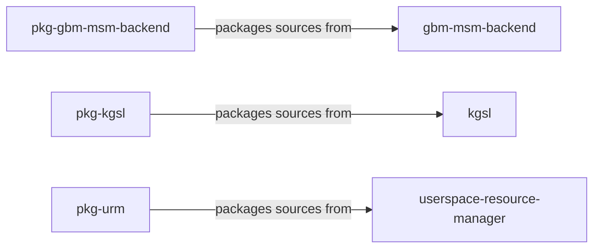
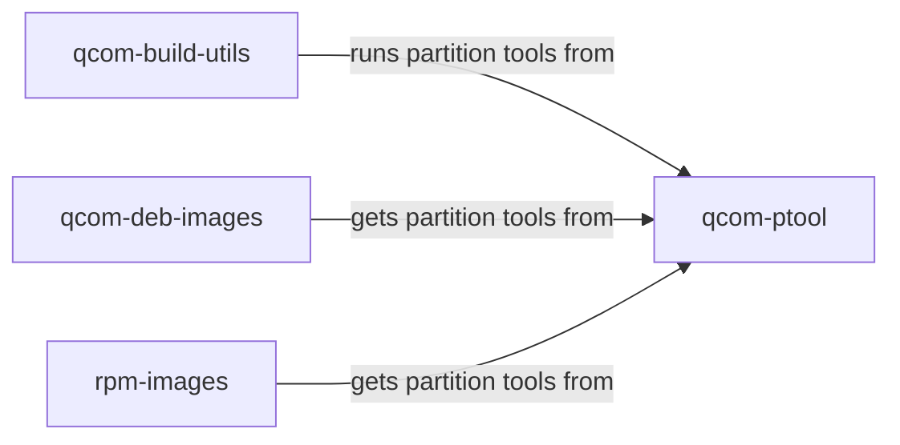
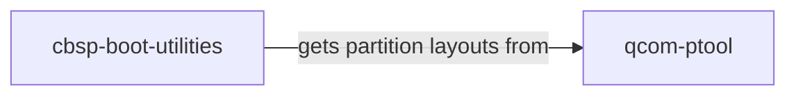

# Qualcomm repository map

Qualcomm repositories: public repositories in Qualcomm's GitHub organisations (qualcomm-linux and qualcomm). Upstream projects, board vendors, and tools are not recorded. The map is not limited to a release or engagement.

**Coverage:** 137 repositories; 51 recorded build/component relationships.

Repository inventory is broader than reviewed relationships. An absent edge means no relationship has been recorded, not proof of independence.

Click a repository node to open it. Indirect connections follow the actual path through their provider.

- [Yocto builds and releases (1/2)](#yocto-builds-and-releases-12)
- [Yocto builds and releases (2/2)](#yocto-builds-and-releases-22)
- [Kernel integration](#kernel-integration)
- [Source packaging](#source-packaging)
- [Images and build tooling relationships](#images-and-build-tooling-relationships)
- [Boot and firmware relationships](#boot-and-firmware-relationships)

## Yocto builds and releases (1/2)

```mermaid
flowchart LR
    r0["TC9564_Host_Driver"]
    click r0 href "https://github.com/qualcomm-linux/TC9564_Host_Driver" _blank
    r1["boot-firmware-ci"]
    click r1 href "https://github.com/qualcomm-linux/boot-firmware-ci" _blank
    r2["camera-driver"]
    click r2 href "https://github.com/qualcomm-linux/camera-driver" _blank
    r3["gbm-msm-backend"]
    click r3 href "https://github.com/qualcomm-linux/gbm-msm-backend" _blank
    r4["kernel"]
    click r4 href "https://github.com/qualcomm-linux/kernel" _blank
    r5["kgsl"]
    click r5 href "https://github.com/qualcomm-linux/kgsl" _blank
    r6["location-hal-qcom"]
    click r6 href "https://github.com/qualcomm-linux/location-hal-qcom" _blank
    r7["meta-ai"]
    click r7 href "https://github.com/qualcomm-linux/meta-ai" _blank
    r8["meta-qcom"]
    click r8 href "https://github.com/qualcomm-linux/meta-qcom" _blank
    r9["meta-qcom-distro"]
    click r9 href "https://github.com/qualcomm-linux/meta-qcom-distro" _blank
    r10["optee_os"]
    click r10 href "https://github.com/qualcomm-linux/optee_os" _blank
    r11["qcom-dtb-metadata"]
    click r11 href "https://github.com/qualcomm-linux/qcom-dtb-metadata" _blank
    r12["qcom-ptool"]
    click r12 href "https://github.com/qualcomm-linux/qcom-ptool" _blank
    r13["trusted-firmware-a"]
    click r13 href "https://github.com/qualcomm-linux/trusted-firmware-a" _blank
    r14["u-boot"]
    click r14 href "https://github.com/qualcomm-linux/u-boot" _blank
    r15["video-driver"]
    click r15 href "https://github.com/qualcomm-linux/video-driver" _blank
    r16["abl2esp"]
    click r16 href "https://github.com/qualcomm/abl2esp" _blank
    r17["camera-service"]
    click r17 href "https://github.com/qualcomm/camera-service" _blank
    r18["cbsp-boot-utilities"]
    click r18 href "https://github.com/qualcomm/cbsp-boot-utilities" _blank
    r19["fastrpc"]
    click r19 href "https://github.com/qualcomm/fastrpc" _blank
    r20["mink-idl-compiler"]
    click r20 href "https://github.com/qualcomm/mink-idl-compiler" _blank
    r21["minkipc"]
    click r21 href "https://github.com/qualcomm/minkipc" _blank
    r22["qca-swiss-army-knife"]
    click r22 href "https://github.com/qualcomm/qca-swiss-army-knife" _blank
    r23["qimsdk"]
    click r23 href "https://github.com/qualcomm/qimsdk" _blank
    r8 -->|"fetches sources from"| r0
    r8 -->|"fetches sources from"| r1
    r8 -->|"fetches sources from"| r2
    r8 -->|"fetches sources from"| r3
    r8 -->|"fetches Linux kernel sources from"| r4
    r8 -->|"fetches sources from"| r5
    r8 -->|"fetches sources from"| r6
    r8 -->|"adds recipes when combined with"| r7
    r8 -->|"includes for Qualcomm Linux images"| r7
    r8 -->|"adds recipes when combined with"| r9
    r8 -->|"includes for Qualcomm Linux images"| r9
    r8 -->|"fetches sources from"| r10
    r8 -->|"fetches sources from"| r11
    r8 -->|"gets partition tools from"| r12
    r8 -->|"fetches sources from"| r13
    r8 -->|"fetches sources from"| r14
    r8 -->|"fetches sources from"| r15
    r8 -->|"fetches sources from"| r16
    r8 -->|"fetches sources from"| r17
    r8 -->|"fetches sources from"| r18
    r8 -->|"fetches sources from"| r19
    r8 -->|"fetches sources from"| r20
    r8 -->|"fetches sources from"| r21
    r8 -->|"fetches sources from"| r22
    r8 -->|"fetches sources from"| r23
```

## Yocto builds and releases (2/2)

## Kernel integration

## Source packaging

## Images and build tooling relationships

## Boot and firmware relationships

## Reference details

Repository inventory

### Boot and firmware

- [qualcomm-linux/boot-firmware-ci](https://github.com/qualcomm-linux/boot-firmware-ci) — Boot Firmware CI/CD repo providing build artifacts for reuse across distros (default branch: `main`).
- [qualcomm-linux/edk2](https://github.com/qualcomm-linux/edk2) — Qualcomm upstream staging repo for edk2 (default branch: `qcom-next`).
- [qualcomm-linux/edk2-platforms](https://github.com/qualcomm-linux/edk2-platforms) — Qualcomm upstream staging repo for edk2-platforms (default branch: `qcom-next`).
- [qualcomm-linux/optee_os](https://github.com/qualcomm-linux/optee_os) — Qualcomm upstream staging repo for OP-TEE OS (default branch: `qcom-next`).
- [qualcomm-linux/qcom-ptool](https://github.com/qualcomm-linux/qcom-ptool) — qcom-ptool contains various device partitioning utilities like ptool.py, gen_partitions.py and various sample partition configuration files needed for Qualcomm SoCs. (default branch: `main`).
- [qualcomm-linux/qcom-sec-tools-wrapper](https://github.com/qualcomm-linux/qcom-sec-tools-wrapper) — Shell tooling around Qualcomm's secure boot flow - generate OEM keys, sign images, provision fuses, and build UEFI update capsules. (default branch: `main`).
- [qualcomm-linux/snagboot](https://github.com/qualcomm-linux/snagboot) — Generic recovery and reflashing tool for embedded platforms (default branch: `main`).
- [qualcomm-linux/trusted-firmware-a](https://github.com/qualcomm-linux/trusted-firmware-a) — Qualcomm upstream staging repo for Trusted Firmware-A (default branch: `qcom-next`).
- [qualcomm-linux/u-boot](https://github.com/qualcomm-linux/u-boot) — "Das U-Boot" Source Tree (default branch: `master`).
- [qualcomm/abl2esp](https://github.com/qualcomm/abl2esp) — Minimal Android Bootloader replacement that chainloads bootaa64.efi from the EFI System Partition. (default branch: `main`).
- [qualcomm/cbsp-boot-utilities](https://github.com/qualcomm/cbsp-boot-utilities) — Utilities and applications for Qualcomm boot firmware, including UEFI capsule generation. (default branch: `main`).

### Images and build tooling

- [qualcomm-linux/docker-pkg-build](https://github.com/qualcomm-linux/docker-pkg-build) — Debian packages build tool for native (arm64-arm64) or cross (amd64-arm64) build (default branch: `main`).
- [qualcomm-linux/qcom-build-utils](https://github.com/qualcomm-linux/qcom-build-utils) — Qualcomm utilities for Linux builds (default branch: `main`).
- [qualcomm-linux/qcom-deb-images](https://github.com/qualcomm-linux/qcom-deb-images) — Qualcomm Linux Debian build scripts (default branch: `main`).
- [qualcomm-linux/qcom-rpm-utils](https://github.com/qualcomm-linux/qcom-rpm-utils) — This repo will hold build scripts and reusable workflows for pkg rpm builds. (default branch: `main`).
- [qualcomm-linux/qli-ci](https://github.com/qualcomm-linux/qli-ci) — Central location for pkg reusable workflows (default branch: `main`).
- [qualcomm-linux/rpm-images](https://github.com/qualcomm-linux/rpm-images) — Repository purpose needs review; open the repository for its maintained documentation. (default branch: `main`).
- [qualcomm/commit-emails-check-action](https://github.com/qualcomm/commit-emails-check-action) — GitHub action for checking email addresses in PR/Push commits (default branch: `main`).
- [qualcomm/qcom-reusable-workflows](https://github.com/qualcomm/qcom-reusable-workflows) — Qualcomm reusable workflows (default branch: `main`).

### Kernel integration

- [qualcomm-linux/automerge](https://github.com/qualcomm-linux/automerge) — Tools to manage creation of qcom-next from the topic branches (default branch: `main`).
- [qualcomm-linux/kernel](https://github.com/qualcomm-linux/kernel) — Linux Kernel for QLI mainline (default branch: `main`).
- [qualcomm-linux/kernel-checkers](https://github.com/qualcomm-linux/kernel-checkers) — Checker tests kernel patches for correctness by running a suite of tests. (default branch: `main`).
- [qualcomm-linux/kernel-config](https://github.com/qualcomm-linux/kernel-config) — Configuration data to create qcom-next from the tech topic branches (default branch: `main`).
- [qualcomm-linux/kernel-topics](https://github.com/qualcomm-linux/kernel-topics) — Tech Topic Branches for QLI mainline (default branch: `main`).
- [qualcomm-linux/kmake-image](https://github.com/qualcomm-linux/kmake-image) — Docker setup for building the Linux kernel (default branch: `main`).
- [qualcomm-linux/ubuntu-qcom-kernel](https://github.com/qualcomm-linux/ubuntu-qcom-kernel) — Mirror and CI build pipeline for Canonical kernel  (default branch: `main`).

### Layers and releases

- [qualcomm-linux/meta-ai](https://github.com/qualcomm-linux/meta-ai) — OpenEmbedded layer for AI/ML related recipes (default branch: `main`).
- [qualcomm-linux/meta-qcom](https://github.com/qualcomm-linux/meta-qcom) — OpenEmbedded/Yocto Project BSP layer for Qualcomm based platforms (default branch: `master`).
- [qualcomm-linux/meta-qcom-3rdparty](https://github.com/qualcomm-linux/meta-qcom-3rdparty) — OpenEmbedded/Yocto Project BSP layer for Third-Party Maintained Qualcomm based platforms (default branch: `main`).
- [qualcomm-linux/meta-qcom-arduino](https://github.com/qualcomm-linux/meta-qcom-arduino) — OpenEmbedded/Yocto Project BSP layer for Qualcomm based Arduino platforms (default branch: `main`).
- [qualcomm-linux/meta-qcom-distro](https://github.com/qualcomm-linux/meta-qcom-distro) — OpenEmbedded/Yocto Project Reference Distribution layer for Qualcomm based platforms (default branch: `main`).
- [qualcomm-linux/meta-qcom-extras-releases](https://github.com/qualcomm-linux/meta-qcom-extras-releases) — This repo will be used to store kas-lock files for milestone releases of meta-qcom-extras (default branch: `main`).
- [qualcomm-linux/meta-qcom-hwe](https://github.com/qualcomm-linux/meta-qcom-hwe) — Repository purpose needs review; open the repository for its maintained documentation. (default branch: `main`).
- [qualcomm-linux/meta-qcom-qim-product-sdk](https://github.com/qualcomm-linux/meta-qcom-qim-product-sdk) — Repository purpose needs review; open the repository for its maintained documentation. (default branch: `scarthgap`).
- [qualcomm-linux/meta-qcom-realtime](https://github.com/qualcomm-linux/meta-qcom-realtime) — Repository purpose needs review; open the repository for its maintained documentation. (default branch: `scarthgap`).
- [qualcomm-linux/meta-qcom-releases](https://github.com/qualcomm-linux/meta-qcom-releases) — This repo will be used to store kas-lock files for milestone releases of meta-qcom (default branch: `main`).
- [qualcomm-linux/meta-qcom-robotics](https://github.com/qualcomm-linux/meta-qcom-robotics) — Repository purpose needs review; open the repository for its maintained documentation. (default branch: `scarthgap`).
- [qualcomm-linux/meta-qcom-robotics-distro](https://github.com/qualcomm-linux/meta-qcom-robotics-distro) — Repository purpose needs review; open the repository for its maintained documentation. (default branch: `scarthgap`).
- [qualcomm-linux/meta-qcom-robotics-releases](https://github.com/qualcomm-linux/meta-qcom-robotics-releases) — This repo will be used to store kas-lock files for milestone releases of meta-qcom-robotics-sdk (default branch: `main`).
- [qualcomm-linux/meta-qcom-robotics-sdk](https://github.com/qualcomm-linux/meta-qcom-robotics-sdk) — Repository purpose needs review; open the repository for its maintained documentation. (default branch: `main`).
- [qualcomm-linux/qcom-manifest](https://github.com/qualcomm-linux/qcom-manifest) — Repository purpose needs review; open the repository for its maintained documentation. (default branch: `qcom-linux-scarthgap`).

### Other repositories

- [qualcomm-linux/.github](https://github.com/qualcomm-linux/.github) — Qualcomm Linux GitHub organization action templates and configs (default branch: `main`).
- [qualcomm-linux/Robotics-SDK-Ubuntu](https://github.com/qualcomm-linux/Robotics-SDK-Ubuntu) —  Qualcomm Intelligent Robotics SDK (QIR SDK) for ubuntu (default branch: `main`).
- [qualcomm-linux/TC9564_Host_Driver](https://github.com/qualcomm-linux/TC9564_Host_Driver) — TC9564 PCIe-Ethernet Bridge Linux Host Driver (default branch: `qcom`).
- [qualcomm-linux/abctl](https://github.com/qualcomm-linux/abctl) — Repository purpose needs review; open the repository for its maintained documentation. (default branch: `main`).
- [qualcomm-linux/apt-artifactory-action](https://github.com/qualcomm-linux/apt-artifactory-action) — A GitHub Action for managing Debian packages in JFrog Artifactory. This action streamlines workflows for uploading artifacts, validating metadata, cleaning up stale packages, and performing custom operations on APT repositories hosted in Artifactory. (default branch: `main`).
- [qualcomm-linux/bitbake-lint-action](https://github.com/qualcomm-linux/bitbake-lint-action) — GitHub Action for linting bitbake recipes using oelint-adv linter  (default branch: `main`).
- [qualcomm-linux/camera-driver](https://github.com/qualcomm-linux/camera-driver) — This repository contains the source code of camera-kernel driver for the downstream camera-kernel (default branch: `camera-kernel.qclinux.0.0`).
- [qualcomm-linux/clk-debug-tools-for-qualcomm-linux](https://github.com/qualcomm-linux/clk-debug-tools-for-qualcomm-linux) — Out-of-tree clk debug patches for linux-next and scripts for clock-measurement based debugging on Qualcomm SoCs. (default branch: `main`).
- [qualcomm-linux/debusine-action](https://github.com/qualcomm-linux/debusine-action) — A GitHub Actions composite action that automates uploading Debian source packages and triggering Debusine workflows. (default branch: `main`).
- [qualcomm-linux/display-driver](https://github.com/qualcomm-linux/display-driver) — Repository purpose needs review; open the repository for its maintained documentation. (default branch: `main`).
- [qualcomm-linux/eva-driver](https://github.com/qualcomm-linux/eva-driver) — This repository contains the source code of eva-kernel driver for the downstream eva-kernel (default branch: `eva-kernel.qclinux.0.0`).
- [qualcomm-linux/gbm-msm-backend](https://github.com/qualcomm-linux/gbm-msm-backend) — MSM Backend repository to overlay on top of upstream MESA GBM. (default branch: `main`).
- [qualcomm-linux/github-action-matrix-outputs-read](https://github.com/qualcomm-linux/github-action-matrix-outputs-read) — Workaround implementation - Read matrix jobs outputs (default branch: `main`).
- [qualcomm-linux/github-action-matrix-outputs-write](https://github.com/qualcomm-linux/github-action-matrix-outputs-write) — Workaround implementation - Write matrix jobs outputs (default branch: `main`).
- [qualcomm-linux/kgsl](https://github.com/qualcomm-linux/kgsl) — Repository purpose needs review; open the repository for its maintained documentation. (default branch: `gfx-kernel.le.0.0`).
- [qualcomm-linux/location-apis-qcom](https://github.com/qualcomm-linux/location-apis-qcom) — Location Client API layer for Qualcomm based platforms (default branch: `location.lnx.0.0`).
- [qualcomm-linux/location-hal-qcom](https://github.com/qualcomm-linux/location-hal-qcom) — Location hal layer for Qualcomm based platforms (default branch: `location.lnx.0.0`).
- [qualcomm-linux/qcom-dtb-metadata](https://github.com/qualcomm-linux/qcom-dtb-metadata) — Repository purpose needs review; open the repository for its maintained documentation. (default branch: `main`).
- [qualcomm-linux/qcom-linux-skills](https://github.com/qualcomm-linux/qcom-linux-skills) — Agent Skills for Qualcomm Linux (default branch: `main`).
- [qualcomm-linux/qualcomm-CDI-generator](https://github.com/qualcomm-linux/qualcomm-CDI-generator) — Tooling to generate CDI config files to pass devices through to containers (default branch: `main`).
- [qualcomm-linux/rtss-mailbox-kmd](https://github.com/qualcomm-linux/rtss-mailbox-kmd) — RTSS Mailbox Kernel Mode Driver (KMD) for IPC-based inter-processor communication on Qualcomm Automotive, IE-IoT, Robotics SoCs. (default branch: `main`).
- [qualcomm-linux/rtss-mailbox-umd](https://github.com/qualcomm-linux/rtss-mailbox-umd) — RTSS Mailbox User Space package of libraries, demo applications, utils for Qualcomm Automotive, IE-IoT, Robotics SoCs. (default branch: `main`).
- [qualcomm-linux/upload-private-artifact-action](https://github.com/qualcomm-linux/upload-private-artifact-action) — An action for use in qualcomm-linux projects that need to publish CI artifacts that aren't cleared for public distribution. (default branch: `aws`).
- [qualcomm-linux/video-driver](https://github.com/qualcomm-linux/video-driver) — Repository purpose needs review; open the repository for its maintained documentation. (default branch: `video.qclinux.main`).
- [qualcomm-linux/weston-sdm-backend](https://github.com/qualcomm-linux/weston-sdm-backend) — Repository purpose needs review; open the repository for its maintained documentation. (default branch: `main`).
- [qualcomm/camera-service](https://github.com/qualcomm/camera-service) — Camera service that loads the CamX libraries and offers client APIs to applications. (default branch: `main`).
- [qualcomm/fastrpc](https://github.com/qualcomm/fastrpc) — FastRPC library and daemons for offloading work to Hexagon DSPs. (default branch: `not inventoried`).
- [qualcomm/mink-idl-compiler](https://github.com/qualcomm/mink-idl-compiler) — Compiler for Mink interface definition language (IDL) files. (default branch: `main`).
- [qualcomm/minkipc](https://github.com/qualcomm/minkipc) — Libraries and clients for the Mink-IPC interface. (default branch: `main`).
- [qualcomm/qca-swiss-army-knife](https://github.com/qualcomm/qca-swiss-army-knife) — Utilities that help Qualcomm Atheros (QCA) driver development. (default branch: `master`).
- [qualcomm/qimsdk](https://github.com/qualcomm/qimsdk) — Qualcomm IMSDK GStreamer plugins and their base libraries. (default branch: `main`).
- [qualcomm/qmi-framework](https://github.com/qualcomm/qmi-framework) — QMI Framework messaging library for communication between Linux clients and Qualcomm subsystems. (default branch: `main`).
- [qualcomm/quic-teec](https://github.com/qualcomm/quic-teec) — Qualcomm clients for the Linux TEE subsystem. (default branch: `main`).
- [qualcomm/sensinghub](https://github.com/qualcomm/sensinghub) — Qualcomm sensing hub library. (default branch: `main`).
- [qualcomm/sigma-dut](https://github.com/qualcomm/sigma-dut) — Wi-Fi Alliance Sigma DUT and control agent. (default branch: `master`).
- [qualcomm/userspace-resource-manager](https://github.com/qualcomm/userspace-resource-manager) — Upstream userspace resource manager source packaged by pkg-urm. (default branch: `not inventoried`).

### Packaging

- [qualcomm-linux/pkg-adreno](https://github.com/qualcomm-linux/pkg-adreno) — Repository purpose needs review; open the repository for its maintained documentation. (default branch: `qli-ci`).
- [qualcomm-linux/pkg-alsa-ucm-conf](https://github.com/qualcomm-linux/pkg-alsa-ucm-conf) — Repository purpose needs review; open the repository for its maintained documentation. (default branch: `qli-ci`).
- [qualcomm-linux/pkg-android-platform-tools](https://github.com/qualcomm-linux/pkg-android-platform-tools) — Repository purpose needs review; open the repository for its maintained documentation. (default branch: `qli-ci`).
- [qualcomm-linux/pkg-audioreach-audio-utils](https://github.com/qualcomm-linux/pkg-audioreach-audio-utils) — Repository purpose needs review; open the repository for its maintained documentation. (default branch: `qli-ci`).
- [qualcomm-linux/pkg-audioreach-conf](https://github.com/qualcomm-linux/pkg-audioreach-conf) — Repository purpose needs review; open the repository for its maintained documentation. (default branch: `qli-ci`).
- [qualcomm-linux/pkg-audioreach-dkms](https://github.com/qualcomm-linux/pkg-audioreach-dkms) — Repository purpose needs review; open the repository for its maintained documentation. (default branch: `qli-ci`).
- [qualcomm-linux/pkg-audioreach-graphmgr](https://github.com/qualcomm-linux/pkg-audioreach-graphmgr) — Repository purpose needs review; open the repository for its maintained documentation. (default branch: `qli-ci`).
- [qualcomm-linux/pkg-audioreach-graphservices](https://github.com/qualcomm-linux/pkg-audioreach-graphservices) — Repository purpose needs review; open the repository for its maintained documentation. (default branch: `qli-ci`).
- [qualcomm-linux/pkg-audioreach-pal](https://github.com/qualcomm-linux/pkg-audioreach-pal) — Repository purpose needs review; open the repository for its maintained documentation. (default branch: `qli-ci`).
- [qualcomm-linux/pkg-audioreach-pipewire-plugin](https://github.com/qualcomm-linux/pkg-audioreach-pipewire-plugin) — Repository purpose needs review; open the repository for its maintained documentation. (default branch: `qli-ci`).
- [qualcomm-linux/pkg-btftm](https://github.com/qualcomm-linux/pkg-btftm) — this is for bt-performant.qclinux.0.0  Btdiag debian generate and upload to apt (default branch: `qli-ci`).
- [qualcomm-linux/pkg-camx-dev](https://github.com/qualcomm-linux/pkg-camx-dev) — Repository purpose needs review; open the repository for its maintained documentation. (default branch: `qli-ci`).
- [qualcomm-linux/pkg-camx-dkms](https://github.com/qualcomm-linux/pkg-camx-dkms) — repo to created camx-dlkm debian (default branch: `qli-ci`).
- [qualcomm-linux/pkg-camx-firmware-glymur](https://github.com/qualcomm-linux/pkg-camx-firmware-glymur) — add repo for glymur target firmware (default branch: `qli-ci`).
- [qualcomm-linux/pkg-camx-firmware-hamoa](https://github.com/qualcomm-linux/pkg-camx-firmware-hamoa) — Repository purpose needs review; open the repository for its maintained documentation. (default branch: `qli-ci`).
- [qualcomm-linux/pkg-camx-firmware-kodiak](https://github.com/qualcomm-linux/pkg-camx-firmware-kodiak) — Repository purpose needs review; open the repository for its maintained documentation. (default branch: `qli-ci`).
- [qualcomm-linux/pkg-camx-firmware-lemans](https://github.com/qualcomm-linux/pkg-camx-firmware-lemans) — Repository purpose needs review; open the repository for its maintained documentation. (default branch: `qli-ci`).
- [qualcomm-linux/pkg-camx-firmware-talos](https://github.com/qualcomm-linux/pkg-camx-firmware-talos) — Repository purpose needs review; open the repository for its maintained documentation. (default branch: `qli-ci`).
- [qualcomm-linux/pkg-camx-glymur](https://github.com/qualcomm-linux/pkg-camx-glymur) — repo for glymur target (default branch: `qli-ci`).
- [qualcomm-linux/pkg-camx-hamoa](https://github.com/qualcomm-linux/pkg-camx-hamoa) — Camera hamoa (default branch: `qli-ci`).
- [qualcomm-linux/pkg-camx-kodiak](https://github.com/qualcomm-linux/pkg-camx-kodiak) — camx kodiak UMD Debian creation (default branch: `qli-ci`).
- [qualcomm-linux/pkg-camx-lemans](https://github.com/qualcomm-linux/pkg-camx-lemans) — camx lemans UMD Debian creation (default branch: `qli-ci`).
- [qualcomm-linux/pkg-camx-nhx](https://github.com/qualcomm-linux/pkg-camx-nhx) — camx test Debian creation (default branch: `qli-ci`).
- [qualcomm-linux/pkg-camx-talos](https://github.com/qualcomm-linux/pkg-camx-talos) — camx talos UMD Debian. (default branch: `qli-ci`).
- [qualcomm-linux/pkg-diag-router](https://github.com/qualcomm-linux/pkg-diag-router) — Debain package repo for qcom-diag-router (default branch: `qli-ci`).
- [qualcomm-linux/pkg-eva-dkms](https://github.com/qualcomm-linux/pkg-eva-dkms) — Qcom Linux repo to generate the EVA dlkm debian packages (default branch: `qli-ci`).
- [qualcomm-linux/pkg-fastrpc](https://github.com/qualcomm-linux/pkg-fastrpc) — Repository purpose needs review; open the repository for its maintained documentation. (default branch: `qli-ci`).
- [qualcomm-linux/pkg-gbm-msm-backend](https://github.com/qualcomm-linux/pkg-gbm-msm-backend) — Packaging repo for gbm-msm-backend (default branch: `qli-ci`).
- [qualcomm-linux/pkg-gst-plugins-imsdk](https://github.com/qualcomm-linux/pkg-gst-plugins-imsdk) — Repository purpose needs review; open the repository for its maintained documentation. (default branch: `qli-ci`).
- [qualcomm-linux/pkg-kgsl](https://github.com/qualcomm-linux/pkg-kgsl) — Packaging repo for kgsl (default branch: `qli-ci`).
- [qualcomm-linux/pkg-libdiag](https://github.com/qualcomm-linux/pkg-libdiag) — Deb file distribution repo for libdiag and diagnostics utils  (default branch: `qli-ci`).
- [qualcomm-linux/pkg-linux-qcom](https://github.com/qualcomm-linux/pkg-linux-qcom) — QCOM Linux Kernel Debian Package repository (default branch: `main`).
- [qualcomm-linux/pkg-mink-idl-compiler](https://github.com/qualcomm-linux/pkg-mink-idl-compiler) — Debian packaging meta-data for mink-idl-compiler project. (default branch: `qli-ci`).
- [qualcomm-linux/pkg-minkipc](https://github.com/qualcomm-linux/pkg-minkipc) — Debian packaging meta-data for minkipc project. (default branch: `qli-ci`).
- [qualcomm-linux/pkg-optee-client](https://github.com/qualcomm-linux/pkg-optee-client) — Debian package meta-data to package Qualcomm vendored mink optee-client library (default branch: `qli-ci`).
- [qualcomm-linux/pkg-optee-test](https://github.com/qualcomm-linux/pkg-optee-test) — Debian package meta-data to package Qualcomm vendored mink xtest for QTEE (default branch: `qli-ci`).
- [qualcomm-linux/pkg-qcom-fastcv-binaries](https://github.com/qualcomm-linux/pkg-qcom-fastcv-binaries) — Repository purpose needs review; open the repository for its maintained documentation. (default branch: `qli-ci`).
- [qualcomm-linux/pkg-qcom-sensors](https://github.com/qualcomm-linux/pkg-qcom-sensors) — Repository purpose needs review; open the repository for its maintained documentation. (default branch: `qli-ci`).
- [qualcomm-linux/pkg-qcom-sv-binaries](https://github.com/qualcomm-linux/pkg-qcom-sv-binaries) — Qcom Linux SV Debian packaging repository (default branch: `qli-ci`).
- [qualcomm-linux/pkg-qimsdk-smartvenc](https://github.com/qualcomm-linux/pkg-qimsdk-smartvenc) — pkg-bin-smart-venc-ctrl (default branch: `qli-ci`).
- [qualcomm-linux/pkg-qmi-framework](https://github.com/qualcomm-linux/pkg-qmi-framework) — Repository purpose needs review; open the repository for its maintained documentation. (default branch: `qli-ci`).
- [qualcomm-linux/pkg-qti-camera-service](https://github.com/qualcomm-linux/pkg-qti-camera-service) — Repository purpose needs review; open the repository for its maintained documentation. (default branch: `qli-ci`).
- [qualcomm-linux/pkg-quic-teec](https://github.com/qualcomm-linux/pkg-quic-teec) — Debian packaging meta-data for quic-teec project. (default branch: `qli-ci`).
- [qualcomm-linux/pkg-ros-jazzy-xsens-mti-ros2-driver](https://github.com/qualcomm-linux/pkg-ros-jazzy-xsens-mti-ros2-driver) — ROS 2 driver for Xsens MTi IMU sensors (default branch: `qcom/debian/latest`).
- [qualcomm-linux/pkg-rpm-qcom-fastcv-binaries](https://github.com/qualcomm-linux/pkg-rpm-qcom-fastcv-binaries) — Repository purpose needs review; open the repository for its maintained documentation. (default branch: `main`).
- [qualcomm-linux/pkg-rpm-video-driver](https://github.com/qualcomm-linux/pkg-rpm-video-driver) — Repository purpose needs review; open the repository for its maintained documentation. (default branch: `main`).
- [qualcomm-linux/pkg-sensinghub](https://github.com/qualcomm-linux/pkg-sensinghub) — Repository purpose needs review; open the repository for its maintained documentation. (default branch: `qli-ci`).
- [qualcomm-linux/pkg-thermald](https://github.com/qualcomm-linux/pkg-thermald) — Debian overlay package for thermald: backports upstream patches  (default branch: `qli-ci`).
- [qualcomm-linux/pkg-time-services](https://github.com/qualcomm-linux/pkg-time-services) — Time-services package repo (default branch: `qli-ci`).
- [qualcomm-linux/pkg-tinyalsa](https://github.com/qualcomm-linux/pkg-tinyalsa) — Repository purpose needs review; open the repository for its maintained documentation. (default branch: `qli-ci`).
- [qualcomm-linux/pkg-tinycompress](https://github.com/qualcomm-linux/pkg-tinycompress) — Repository purpose needs review; open the repository for its maintained documentation. (default branch: `qli-ci`).
- [qualcomm-linux/pkg-urm](https://github.com/qualcomm-linux/pkg-urm) — This project handles Debian packaging for the URM project (<https://github.com/qualcomm/userspace-resource-manager>) (default branch: `qli-ci`).
- [qualcomm-linux/pkg-urm-ext](https://github.com/qualcomm-linux/pkg-urm-ext) — This project handles Debian packaging for the URM extension project i.e <https://github.com/qualcomm/userspace-resource-manager-extensions>  (default branch: `qli-ci`).
- [qualcomm-linux/pkg-video-driver](https://github.com/qualcomm-linux/pkg-video-driver) — Repository purpose needs review; open the repository for its maintained documentation. (default branch: `qli-ci`).

### Validation

- [qualcomm-linux/aiml-container-test](https://github.com/qualcomm-linux/aiml-container-test) — Container targeted at testing AI and ML workloads for Qualcomm platforms (default branch: `main`).
- [qualcomm-linux/awstest-meta-qcom](https://github.com/qualcomm-linux/awstest-meta-qcom) — OpenEmbedded/Yocto Project BSP layer for Qualcomm based platforms (default branch: `master`).
- [qualcomm-linux/job_render](https://github.com/qualcomm-linux/job_render) — Lava job render (default branch: `main`).
- [qualcomm-linux/lava-test-plans](https://github.com/qualcomm-linux/lava-test-plans) — Repository purpose needs review; open the repository for its maintained documentation. (default branch: `master`).
- [qualcomm-linux/mark-test](https://github.com/qualcomm-linux/mark-test) — Repository purpose needs review; open the repository for its maintained documentation. (default branch: `main`).
- [qualcomm-linux/qcom-linux-testkit](https://github.com/qualcomm-linux/qcom-linux-testkit) — This repository provides standalone validation scripts designed to test and verify various Linux features, particularly for Qualcomm RB3Gen2 and platforms based on meta-qcom and meta-qcom-distros. (default branch: `main`).

Relationship applicability and sources

### qualcomm-linux/kernel-checkers

- **runs automation from** [kernel-config](https://github.com/qualcomm-linux/kernel-config)
  - GitHub Actions integration
  - [checker.yml](https://github.com/qualcomm-linux/kernel-checkers/blob/23c35b0e159903b2f69ec5d11f5b6e5dcd493319/.github/workflows/checker.yml)

### qualcomm-linux/kernel-config

- **configures** [automerge](https://github.com/qualcomm-linux/automerge)
  - qcom-next integration configuration.
  - [README](https://github.com/qualcomm-linux/kernel-config/blob/ca3a00b71520dd58ede87f9c2921b48f95ac0b32/README)
- **selects branches from** [kernel](https://github.com/qualcomm-linux/kernel)
  - qcom-next.conf names baseline and topic branches.
  - [qcom-next.conf](https://github.com/qualcomm-linux/kernel-config/blob/ca3a00b71520dd58ede87f9c2921b48f95ac0b32/qcom-next.conf)
- **runs automation from** [kernel-checkers](https://github.com/qualcomm-linux/kernel-checkers)
  - GitHub Actions integration
  - [kernel_checker.yml](https://github.com/qualcomm-linux/kernel-config/blob/ca3a00b71520dd58ede87f9c2921b48f95ac0b32/.github/workflows/kernel_checker.yml)
- **selects branches from** [kernel-topics](https://github.com/qualcomm-linux/kernel-topics)
  - qcom-next.conf names baseline and topic branches.
  - [qcom-next.conf](https://github.com/qualcomm-linux/kernel-config/blob/ca3a00b71520dd58ede87f9c2921b48f95ac0b32/qcom-next.conf)
- **gets partition tools from** [qcom-ptool](https://github.com/qualcomm-linux/qcom-ptool)
  - Ubuntu build action; clones qcom-ptool and runs ptool to generate flat_meta.
  - [action.yml](https://github.com/qualcomm-linux/kernel-config/blob/daa2c34f29daa7cb50d0eb3084b70bf552133d2a/.github/actions/build_ubuntu/action.yml)
- **runs automation from** [commit-emails-check-action](https://github.com/qualcomm/commit-emails-check-action)
  - GitHub Actions integration
  - [email_checker.yml](https://github.com/qualcomm-linux/kernel-config/blob/ca3a00b71520dd58ede87f9c2921b48f95ac0b32/.github/workflows/email_checker.yml)

### qualcomm-linux/meta-qcom

- **fetches sources from** [TC9564_Host_Driver](https://github.com/qualcomm-linux/TC9564_Host_Driver)
  - qps615-dlkm recipe; recommended by the rb3gen2-core-kit, iq-615-evk, iq-8275-evk, iq-9075-evk, and qcom-armv8a machines.
  - [qps615-dlkm_git.bb](https://github.com/qualcomm-linux/meta-qcom/blob/441a8e00957fd0e550ed62b0fbf2090b3dc24d31/recipes-kernel/qps615-module/qps615-dlkm_git.bb)
- **fetches sources from** [boot-firmware-ci](https://github.com/qualcomm-linux/boot-firmware-ci)
  - swiv-build-utility recipe, which prepares the U-Boot SPL for signing.
  - [swiv-build-utility_git.bb](https://github.com/qualcomm-linux/meta-qcom/blob/441a8e00957fd0e550ed62b0fbf2090b3dc24d31/recipes-devtools/swiv-build-utility/swiv-build-utility_git.bb)
- **fetches sources from** [camera-driver](https://github.com/qualcomm-linux/camera-driver)
  - camx-dlkm camera kernel module recipe.
  - [camx-dlkm_1.0.6.bb](https://github.com/qualcomm-linux/meta-qcom/blob/441a8e00957fd0e550ed62b0fbf2090b3dc24d31/recipes-multimedia/camx/camx-dlkm_1.0.6.bb)
- **fetches sources from** [gbm-msm-backend](https://github.com/qualcomm-linux/gbm-msm-backend)
  - msm-gbm-backend recipe.
  - [msm-gbm-backend.bb](https://github.com/qualcomm-linux/meta-qcom/blob/441a8e00957fd0e550ed62b0fbf2090b3dc24d31/recipes-graphics/msm-gbm-backend/msm-gbm-backend.bb)
- **fetches Linux kernel sources from** [kernel](https://github.com/qualcomm-linux/kernel)
  - linux-qcom-next and linux-qcom 6.18 recipes; kernel provider and source revision are configuration-dependent.
  - [linux-qcom-next_git.bb](https://github.com/qualcomm-linux/meta-qcom/blob/c6729710f055e1c0337c830030ab25eef7f293a5/recipes-kernel/linux/linux-qcom-next_git.bb)
  - [linux-qcom_6.18.bb](https://github.com/qualcomm-linux/meta-qcom/blob/441a8e00957fd0e550ed62b0fbf2090b3dc24d31/recipes-kernel/linux/linux-qcom_6.18.bb)
- **fetches sources from** [kgsl](https://github.com/qualcomm-linux/kgsl)
  - kgsl-dlkm kernel graphics module recipe.
  - [kgsl-dlkm_1.0.14.bb](https://github.com/qualcomm-linux/meta-qcom/blob/441a8e00957fd0e550ed62b0fbf2090b3dc24d31/recipes-graphics/kgsl-dlkm/kgsl-dlkm_1.0.14.bb)
- **fetches sources from** [location-hal-qcom](https://github.com/qualcomm-linux/location-hal-qcom)
  - location-hal recipe; applies only when meta-oe is in the build.
  - [location-hal_1.0.2.bb](https://github.com/qualcomm-linux/meta-qcom/blob/441a8e00957fd0e550ed62b0fbf2090b3dc24d31/dynamic-layers/openembedded-layer/recipes-navigation/location-client-api/location-hal_1.0.2.bb)
- **adds recipes when combined with** [meta-ai](https://github.com/qualcomm-linux/meta-ai)
  - Optional: dynamic-layers/ai recipes apply only when the ai layer collection is present.
  - [layer.conf](https://github.com/qualcomm-linux/meta-qcom/blob/441a8e00957fd0e550ed62b0fbf2090b3dc24d31/conf/layer.conf)
  - [layer.conf](https://github.com/qualcomm-linux/meta-ai/blob/1bb956f0cf342857c8aa34486ba23ecdc8c8a968/conf/layer.conf)
- **includes for Qualcomm Linux images** [meta-ai](https://github.com/qualcomm-linux/meta-ai)
  - Optional qcom-distro kas composition; not required by every BSP-only build.
  - [qcom-distro.yml](https://github.com/qualcomm-linux/meta-qcom/blob/c6729710f055e1c0337c830030ab25eef7f293a5/ci/qcom-distro.yml)
- **adds recipes when combined with** [meta-qcom-distro](https://github.com/qualcomm-linux/meta-qcom-distro)
  - Optional: dynamic-layers/qcom-distro recipes apply only when the qcom-distro layer collection is present.
  - [layer.conf](https://github.com/qualcomm-linux/meta-qcom/blob/441a8e00957fd0e550ed62b0fbf2090b3dc24d31/conf/layer.conf)
  - [layer.conf](https://github.com/qualcomm-linux/meta-qcom-distro/blob/270fab495f0fe6175016ca75bcbc98e69314e2ca/conf/layer.conf)
- **includes for Qualcomm Linux images** [meta-qcom-distro](https://github.com/qualcomm-linux/meta-qcom-distro)
  - Optional qcom-distro kas composition; not required by every BSP-only build.
  - [qcom-distro.yml](https://github.com/qualcomm-linux/meta-qcom/blob/c6729710f055e1c0337c830030ab25eef7f293a5/ci/qcom-distro.yml)
- **fetches sources from** [optee_os](https://github.com/qualcomm-linux/optee_os)
  - optee-os-qcom recipes; apply only when meta-arm is in the build.
  - [optee-os-qcom.inc](https://github.com/qualcomm-linux/meta-qcom/blob/441a8e00957fd0e550ed62b0fbf2090b3dc24d31/dynamic-layers/meta-arm/recipes-security/optee/optee-os-qcom.inc)
- **fetches sources from** [qcom-dtb-metadata](https://github.com/qualcomm-linux/qcom-dtb-metadata)
  - qcom-dtb-metadata recipe, which dtb-fit-image.bbclass uses for multi-DTB FIT images.
  - [qcom-dtb-metadata_1.1.bb](https://github.com/qualcomm-linux/meta-qcom/blob/441a8e00957fd0e550ed62b0fbf2090b3dc24d31/recipes-kernel/linux/qcom-dtb-metadata_1.1.bb)
- **gets partition tools from** [qcom-ptool](https://github.com/qualcomm-linux/qcom-ptool)
  - Partition recipe source; pinned by qcom-ptool.inc.
  - [qcom-ptool.inc](https://github.com/qualcomm-linux/meta-qcom/blob/c6729710f055e1c0337c830030ab25eef7f293a5/recipes-bsp/partition/qcom-ptool.inc)
- **fetches sources from** [trusted-firmware-a](https://github.com/qualcomm-linux/trusted-firmware-a)
  - trusted-firmware-a-qcom recipes; apply only when meta-arm is in the build.
  - [trusted-firmware-a-qcom.inc](https://github.com/qualcomm-linux/meta-qcom/blob/441a8e00957fd0e550ed62b0fbf2090b3dc24d31/dynamic-layers/meta-arm/recipes-bsp/trusted-firmware-a/trusted-firmware-a-qcom.inc)
- **fetches sources from** [u-boot](https://github.com/qualcomm-linux/u-boot)
  - u-boot-qcom recipe; used where a machine or kas fragment selects it as the boot loader.
  - [u-boot-qcom_git.bb](https://github.com/qualcomm-linux/meta-qcom/blob/441a8e00957fd0e550ed62b0fbf2090b3dc24d31/recipes-bsp/u-boot/u-boot-qcom_git.bb)
- **fetches sources from** [video-driver](https://github.com/qualcomm-linux/video-driver)
  - iris-video-dlkm video kernel module recipe.
  - [iris-video-dlkm_1.0.28.bb](https://github.com/qualcomm-linux/meta-qcom/blob/441a8e00957fd0e550ed62b0fbf2090b3dc24d31/recipes-kernel/iris-video-module/iris-video-dlkm_1.0.28.bb)
- **fetches sources from** [abl2esp](https://github.com/qualcomm/abl2esp)
  - abl2esp recipe; image_types_qcom.bbclass adds it when ABL_SIGNATURE_VERSION is set.
  - [abl2esp_1.0.bb](https://github.com/qualcomm-linux/meta-qcom/blob/441a8e00957fd0e550ed62b0fbf2090b3dc24d31/recipes-support/abl2esp/abl2esp_1.0.bb)
- **fetches sources from** [camera-service](https://github.com/qualcomm/camera-service)
  - camera-service recipe; applies only when meta-oe is in the build.
  - [camera-service_1.0.6.bb](https://github.com/qualcomm-linux/meta-qcom/blob/441a8e00957fd0e550ed62b0fbf2090b3dc24d31/dynamic-layers/openembedded-layer/recipes-multimedia/camera-service/camera-service_1.0.6.bb)
- **fetches sources from** [cbsp-boot-utilities](https://github.com/qualcomm/cbsp-boot-utilities)
  - cbsp-boot-utilities-native recipe in the meta-arm dynamic layer; the recipe pins SRCREV.
  - [cbsp-boot-utilities-native_1.0.bb](https://github.com/qualcomm-linux/meta-qcom/blob/441a8e00957fd0e550ed62b0fbf2090b3dc24d31/dynamic-layers/meta-arm/recipes-devtools/cbsp-boot-utilities/cbsp-boot-utilities-native_1.0.bb)
- **fetches sources from** [fastrpc](https://github.com/qualcomm/fastrpc)
  - fastrpc recipe; the tagged release is pinned by SRCREV.
  - [fastrpc_1.0.7.bb](https://github.com/qualcomm-linux/meta-qcom/blob/1d8048f3a515eeef3758868566ec847b63065811/recipes-support/fastrpc/fastrpc_1.0.7.bb)
- **fetches sources from** [mink-idl-compiler](https://github.com/qualcomm/mink-idl-compiler)
  - mink-idl-compiler recipe in the openembedded-layer dynamic layer; a tagged release is pinned by SRCREV.
  - [mink-idl-compiler_0.2.3.bb](https://github.com/qualcomm-linux/meta-qcom/blob/441a8e00957fd0e550ed62b0fbf2090b3dc24d31/dynamic-layers/openembedded-layer/recipes-devtools/mink-idl-compiler/mink-idl-compiler_0.2.3.bb)
- **fetches sources from** [minkipc](https://github.com/qualcomm/minkipc)
  - minkipc recipe; applies only when meta-oe is in the build.
  - [minkipc_1.2.10.bb](https://github.com/qualcomm-linux/meta-qcom/blob/441a8e00957fd0e550ed62b0fbf2090b3dc24d31/dynamic-layers/openembedded-layer/recipes-security/minkipc/minkipc_1.2.10.bb)
- **fetches sources from** [qca-swiss-army-knife](https://github.com/qualcomm/qca-swiss-army-knife)
  - qca-swiss-army-knife recipe; the recipe pins SRCREV.
  - [qca-swiss-army-knife_git.bb](https://github.com/qualcomm-linux/meta-qcom/blob/441a8e00957fd0e550ed62b0fbf2090b3dc24d31/recipes-devtools/qca-swiss-army-knife/qca-swiss-army-knife_git.bb)
- **fetches sources from** [qimsdk](https://github.com/qualcomm/qimsdk)
  - gst-plugins-imsdk recipes; the shared include pins the tag.
  - [gst-plugins-imsdk-common.inc](https://github.com/qualcomm-linux/meta-qcom/blob/441a8e00957fd0e550ed62b0fbf2090b3dc24d31/recipes-multimedia/imsdk/gst-plugins-imsdk-common.inc)
- **fetches sources from** [qmi-framework](https://github.com/qualcomm/qmi-framework)
  - qmi-framework recipe; a tagged release is pinned by SRCREV.
  - [qmi-framework_0.1.4.bb](https://github.com/qualcomm-linux/meta-qcom/blob/441a8e00957fd0e550ed62b0fbf2090b3dc24d31/recipes-support/qmi-framework/qmi-framework_0.1.4.bb)
- **fetches sources from** [quic-teec](https://github.com/qualcomm/quic-teec)
  - qcomtee recipe in the openembedded-layer dynamic layer; a tagged release is pinned by SRCREV.
  - [qcomtee_1.0.2.bb](https://github.com/qualcomm-linux/meta-qcom/blob/441a8e00957fd0e550ed62b0fbf2090b3dc24d31/dynamic-layers/openembedded-layer/recipes-security/qcomtee/qcomtee_1.0.2.bb)
- **fetches sources from** [sensinghub](https://github.com/qualcomm/sensinghub)
  - sensinghub recipe; applies only when meta-oe is in the build.
  - [sensinghub_1.0.6.bb](https://github.com/qualcomm-linux/meta-qcom/blob/441a8e00957fd0e550ed62b0fbf2090b3dc24d31/dynamic-layers/openembedded-layer/recipes-support/sensors/sensinghub_1.0.6.bb)
- **fetches sources from** [sigma-dut](https://github.com/qualcomm/sigma-dut)
  - sigma-dut recipe.
  - [sigma-dut_git.bb](https://github.com/qualcomm-linux/meta-qcom/blob/441a8e00957fd0e550ed62b0fbf2090b3dc24d31/recipes-connectivity/sigma-dut/sigma-dut_git.bb)
- **fetches sources from** [userspace-resource-manager](https://github.com/qualcomm/userspace-resource-manager)
  - userspace-resource-manager recipe.
  - [userspace-resource-manager_0.4.9.bb](https://github.com/qualcomm-linux/meta-qcom/blob/441a8e00957fd0e550ed62b0fbf2090b3dc24d31/recipes-support/userspace-resource-manager/userspace-resource-manager_0.4.9.bb)

### qualcomm-linux/meta-qcom-3rdparty

- **through [meta-qcom](https://github.com/qualcomm-linux/meta-qcom)** [kernel](https://github.com/qualcomm-linux/kernel)
  - linux-qcom-next recipe; kernel provider and source revision are configuration-dependent.
  - [rubikpi3.conf](https://github.com/qualcomm-linux/meta-qcom-3rdparty/blob/8927b428bcaea0c47186beeb9d9446061c785e9c/conf/machine/rubikpi3.conf)
  - [linux-qcom-next_git.bb](https://github.com/qualcomm-linux/meta-qcom/blob/c6729710f055e1c0337c830030ab25eef7f293a5/recipes-kernel/linux/linux-qcom-next_git.bb)
- **through [meta-qcom](https://github.com/qualcomm-linux/meta-qcom)** [meta-ai](https://github.com/qualcomm-linux/meta-ai)
  - Optional qcom-distro kas composition; not required by every BSP-only build.
  - [qcom-distro.yml](https://github.com/qualcomm-linux/meta-qcom-3rdparty/blob/8927b428bcaea0c47186beeb9d9446061c785e9c/ci/qcom-distro.yml)
  - [qcom-distro.yml](https://github.com/qualcomm-linux/meta-qcom/blob/c6729710f055e1c0337c830030ab25eef7f293a5/ci/qcom-distro.yml)
- **adds third-party board support to** [meta-qcom](https://github.com/qualcomm-linux/meta-qcom)
  - wrynose-compatible main snapshot 8927b428bcae; required layer collection.
  - [layer.conf](https://github.com/qualcomm-linux/meta-qcom-3rdparty/blob/8927b428bcaea0c47186beeb9d9446061c785e9c/conf/layer.conf)
- **can use Qualcomm Linux settings from** [meta-qcom-distro](https://github.com/qualcomm-linux/meta-qcom-distro)
  - Optional: the dynamic layer applies only when qcom-distro is present.
  - [layer.conf](https://github.com/qualcomm-linux/meta-qcom-3rdparty/blob/8927b428bcaea0c47186beeb9d9446061c785e9c/conf/layer.conf)
- **builds on (scarthgap, kirkstone)** [meta-qcom-hwe](https://github.com/qualcomm-linux/meta-qcom-hwe)
  - scarthgap and kirkstone branches only (Qualcomm Linux 1.x); required layer collection. main and wrynose do not depend on it.
  - [layer.conf](https://github.com/qualcomm-linux/meta-qcom-3rdparty/blob/b411da79d08b3726eeba85df834627008b31fd7c/conf/layer.conf)
  - [layer.conf](https://github.com/qualcomm-linux/meta-qcom-3rdparty/blob/d2f48af6ee98870294be24c16673dde7fa941543/conf/layer.conf)
- **through [meta-qcom](https://github.com/qualcomm-linux/meta-qcom)** [qcom-ptool](https://github.com/qualcomm-linux/qcom-ptool)
  - Partition tooling is supplied through meta-qcom; this is an indirect relationship, not an extra layer dependency.
  - [qcom-ptool.inc](https://github.com/qualcomm-linux/meta-qcom/blob/c6729710f055e1c0337c830030ab25eef7f293a5/recipes-bsp/partition/qcom-ptool.inc)
  - [rubikpi3.conf](https://github.com/qualcomm-linux/meta-qcom-3rdparty/blob/8927b428bcaea0c47186beeb9d9446061c785e9c/conf/machine/rubikpi3.conf)
- **through [meta-qcom](https://github.com/qualcomm-linux/meta-qcom)** [fastrpc](https://github.com/qualcomm/fastrpc)
  - Both machines: the QCS6490 SoC include they require recommends packagegroup-qcom-boot-additional, which adds fastrpc on aarch64.
  - [rubikpi3.conf](https://github.com/qualcomm-linux/meta-qcom-3rdparty/blob/8927b428bcaea0c47186beeb9d9446061c785e9c/conf/machine/rubikpi3.conf)
  - [qcom-qcs6490.inc](https://github.com/qualcomm-linux/meta-qcom/blob/1d8048f3a515eeef3758868566ec847b63065811/conf/machine/include/qcom-qcs6490.inc)
  - [packagegroup-qcom.bb](https://github.com/qualcomm-linux/meta-qcom/blob/1d8048f3a515eeef3758868566ec847b63065811/recipes-bsp/packagegroups/packagegroup-qcom.bb)
  - [fastrpc_1.0.7.bb](https://github.com/qualcomm-linux/meta-qcom/blob/1d8048f3a515eeef3758868566ec847b63065811/recipes-support/fastrpc/fastrpc_1.0.7.bb)

### qualcomm-linux/meta-qcom-arduino

- **builds on** [meta-qcom](https://github.com/qualcomm-linux/meta-qcom)
  - Required layer collection: LAYERDEPENDS_qcom-arduino includes qcom.
  - [layer.conf](https://github.com/qualcomm-linux/meta-qcom-arduino/blob/4e5b0fde276990dfb282fe5efe8b779c9643e4ae/conf/layer.conf)

### qualcomm-linux/meta-qcom-distro

- **builds on** [meta-qcom](https://github.com/qualcomm-linux/meta-qcom)
  - Required layer collection: LAYERDEPENDS_qcom-distro includes qcom.
  - [layer.conf](https://github.com/qualcomm-linux/meta-qcom-distro/blob/270fab495f0fe6175016ca75bcbc98e69314e2ca/conf/layer.conf)

### qualcomm-linux/meta-qcom-releases

- **pins a release of** [meta-qcom](https://github.com/qualcomm-linux/meta-qcom)
  - Milestone tags and kas lock files; select the desired release tag.
  - [README.md](https://github.com/qualcomm-linux/meta-qcom-releases/blob/4129a6850c070bb57da122b2ebceff3de9951a1a/README.md)

### qualcomm-linux/pkg-gbm-msm-backend

- **packages sources from** [gbm-msm-backend](https://github.com/qualcomm-linux/gbm-msm-backend)
  - Package metadata and source ownership are separate; choose the package branch before editing packaging.
  - [README.md](https://github.com/qualcomm-linux/pkg-gbm-msm-backend/blob/f6b4fbab5add28563a816f3c49f94c5651c04972/README.md)

### qualcomm-linux/pkg-kgsl

- **packages sources from** [kgsl](https://github.com/qualcomm-linux/kgsl)
  - Package metadata and source ownership are separate; choose the package branch before editing packaging.
  - [README.md](https://github.com/qualcomm-linux/pkg-kgsl/blob/e86b135670ce1464db9035193492ddf08ad7f5ed/README.md)

### qualcomm-linux/pkg-urm

- **packages sources from** [userspace-resource-manager](https://github.com/qualcomm/userspace-resource-manager)
  - Package metadata and source ownership are separate; choose the package branch before editing packaging.
  - [README.md](https://github.com/qualcomm-linux/pkg-urm/blob/f3dd7df55fe9522d5dabd9b00729c54d7076a111/README.md)

### qualcomm-linux/qcom-build-utils

- **runs partition tools from** [qcom-ptool](https://github.com/qualcomm-linux/qcom-ptool)
  - Flash directories; gen-flash-dirs.sh runs ptool from a qcom-ptool checkout passed with --ptool-dir.
  - [gen-flash-dirs.sh](https://github.com/qualcomm-linux/qcom-build-utils/blob/08747f3a77250e9e1c98ea0de5b53dd828f67a80/flash/gen-flash-dirs.sh)

### qualcomm-linux/qcom-deb-images

- **gets partition tools from** [qcom-ptool](https://github.com/qualcomm-linux/qcom-ptool)
  - Debian flash images; the flash recipe downloads a pinned qcom-ptool archive and runs its partition generators.
  - [qualcomm-linux-debian-flash.yaml](https://github.com/qualcomm-linux/qcom-deb-images/blob/80a7ae2689d817ae0cdb20e8e1299150cfee097a/debos-recipes/qualcomm-linux-debian-flash.yaml)
  - [gen-ptool.sh](https://github.com/qualcomm-linux/qcom-deb-images/blob/80a7ae2689d817ae0cdb20e8e1299150cfee097a/scripts/gen-ptool.sh)

### qualcomm-linux/rpm-images

- **gets partition tools from** [qcom-ptool](https://github.com/qualcomm-linux/qcom-ptool)
  - Flash packages; generate_flat_build.sh downloads a pinned qcom-ptool archive and generates each board's partition files.
  - [generate_flat_build.sh](https://github.com/qualcomm-linux/rpm-images/blob/b316daa734d42828748387acd93af96bed85dfca/scripts/generate_flat_build.sh)

### qualcomm-linux/ubuntu-qcom-kernel

- **runs automation from** [upload-private-artifact-action](https://github.com/qualcomm-linux/upload-private-artifact-action)
  - GitHub Actions integration
  - [build-kernel.yml](https://github.com/qualcomm-linux/ubuntu-qcom-kernel/blob/a26c66f4e02e0009a19c49368d5557de21c26747/.github/workflows/build-kernel.yml)

### qualcomm/cbsp-boot-utilities

- **gets partition layouts from** [qcom-ptool](https://github.com/qualcomm-linux/qcom-ptool)
  - UEFI capsule generation; clones qcom-ptool to read a board's partitions.conf unless --ptool-path names a checkout.
  - [UpdateFvXml.py](https://github.com/qualcomm/cbsp-boot-utilities/blob/8a0f1deef97beae600910506bfba488976465828/uefi_capsule_generation/src/qcom_capsule_tool/UpdateFvXml.py)

[Map data and updates](data/README.md).

<!-- Dataset SHA-256: 3e08766dec124c3a72f891d688eeee291dffe4c160aba66c6c4f7c0f401f8aca. -->
