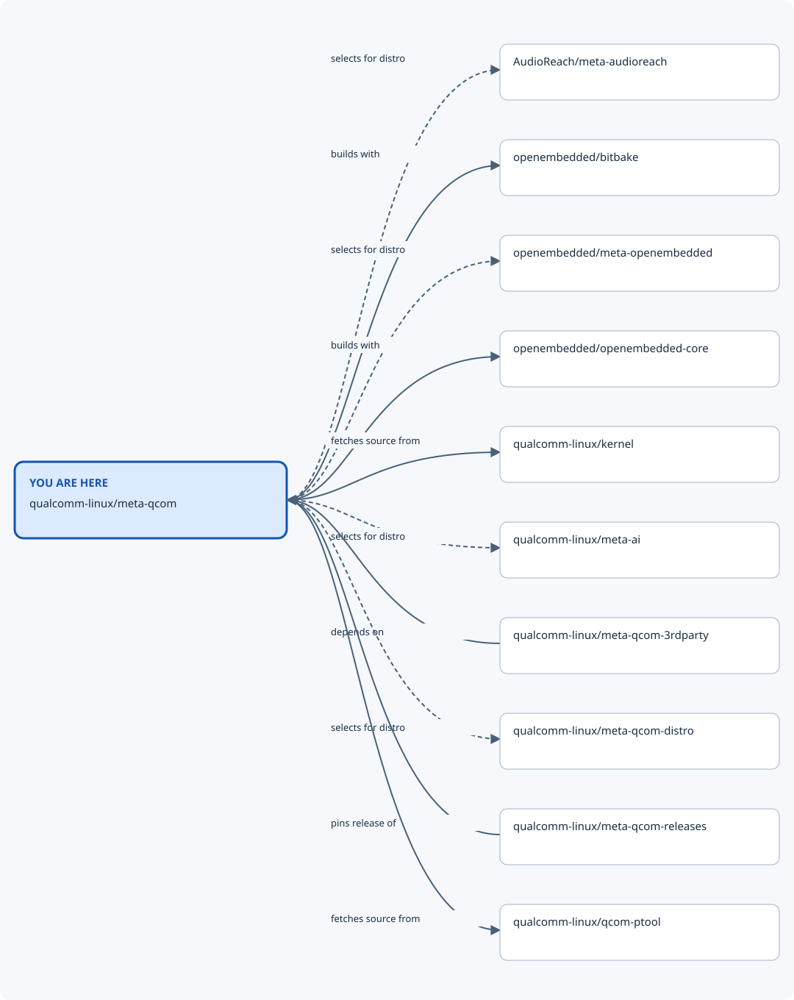
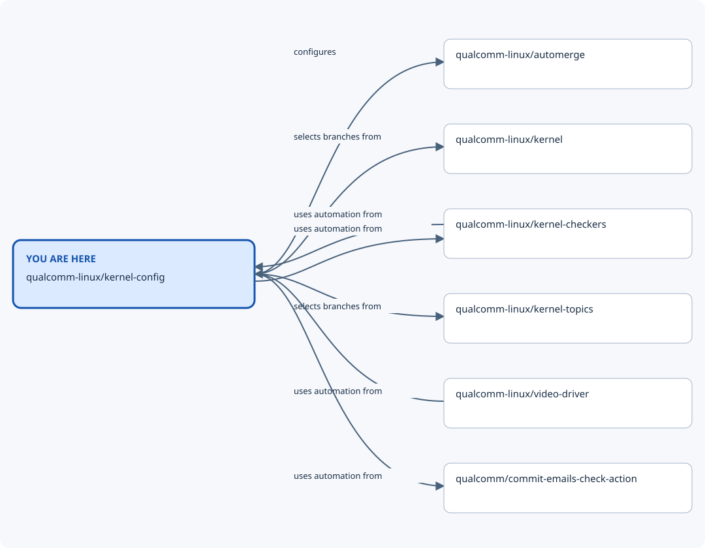
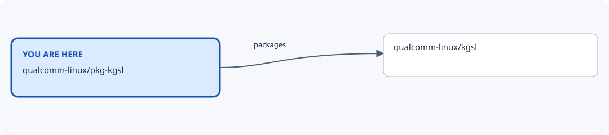

# Qualcomm repository map

Explore Qualcomm repositories and how they relate: build layers, kernel
integration, package sources, release locks, and shared tooling. This resource
covers the Qualcomm ecosystem independently of any engagement or release.

## Open the map

Clone this repository and open `docs/site/index.html` directly in a browser.
The full inventory and nearby views work without an HTTP server or network access.
Start with a connected pathway, choose a repository, and follow its nearby views.
Each arrow has a relationship type, applicability, and revision-pinned evidence.

The initial inventory covers public `qualcomm-linux` repositories and reviewed
neighbouring upstreams. The map reports which repositories have reviewed
connections. An absent connection does not prove independence.

## Map pathways

The site provides the full inventory, connection evidence, and nearby views.
These generated diagrams give entry points into software and build relationships;
shared automation connections are also recorded in the site tables.

## Contribute

[Contributor setup](docs/source/contributing/DEVELOPMENT.md) explains editing the
dataset, checking evidence, regenerating views, and exporting a nearby view.
The [contributor guide](docs/source/contributing/CONTRIBUTING.md) defines review.
Repository facts live in the [dataset](data/repositories.json). Generated diagrams,
nearby pages, and sites are not separately maintained copies of those facts.

## Branches

`main` owns the map and accepts contributions. See [BRANCHES.md](BRANCHES.md).

## Folders

- [data/](data/README.md) — Owns repository records, relationship evidence, and the dataset schema.
- [tools/](tools/README.md) — Generates and validates the map and nearby exports.
- [docs/](docs/README.md) — Contains documentation source and the generated offline site.
- [.github/](.github/) — Supplies review ownership, issue/PR forms, and documentation CI.

## Files

- [README.md](README.md) — Introduces the ecosystem map and repository contents.
- [CLAUDE.md](CLAUDE.md) — Guides automated changes and evidence handling.
- [BRANCHES.md](BRANCHES.md) — Defines the maintained branch and contribution destination.
- [CONTRIBUTING.md](CONTRIBUTING.md) — Links to the full contributor guide.
- [CODE_OF_CONDUCT.md](CODE_OF_CONDUCT.md) — Defines conduct and the reporting route.
- [SECURITY.md](SECURITY.md) — Defines private vulnerability reporting.
- [LICENSE](LICENSE) — Retains the template licence and notices.
- [.env.example](.env.example) — States that no environment settings are required.
- [.gitignore](.gitignore) — Excludes the local environment, caches, and intermediate generated source.

## Support and licence

Use the repository issue tracker for map corrections and evidence gaps. Follow
[SECURITY.md](SECURITY.md) for private vulnerability reports. The repository uses
the [BSD 3-Clause licence](LICENSE), retaining notices from the adopted skeleton.
